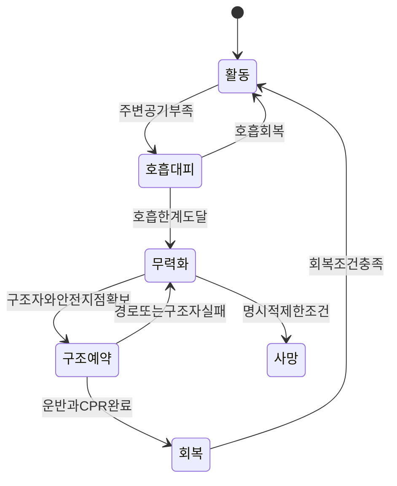

# 대원 생존·사기·기술·일정 고도화

## 1. 복원 범위와 판정

이 문서는 공개 자료로 확인한 원작 규칙을 기준으로 숨 4.0의 다음 설계를 제안한다. 원작 실행 파일·세이브·설정 파일을 추출하지 않았으며, 현재 배포 게임을 수정한 결과도 아니다. 수치 표의 `원작 공개 참조`는 열람일 2026-11-18의 공개 페이지에 적힌 값을 뜻한다. 정확한 원작 빌드가 명시되지 않은 페이지는 `current_page_build_unpinned`로 기록했다.

기본 프로필은 표준 유기체 대원, 특성 없음, 보통 배고픔 설정이다. 바이오닉 대원은 칼로리·산소 저장·윤활·폐기물 요구가 달라 같은 수식에 넣지 않는다. DLC별 모델을 나중에 독립 프로필로 확장한다.

## 2. 기본 수치와 숨 4.0 차이

| 항목 | 원작 공개 참조 | 숨 4.0 실제 구현 | 설계 판단 |
|---|---:|---|---|
| 주기 | 600초 | `engine.js`의 `CYCLE_SECONDS=120` | 게임 시간과 실시간 배속을 분리 |
| 일정 | 24블록, 각25초 | work66%·break18%·sleep16%의 고정 패턴과 시차 | 블록 배열로 변경하고 프리셋 유지 |
| 기본 산소 소비 | 0.1kg/s | 0.055 내부 단위/s | 현재 단위를 원작 kg로 해석하지 않음 |
| 기본 CO₂ 배출 | 0.002kg/s | 소비산소×0.65 | 생물학적 전환을 별도 원천·흡수항으로 기록 |
| 기본 열량 소비 | 1,000kcal/cycle | hunger가 초당0.20 감소 | 칼로리 저장량·기초대사·음식 열량 모델 필요 |
| 스트레스 붕괴 | 100% 진입, 60%까지 해소 | 스트레스35 초과 시 작업 효율 감소 중심 | 스트레스 원인·행동 상태·회복을 분리 |
| 기술 비용 | 선행 기술과 기술별 사기 요구 | 60XP마다1점, 최대6, 3개 계열 | XP 곡선과 사기 요구를 독립 데이터화 |

원작 시간·호흡·칼로리는 [C01 Duplicant](https://oxygennotincluded.wiki.gg/wiki/Duplicant), [C02 Schedule](https://oxygennotincluded.wiki.gg/wiki/Schedule), [C35 Oxygen](https://oxygennotincluded.wiki.gg/wiki/Guide/Oxygen), 스트레스 전환은 [C29 Stress](https://oxygennotincluded.wiki.gg/wiki/Stress)를 참조한다. 현재 구현 값은 `dist/engine.js`, `dist/community.js`, `dist/frontier.js`를 읽어 확인했다.

### 단위 계약

`simulationSeconds`는 게임 시간이다. 사용자가 4배속을 고르면 실시간 한 초 동안 시뮬레이션 4초를 진행한다. 산소 kg/s·배터리 J·음식 kcal·기체 온도 °C에 별도의 배속 보정을 다시 적용하지 않는다.

```text
cycle = floor(simulationSeconds / 600) + 1
scheduleBlock = floor(simulationSeconds / 25) mod 24
oxygenDemand = 0.1 × activeBreathingSeconds
calorieDemand = 1000 × simulationSeconds / 600
```

3명 정상 대원의 1주기 산소 기준 수요는 180kg, 열량 수요는 3,000kcal이다. 이 값은 정상 호흡 지속·특성 없음 가정의 산술 예산이며, 숨 참기·장비·특성·배고픔 난이도까지 합친 실측 소비량을 뜻하지 않는다.

## 3. 신체 상태를 직접 원인으로 분해

제안 대원 레코드는 다음 데이터를 가진다.

| 그룹 | 저장할 값 | 계산하는 값 |
|---|---|---|
| 생존 | 체력, 남은호흡, kcal, 체력회복상태 | 질식위험·굶주림위험 |
| 생활 | 기력, 방광, 위생, 장비별 산소 | 다음긴급생활행동 |
| 사기 | 만료시각 있는 효과 목록, 습득기술 | 현재사기·필요사기·차이 |
| 스트레스 | 현재수치, 원인별증감량, 반응유형 | 다음붕괴위험·주기당순증감 |
| 작업 | 역할별우선순위, 작업예약, 운반화물 | 수행가능직무·경로비용 |
| 성장 | 속성경험, 기술포인트, 습득기술ID | 표시숙련도·학습가능목록 |

`morale`와 `stress`는 같은 수치가 아니다. 예를 들어 새 기술을 배워 사기 요구가 올라가도 즉시 스트레스 수치를 임의로 증가시키지 않는다. 이후 틱에서 사기 부족이라는 원인을 통해 누적되도록 한다. 침실과 식사는 실제 사용 이벤트로 사기 효과를 갱신한다.

## 4. 사기와 기술 배분의 연결

공개 규칙에서 기술은 숫자 등급에 대응하는 사기 비용을 갖는다. 관심 분야 기술을 습득하면 실제 사기에 +1을 더한다. 필요 사기 비용에서 1을 빼는 방식은 사용하지 않는다. 이 차이는 사기 여유값만 비교하면 같아 보여도 UI·효과 합산·저장 구조에서는 구별해야 한다. [C39 Klei 346893](https://kleiforums.com/game-updates/oni-alpha/346893-r789) 기술의 선행 조건을 만족한 뒤 프린팅 포드를 방문해 학습하는 흐름이 있다. 정확한 기술 XP 곡선은 이번 조사에서 확정하지 않았으므로 `null`이다. 숨 4.0의 60XP 등간격을 원작 XP로 표시하지 않는다. [C20 Skills](https://oxygennotincluded.wiki.gg/wiki/Skills)

### 제안 데이터와 UI

```text
SkillDefinition
  id, prerequisites[], requiredAttribute?, workCapabilities[]
  moraleCost, interestTag, attributeModifiers[], sourceProfile
CrewSkills
  learnedIds[], availablePoints, learningReservation
```

학습 확인 창에는 `현재사기 / 새 필요사기`, 새로 가능한 작업, 선행 기술, 관심 보정, 예상 스트레스 방향을 함께 보여준다. 사용자가 포인트를 남겨 두는 선택이 유효해야 한다. 직접 작업 속도를 올리는 기술과 새로운 작업을 허용하는 기술을 분리한다.

| 현재 단순 계열 | 고도화 역할 | 능력 게이트 예시 |
|---|---|---|
| 굴착 | 굴착속성 + 채굴기술 | 단단한 물질별 채굴 허용 |
| 공학 | 건설·기계·과학 분리 | 고급연구장비·자동운반설비 운용 |
| 생활 | 조리·농업·목축·의료 분리 | 고급조리·작물관리·사육·치료 |

위 분할은 웹판 설계 제안이다. 원작의 전체 스킬 트리와 속성별 수치까지 복원되었다는 의미는 아니다.

### 사기 효과의 중복 처리

침실 계열, 식당 계열, 화장실 계열, 공원 계열은 각각 배타 그룹으로 관리한다. 높은 등급 방을 이용했다고 낮은 등급 효과를 추가 합산하지 않는다. 효과는 부여 시각·만료 시각·원인을 보관하고 세이브에도 그대로 기록한다. [C16 Morale](https://oxygennotincluded.wiki.gg/wiki/Morale)

```text
requiredMorale = sum(learned skill base costs)
               + explicit requirement modifiers
interestMoraleBonus = count(learned skills matching interests) × 1
actualMorale = baseMorale + interestMoraleBonus
             + sum(active nonexclusive effects)
             + sum(max(active values in each exclusive group))
moraleMargin = actualMorale - requiredMorale
```

관심 분야 기술 보너스를 비용 차감과 실제 사기 증가에 동시에 적용하면 이중 혜택이 되므로 금지한다.

공개 사기 문서의 부족 시 스트레스 변화 설명에는 상한과 부호가 불분명한 문장이 있다. 난이도에 따른 결과도 구분해야 한다. 따라서 `morale_deficit_stress_curve`는 미확정으로 두고, 최소 -2/-1/0/+1/+2 사기차에 대한 주기별 변화 실측 후 값을 고정한다. 임의 추정곡선을 원작값으로 배포하지 않는다.

## 5. 일정과 작업 선택

24블록 배열을 편집할 수 있게 하고, 초반에는 주간·엇교대·야간을 프리셋으로 제공한다. 원작 일정은 이동·식사·수면 시간과 연결되므로 생산량만으로 인구수용량을 계산하면 안 된다.

제안 선택 순서는 긴급 호흡·구조 → 생존 식사·실신위험 수면 → 예정 생활 → 우선순위 작업이다. 정확한 원작 전체 작업 점수식의 복원은 아니다. 사용자 명령, 역할, 시설 사용 예약, 도달 가능성, 납품 선행 조건을 정렬하는 웹판 명시 계약이다.

### 예약 상태

1. 실행 가능 작업 후보를 만든다.
2. 재료·대상·시설·경로를 검증한다.
3. 작업자와 필요한 재료를 원자적으로 예약한다.
4. 경로·입력 상태가 바뀌면 예약을 해제한다.
5. 실제 진행량에만 생산과 경험을 적용한다.

같은 침상·식탁·충전소·치료 대상에 두 대원이 동시에 점유하지 못하게 한다. 식탁을 기다리다 굶는 상황에서는 긴급 식사 대체를 허용하되 방 사기 효과를 지급하지 않는다. 대원이 목적지에 도착하지 못했는데 일정 달성 통계가 올라가는 일을 금지한다.

### 필요한 관측값

주기별 작업·이동·운반·식사·수면·대기·호흡 대피 시간을 저장한다. `명목 생산능력`, `재료공급률`, `작업자 가동률`, `경로 실패`, `시설 대기`를 나누어 생산 병목을 보여준다. 예를 들어 농장은 충분하지만 수확자가 오지 않는 상황을 식량 생산 부족과 구분한다.

## 6. 질식 구조 시스템

공식 736649 업데이트는 일반 변경에 질식 시 즉사 대신 무력화, 동료 CPR, 회복 후 상태를 추가했다. 이는 기존 복제된 옛 공략과 다른 현행 방향이다. 이번 팩에서는 무력화·CPR 존재는 공식 확인으로 기록하고, 제한시간·작업시간·체력 회복량은 미복원으로 둔다. [C11 Klei 736649](https://kleiforums.com/game-updates/oni-alpha/736649-r2750)

제안 웹 상태 전이는 다음과 같다.



이 상태도는 구현 제안이며 원작 내부 상태 머신을 추출한 것이 아니다. 구조자가 자기 산소까지 소진하는 연쇄 사고를 막도록 이동 왕복·작업 예상시간과 장비 잔량을 평가한다. 경고에는 피해자 위치, 도달 가능 구조자, 부족한 조건을 표시한다. 필수 수치가 미복원인 상태에서는 새 게임의 선택 프로필로 실험하고 기존 저장에 강제 적용하지 않는다.

## 7. 세이브와 회귀 기준

v4의 hunger는 칼로리와 일대일 대응하지 않는다. 기존 세이브는 `rulesProfile=breath_legacy_v4`로 이어가고, 신규 원작참조 모드는 별도 프로필로 생성하는 방식을 권장한다. 자동 환산을 제공하려면 `hunger100→어떤kcal`인지 화면에 명시한 일회성 전환 규칙이 필요하며 전환 전 JSON을 보존한다.

필수 검증:

- 배속을 바꿔도 같은 게임 시간에서 기초대사 소비가 같다.
- 방 효과를 반복 적용해도 배타 그룹의 사기가 중복 증가하지 않는다.
- 기술 학습 예약 취소 시 포인트와 재료가 이중 차감되지 않는다.
- 사기 효과 만료시각과 일정 블록이 저장·로드 후 같다.
- 무력화 대상 한 명에 구조자 예약이 중복되지 않는다.
- 구조 중 경로가 잠기면 대상 상태와 예약이 복구된다.
- 낮은 사기·젖음·열·호흡 부족을 각각 독립 원인으로 UI에서 확인한다.

기준 데이터는 `colony-records.json`의 `crew` 도메인이며, 수치가 null인 필드는 코드 기본값으로 숨기지 않고 복원 작업 목록에 남긴다.
