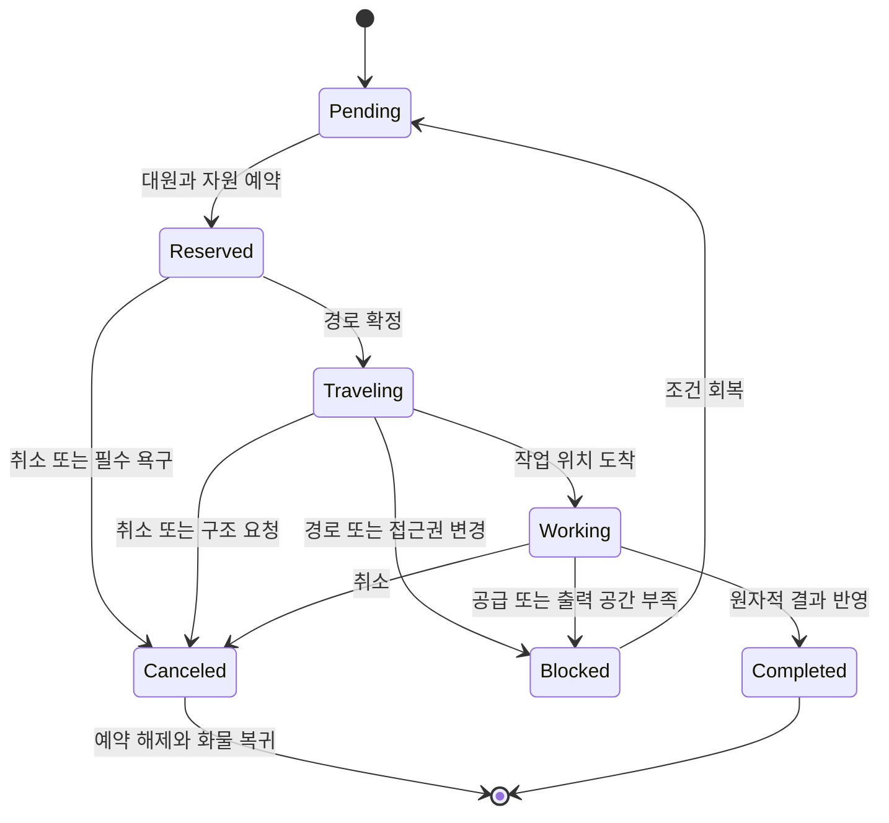

# 09. 작업·물류·자동화 개선 명세

## 1. 현 구현의 한계와 목표

숨 4.0에는 채굴품을 실제 운반하고, 경로가 끊기거나 필수 욕구가 생기면 화물을 내려놓는 흐름이 있다. 그러나 입고 후에는 공용 재고에서 건물·공사로 즉시 사용되므로 마지막 배달 비용이 없다. 냉장고도 개별 저장 음식이 아닌 공용 식품에 효과를 적용한다. 정확한 함수·수치는 [현재 구현 감사](02_Current_Implementation_Audit.md)에 있다.

개선 목표는 **채굴품 → 보관 → 투입 자원 배달 → 작업 → 산출물 수거**를 끊김 없이 연결하는 것이다. 이동 애니메이션의 추가보다 자원의 소유권·예약·도착 순서가 중요하다. 다음 계약은 웹판용 설계안이다.

## 2. 작업 상태 머신

`jobId`, `ownerCrewId`, `targetId`, `workCell`, `reservationIds`, `progress`, `blockReason`, `worldRevision`을 저장한다. 자원 예약은 재고를 복제하지 않으며 UI에서 총량·예약량·가용량을 분리한다. 작업 취소 시 진행된 작업과 아직 소비하지 않은 재료를 구별한다.

## 3. 우선순위 계산

먼저 수행 가능 여부를 걸러낸 후, 긴급성·개인 선호·사용자 우선순위·이동 비용으로 정렬한다. 필수 조건을 점수에 섞어 높은 점수로 우회하게 만들지 않는다.

| 단계 | 판정 |
|---|---|
| 안전 | 현재 산소 잔량·복귀 시간·열 위험·문 접근권 |
| 자격 | 해당 기술 또는 작업 권한이 있는지 |
| 자원 | 재료·배출 공간이 예약 가능한지 |
| 동선 | 작업 위치와 공급처 모두 도달 가능한지 |
| 우선도 | 구조/호흡 등 긴급 클래스 → 사용자 우선순위 → 역할 선호 |
| 동점 | 경로 비용 → 요청 시간 → 안정적인 jobId 순서 |

가중치 수치는 원작 내부 점수의 추측값으로 넣지 않는다. 프로파일별 튜닝 데이터로 정의하고 실제 작업 대기시간·왕복거리·공회전을 보고 조정한다.

## 4. 공간 재고와 예약

모든 물질은 `worldCell`, `debris`, `crewCargo`, `storage`, `buildingInput`, `buildingOutput`, `buildingBody`, `equipmentTank`, `pipePacket` 중 한 위치에만 속한다. 원장에 위치 간 이동을 기록한 뒤 UI 합계를 계산한다. 보관함 내용물은 실제 필터와 용량을 가지며 냉장 효과는 해당 보관함 내부 식품에만 적용한다.

| 상황 | 처리 규칙 |
|---|---|
| 두 대원이 같은 자원 요청 | 예약 가능한 잔량만 할당 |
| 운반 중 작업 취소 | 들고 있는 자원을 현실 위치의 더미로 반납 |
| 수신 설비 철거 | 대체 저장소 재예약 또는 현재 위치에 안전하게 내려놓기 |
| 저장소 용량 감소 | 내용물이 남으면 철거 대기; 강제 삭제 금지 |
| 작업 중 전력 단절 | 진행 보존, 미수행 노동 XP 지급 없음 |
| 출력 막힘 | 출력 예약 전에는 입력 소비·경험 지급 없음 |
| 동일 명령 재전송 | commandId를 기준으로 한 번만 반영 |

마지막 항목은 멀티플레이 구현을 뜻하지 않는다. 브라우저 더블 클릭·저장 재생·테스트 명령에서도 중복 지출을 방지하기 위한 계약이다.

## 5. 다중 칸 건물과 작업 위치

원작 설비의 크기를 반영하면 현재 한 칸 설치 방식과 충돌한다. `footprint`, `foundationCells`, `interactionCells`, `inputPorts`, `outputPorts`, `blockedCells`를 별도로 둔다. 가로·세로 배치와 좌우 반전 때 모든 상대 좌표를 함께 변환한다. 설비 이름만 바꾸고 기존 한 칸 포트에서 작동시키지 않는다.

건설 과정은 위치 예약 → 자재 전달 → 노동 → 완공이다. 통로를 막는 마지막 타일 공사는 작업자 귀환 가능성을 확인한다. 완공 이벤트로 환경·경로·관·전력·방 캐시를 각각 갱신한다. 취소·철거는 건물 본체와 배관·전선을 구분한다.

## 6. 구조 작업

무력화된 대원은 일반 작업 큐에서 제외하고 구조 요청을 발행한다. 구조자는 접근 가능한 안전 위치·호흡 여유·구조 후 회복 공간을 먼저 확인한다. 피해자와 구조자를 동시에 예약하여 두 구조자가 같은 대상에 겹치지 않게 한다. CPR의 정확한 노동 시간·회복량은 미확인 상수이므로 레퍼런스 수치와 웹판 밸런스 제안을 분리한다.

상태는 `정상 → 위험 → 무력화 → 구조 중 → 회복 → 정상`으로 제안한다. 구조 실패의 이유를 산소 부족·도달 불가·잠긴 문·다른 구조 작업 등으로 설명한다. 사망 조건과 회복 후 디버프는 따로 정의한다.

## 7. 자동화

전력선과 별도의 신호망을 추가한다. 최소 구성은 배터리 충전율·기압·온도·유체 원소 센서, 수동 스위치, AND/OR/NOT, 완충 지연이다. 센서 데이터 타입과 물리 단위를 고정하고, 출력은 설비의 **가동 허용**을 제어한다. 신호가 초록이어도 자원·전력·공간·노동 조건이 충족되지 않으면 대기한다.

임계값 두 개를 이용한 히스테리시스로 발전기와 냉각기의 빠른 켜짐/꺼짐 반복을 줄인다. 예를 들어 제안 배터리 설정은 저충전 시 허용, 고충전 시 중지다. 임의 예시 숫자를 원작 기본값처럼 기록하지 않는다.

신호 순환은 같은 틱에서 무한 재평가하지 않는다. 조합 회로를 정렬하거나 한 틱 지연 정책을 명시한다. 저장에는 센서 설정과 지연 상태를 포함한다. UI에는 신호색과 실제 대기 이유를 같이 표시한다.

## 8. 수용 기준

- 2명이 10kg 재료를 동시에 예약해도 합계 예약은 10kg 이하이다.
- 목적지 소멸·문 잠금·강제 생활 행동 이후 자원 총계가 변하지 않는다.
- 배달 완료 전 생산을 시작하지 않고, 출력 공간이 없을 때 입력을 소모하지 않는다.
- 우선순위가 같으면 같은 seed·명령열에서 작업자 배정 순서가 동일하다.
- 대규모 반복 채굴에서 경로 탐색 수와 평균 작업 대기시간을 기록한다.
- 모든 막힘은 안정적인 reason code를 가지며 UI는 해결 가능한 대상 위치로 이동시킨다.
