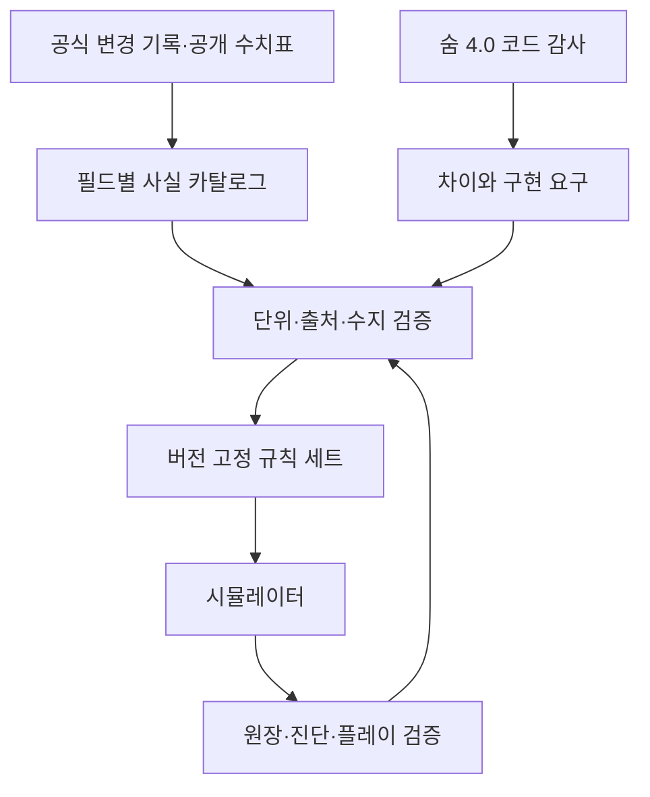

# 10. 데이터 구조·단위·규칙 세트

## 1. 데이터와 시뮬레이터의 경계를 정한다

이번 재구성 파일은 곧바로 제품 설정으로 읽는 JSON이 아니다. **출처가 있는 사실 카탈로그**와 **승인된 런타임 규칙 세트**를 구분한다. 미확인 수치를 담은 카탈로그를 게임에서 `value ?? 0`으로 읽으면 잘못된 무료 설비·무소비 농장·0초 연구가 생긴다.



## 2. 단위 사전

| 물리/게임량 | 저장 단위 제안 | 표시와 계산 |
|---|---|---|
| 시간 | simulation second | cycle은 `secondsPerCycle`로 변환 |
| 물질 | kg | g는 표시만 변환; 액체 L는 밀도 규칙이 있을 때만 사용 |
| 질량 유량 | kg/s | 가동 비율을 곱해 실제 틱 소비·생산 계산 |
| 전력 | W | `E_J = P_W × dt_s` |
| 전기에너지 | J | 축전 상태·충전·방전·손실을 같은 단위 사용 |
| 열량 | DTU | 비열의 g와 저장 질량 kg 사이에 1000 배 변환 |
| 온도 | °C | 절대 열용량과 온도 차이를 구분 |
| 음식 에너지 | kcal | 식품 개수·질량과 별도 필드 |
| 사기 | morale point | 음식 품질·방 효과·기술 요구의 상태 합 |
| 병원균 | 정수 count + species | 물질 종류·위생 수치와 별도 |
| 경험·작업량 | 명시된 game unit | kg/J/kcal로 암묵 변환하지 않음 |

단위 변환은 한 경계에서만 수행한다. 1주기 생산량 표를 초당 소비 코드에 넣을 때 600으로 나누는 변환은 카탈로그 편집자가 수기로 반복하지 않고 변환 도구가 처리한다. 원작 카탈로그의 `kg/cycle`은 **sourceCycleSeconds=600**으로 먼저 `kg/s`에 정규화한다. 대상 게임의 `targetCycleSeconds`와 밸런스 배율은 이후 별도 변환 단계에서 적용한다. 원작 1주기 소비량을 웹판의 120초로 바로 나누면 의도하지 않은 5배 소비가 생긴다.

## 3. 정규화 사실 레코드

```json
{
  "fact_id": "building.electrolyzer.electricity_w",
  "entity_id": "building.electrolyzer",
  "field": "electricity_w",
  "value": 120,
  "unit": "W",
  "evidence_status": "community_reference",
  "source_ids": ["F02"],
  "observed_at": "2026-11-18",
  "source_game_build": null,
  "runtime_approved": false
}
```

위 JSON의 구조는 예시다. 실제 필드 ID·출처는 [reference-facts.json](../data/reference-facts.json)을 기준으로 한다. 외부 자료가 명시한 숫자와 그 숫자로 계산한 파생값은 다른 evidence status를 갖는다. `null`은 0이 아니다. 값이 없으면 필요한 근거와 추가 조사 이유를 붙인다.

공통 필드는 entity ID, domain, label, value, unit, source IDs, 확인일, 범위, 근거 상태, 메모다. 반응은 basis가 `active_second`인지 `batch`인지 명시한다. 기술 노드 선행 ID, 설비 recipe ID, 음식/원소 참조는 참조 무결성 검사 대상이다.

## 4. 세 가지 규칙 세트

| 규칙 세트 | 목적 | 단위와 진행 |
|---|---|---|
| `breath_legacy_v4` | 기존 세이브와 캠페인 재현 | 현재 120초 주기와 기존 게임 단위 유지 |
| `oni_reference_r1` | 확인된 원작 기준을 검증하는 실험 | 600초 주기, kg·kcal·W·J·DTU. 빌드 확인 전 제품 기본값으로 배포하지 않음 |
| `breath_balanced_v5` | 실제 웹 플레이용 조정 | 명시 단위와 구조를 공유하되, 조정값·이유·검증을 별도 기록 |

원작 숫자에 일괄 배율을 적용하면 모든 것이 맞아질 것이라고 가정하지 않는다. 시간이 5배 빨라지면 호흡·성장·연구·연료·발열·축전·운반 등 모두 영향을 받는다. 원작 기준에서는 600초의 시뮬레이션 시간을 유지하고 **화면 배속이 시뮬레이션 시계를 빠르게 진행**하게 하는 편이 해석이 명확하다.

웹판을 더 짧게 만들고 싶다면 목표 유지 시간, 초기 자원, 월드 크기와 운반 거리를 별도 조정한다. 단축한 주기를 쓰려면 모든 `perCycle`와 시간 의존 변환에 대한 별도 균형 검사가 필요하다.

## 5. 반응 거래와 명시적 생성·소멸

다음 가동 비율을 제안한다.

`f = min(1, 입력별 보유량 / 요구량, 출력별 예약 가능량 / 생성량, 공급 전력 / 요구 전력)`.

모든 값은 같은 dt 기준으로 계산하며, 전력 제한항은 `requiredConsumptionW > 0`인 소비 설비에만 적용하고 발전 출력은 거래 결과로 처리한다. 0 요구량은 제한항에서 제외한다. 건물에 따라 원작이 부분 가동을 허용하지 않는다면 `f`를 0 또는 1로 제한하는 정책을 별도 둔다. 입력을 뺀 뒤 출력 공간 부족을 발견하는 순서는 금지한다.

질량 원장은 `초기 + 외부유입 + 명시적생성 − 명시적소멸 − 외부유출 = 현재`를 검사한다. 원작 일부 장치는 입력과 출력 질량이 같지 않다. 예를 들어 확산기 등의 손실은 `intentional_sink`로 기록하며 가상의 부산물 아이템을 만들어 상쇄하지 않는다. 단순 물리학 질량 보존과 원작 규칙 재현은 같은 목표가 아니다.

## 6. 콘텐츠 태그

`base_common`, `spaced_out`, `frosty`, `bionic`, `prehistoric`, `aquatic`, `public_testing`, `legacy`를 분리할 수 있는 구조를 제안한다. 모든 레코드가 이 태그들을 이미 정확하게 검증했다는 뜻은 아니다. 이번 카탈로그는 데이터에 실제 적힌 scope와 unresolved 표시를 우선한다.

설비 태그는 `industrial`, `recreation`, `mess_station`, `cot`, `toilet`, `decor_item`처럼 판정 역할을 표현한다. 방은 건물 이름의 하드코딩 목록보다 태그와 금지 조건을 사용한다. 가구가 전원 꺼짐 상태라고 산업 설비 존재 자체가 사라지는 오류를 막는다.

## 7. 검증 도구의 범위

제공된 `node tools/validate.mjs`는 파일 구조, 필드 근거, ID 중복, 원소 물성, 반응 원장, 파생 밸런스 계산과 링크를 점검한다. 그 결과는 원작 실행 파일과 값이 완전히 같다는 인증이 아니다. 고정 빌드 관찰·통합 시뮬레이션·브라우저 플레이는 구현 단계의 별도 게이트다.
