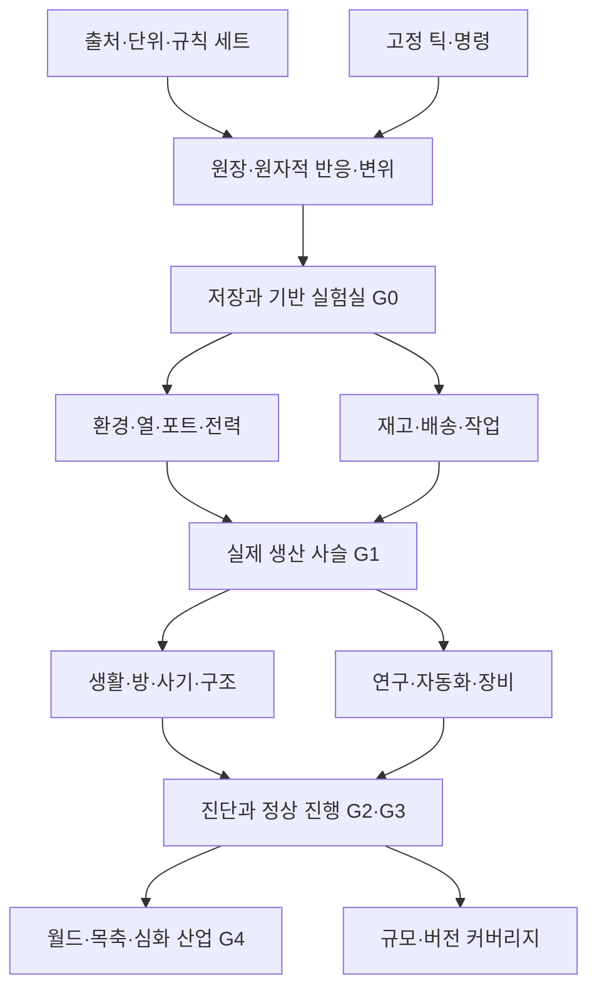

# 14. 시스템 고도화 구현 백로그와 수용 게이트

이번 백로그는 **구현 계획**이다. 모든 티켓은 `planned`, 검증은 `not_executed` 상태다. 새 규칙 세트의 게임 실행이나 30주기 생존 검증을 완료했다고 의미하지 않는다. 기존 숨 4.0의 테스트 결과는 기준 구현의 증거이며 새 규칙의 통과 증거로 재사용하지 않는다.

총 **35개 티켓**, P0 9개·P1 20개·P2 6개이며, 수용 기준은 140개다. 수용 기준 개수는 이미 통과한 테스트 수가 아니다.

기계 판독 원본: [implementation-backlog.json](../data/implementation-backlog.json) · 편집용 [implementation-backlog.csv](../data/implementation-backlog.csv). 현재 감사의16개 항목은 [upgrade_backlog.json](../current-v4/upgrade_backlog.json)을 참조한다. 통합 티켓은 설비 데이터 추가와 구조 변경을 실제 작업 단위로 나누므로 기존 감사 항목과 일대일로 같지 않다.

## 1. 완료 상태와 공수 해석

| 필드 | 해석 |
|---|---|
| `status=planned` | 해당 구현을 아직 완료하지 않은 계획 티켓 |
| `verification.status=not_executed` | 새 규칙의 수용 검사를 아직 실행하지 않음 |
| `dependencies` | 먼저 완료할 통합 티켓 ID. 감사 ID는 여기에 넣지 않음 |
| `audit_references` | 현행 코드 감사의 근거와 기존 개선 항목 |
| `reference_data_gates` | 근거를 더 확인하거나 웹 임시값으로 표시해야 할 데이터 조건 |
| `effort_estimate` | 상대 복잡도와 공수의 추정. 달력 일정이나 작업 시간 아님 |

공수는 **S=2, M=3, L=5, XL=8 상대 포인트**로 추정했다. 합계201포인트는 일수로 변환한 값이 아니며 납기 보장이 아니다. 코드 재사용 가능성, 원작 미확인값, 통합 결과, 대상 기기 측정에 따라 재산정한다. 원작 필드 확인은 런타임 적용 게이트이고, 자료 조사와 호환성 어댑터 작업은 병렬로 진행할 수 있다.

## 2. 권장 실행 순서

| 순서 | 범위 | 끝났을 때 확인할 결과 |
|---|---|---|
| 1 | ONI-001~003 | 사실 카탈로그와 단위/규칙 세트, 고정 틱 명령 계약 |
| 2 | ONI-004~009 | 원장·원자적 반응·변위·연료·저장, 작은 독립 실험실의G0 |
| 3 | ONI-010~017 | 환경→footprint→관·전력·열·재고→작업→실제 생산 사슬G1 |
| 4 | ONI-018~027 | 농사·음식·생존·방·사기·위생·CPR·연구·자동화·장비 |
| 5 | ONI-028~029 | 원인 UI를 연결하고 정상 진행·장애 복구·30주기·브라우저G3 |
| 6 | ONI-030~035 | 월드·목축·심화 산업·터빈·규모와 버전별 적용 범위G4 |

번호 범위는 작업 묶음이다. 엄격한 작업 순서는 JSON의 `recommended_topological_order`를 따른다. 예를 들어 관/전력 작업은 footprint 티켓ONI-014 이후이고, 사기ONI-021은 방ONI-022 이후다. 같은 단계라도 선행 항목이 없는 가지는 병렬로 진행할 수 있다.

도식은 주요 묶음을 보여준다. **35개 티켓 전체의 실제 의존 DAG는 JSON**에 있다. ID 존재·자기 의존 없음·순환 없음과 추천 순서를 형식 검사했다. 이 검사는 계획 그래프 검사이며 시스템 구현 통과가 아니다.

### 기반부터 진행하는 이유

- 원작 수치가 정확해도 kg·L·게임 단위를 혼합하면 생산 수지가 달라진다. ONI-001/002를 먼저 고정한다.
- 원작 일부 반응은 명시적 손실이나 생체 생성이 있다. 장부는 게임 규칙을 기록하며 현실 폐쇄계 질량보존을 강제해 가짜 부산물을 만들지 않는다.
- 입력·출력·전력·노동·XP를 같은 거래로 처리한 다음 설비 수를 늘린다. 마지막 연료와 포화 출력의 경계 사례가 이를 검증한다.
- v4의 환경 단위를 새 kg 모델로 조용히 변환하지 않는다. legacy 저장 재개와 새 규칙 기지를 분리한다.
- CPR·목축·월드 확률처럼 미확인값이 많은 기능은 확인 범위와 웹 설계값을 표시한 뒤 적용한다.

## 3. 전체 티켓 요약

| ID | 우선순위 | 구현 작업 | 선행 티켓 | 공수 추정 |
|---|---|---|---|---|
| ONI-001 | P0 | 원작 사실 카탈로그·출처·미확인 필드의 컴파일 경계 | 없음 | M / 3점 |
| ONI-002 | P0 | 단위 정규화와 세 가지 규칙 세트 | ONI-001 | L / 5점 |
| ONI-003 | P0 | 정수 틱·명령 순서·외부 dt 누산 계약 | 없음 | L / 5점 |
| ONI-004 | P0 | 물질 소유권·생성/소멸·에너지 원장 | ONI-002, ONI-003 | L / 5점 |
| ONI-005 | P0 | 입력·출력 예약을 공유하는 원자적 반응 처리 | ONI-002, ONI-003, ONI-004 | XL / 8점 |
| ONI-006 | P0 | 채굴·타일 완공·철거의 유체 변위 거래 | ONI-003, ONI-004, ONI-005 | L / 5점 |
| ONI-007 | P0 | 마지막 연료와 포화 출력의 실제 가동률 회귀 | ONI-005 | M / 3점 |
| ONI-008 | P0 | 규칙 세트가 고정된 저장 헤더와 legacy 이행 | ONI-002, ONI-003, ONI-004, ONI-005 | L / 5점 |
| ONI-009 | P0 | 기반 계약의 독립 실험실·재생 게이트 | ONI-001, ONI-002, ONI-003, ONI-004, ONI-005, ONI-006, ONI-007, ONI-008 | M / 3점 |
| ONI-010 | P1 | 원소·질량을 가진 기체·액체 환경 상태 | ONI-009 | XL / 8점 |
| ONI-011 | P1 | 유체 패킷·입출력 포트·막힘 처리 | ONI-010, ONI-014 | XL / 8점 |
| ONI-012 | P1 | 열용량·열교환·상변화 상태 | ONI-009, ONI-010 | XL / 8점 |
| ONI-013 | P1 | 회로 부하·정격·축전·발전 배분 | ONI-009, ONI-014 | L / 5점 |
| ONI-014 | P1 | 다중 칸 건물·지지·작업 위치·포트 변환 | ONI-009, ONI-010 | L / 5점 |
| ONI-015 | P1 | 공간 재고·필터·설비 입출력 버퍼·배달 | ONI-009, ONI-010, ONI-014 | XL / 8점 |
| ONI-016 | P1 | 작업 상태 머신·동점 정렬·긴급 선점 | ONI-003, ONI-014, ONI-015 | XL / 8점 |
| ONI-017 | P1 | 산소·급수·정화·연료 생산 사슬 연결 | ONI-005, ONI-007, ONI-011, ONI-012, ONI-013, ONI-016 | L / 5점 |
| ONI-018 | P1 | 종별 작물·종자·비료·환경 조건 | ONI-010, ONI-012, ONI-015, ONI-016 | L / 5점 |
| ONI-019 | P1 | 식품 스택·kcal·조리·위치별 부패 | ONI-005, ONI-013, ONI-015, ONI-016, ONI-018 | XL / 8점 |
| ONI-020 | P1 | 대원 호흡·섭취·기력·일정과 위험 상태 | ONI-010, ONI-012, ONI-016, ONI-019 | L / 5점 |
| ONI-021 | P1 | 사기·흥미·기술 요구와 지속 효과 | ONI-019, ONI-020, ONI-022 | L / 5점 |
| ONI-022 | P1 | 방 태그·면적·금지 가구·이용 효과 | ONI-010, ONI-014, ONI-019, ONI-020 | L / 5점 |
| ONI-023 | P1 | 위생 순환·생체 생성·병원균 분리 | ONI-005, ONI-011, ONI-015, ONI-016, ONI-020 | L / 5점 |
| ONI-024 | P1 | 무력화 대원 운반·구조·CPR | ONI-015, ONI-016, ONI-020 | L / 5점 |
| ONI-025 | P1 | 연구 DAG·포인트 종류·노드별 진행 | ONI-005, ONI-013, ONI-015, ONI-016 | L / 5점 |
| ONI-026 | P1 | 센서·논리·지연을 가진 독립 신호망 | ONI-003, ONI-011, ONI-012, ONI-013 | L / 5점 |
| ONI-027 | P1 | 휴대 산소·보호 장비·안전 복귀 작업 | ONI-005, ONI-011, ONI-015, ONI-016, ONI-020 | L / 5점 |
| ONI-028 | P1 | 생산 병목·원장·규칙 근거와 사용자 UI | ONI-006, ONI-007, ONI-017, ONI-019, ONI-021, ONI-023, ONI-024, ONI-025, ONI-026, ONI-027 | M / 3점 |
| ONI-029 | P1 | 공개 명령 정상 진행·장애 복구·30주기 검증 | ONI-008, ONI-009, ONI-028 | XL / 8점 |
| ONI-030 | P2 | 시드 월드·자원 보증·간헐천 운용 데이터 | ONI-010, ONI-012, ONI-025, ONI-029 | XL / 8점 |
| ONI-031 | P2 | 크리터 먹이·번식·공간·산출물 사슬 | ONI-015, ONI-018, ONI-020, ONI-022, ONI-029, ONI-030 | XL / 8점 |
| ONI-032 | P2 | 원유·석유·플라스틱·강철의 실제 중간 생산 | ONI-012, ONI-015, ONI-016, ONI-017, ONI-025, ONI-029, ONI-030 | XL / 8점 |
| ONI-033 | P2 | 산업 냉각·열 회수·터빈 통합 | ONI-011, ONI-012, ONI-013, ONI-026, ONI-029, ONI-032 | XL / 8점 |
| ONI-034 | P2 | 확대 장면 계측·공간 인덱스·캐시 최적화 | ONI-003, ONI-029, ONI-030 | L / 5점 |
| ONI-035 | P2 | 빌드·DLC 별 적용 범위와 미확인 데이터 관리 | ONI-001, ONI-002, ONI-029 | M / 3점 |

## 4. P0의 구체적 경계조건

| 사례 | 관찰한 v4 동작 | 제안 계약과 티켓 |
|---|---|---|
| 산소 포화 | 수신칸2.999에서 명목+.03, 실제+.001 | 수신공간만 처리 또는 명시 배출 장부. ONI-005/007 |
| 타일 완공 | 산소.9·CO₂.1·수위.4가0으로 제거 | 주변 보존 이동 또는 공사 대기. ONI-006 |
| 잔여 석탄 | .001 잔량으로 .1초 전체60W·6J | .001/.025=.04초, 실제2.4J. ONI-007 |
| 외부 시간 분할 | .06/.1 호출 분할에서 상태 차이 | 단일 고정 틱 시계와 잔여 누산 보존. ONI-003 |

위 값은 **현재 웹판 계수로 만든 임시 메모리 경계 진단**이다. 원작 발전기나 산소 설비의 수치가 아니며 정상 플레이 장기경로로 달성한 상황이라고 주장하지 않는다. [재현 코드와 결과](../current-v4/audit_probe_results.json)에 setup·expected·observed가 있다. 현 브라우저는 이미 `.1`초 양자화 호출을 사용하므로 외부 시간 분할 차이를 일반 화면 프레임레이트 고장으로 설명하지 않는다.

## 5. 티켓별 산출물과 수용 기준

### P0

#### ONI-001 — 원작 사실 카탈로그·출처·미확인 필드의 컴파일 경계

**상태:** 계획 · **선행:** 없음 · **공수 추정:** M(3점)

**산출물:** 필드별 source/evidence/scope/build 계약; null·충돌·중복 ID·참조 검사; 실행용 카탈로그와 조사 카탈로그의 분리。

**수용 기준 — 구현 후 실행할 항목:**

- `AC-001-01` 원작 참조값·파생값·웹 오버라이드값을 다른 분류로 보존한다.
- `AC-001-02` 필수 값이 null인 설비·레시피는 명시적으로 비활성하거나 컴파일 오류를 반환하며 value ?? 0으로 실행하지 않는다.
- `AC-001-03` 충돌하는 출처는 선택 이유와 대안값을 함께 기록하고 조사 상태를 삭제하지 않는다.
- `AC-001-04` 유효한 fact ID, 설비/원소/레시피/기술 참조만 승인된 런타임 카탈로그로 내보낸다.

**근거 문서:** [10_Data_Units_Profiles](10_Data_Units_Profiles.md) · [15_Conflicts_Unknowns](15_Conflicts_Unknowns.md) · [13_Migration_QA](13_Migration_QA.md) · 감사 참조 `AUD-P0-01`, `AUD-P2-03`

#### ONI-002 — 단위 정규화와 세 가지 규칙 세트

**상태:** 계획 · **선행:** ONI-001 · **공수 추정:** L(5점)

**산출물:** kg·kg/s·W·J·DTU·°C·kcal 단위 변환기; breath_legacy_v4 / oni_reference_r1 / breath_balanced_v5 정의; 규칙 해시와 오버라이드 명세。

**수용 기준 — 구현 후 실행할 항목:**

- `AC-002-01` kg/cycle 원작값은 sourceCycleSeconds=600으로 kg/s에 정규화한 뒤 대상 프로파일 조정을 적용한다.
- `AC-002-02` 웹판 120초 주기로 원작 perCycle 값을 직접 나누는 5배 변환 오류를 거부하는 검산 사례를 둔다.
- `AC-002-03` 비열의 g 기반 단위와 상태 질량 kg 사이의 1000배 변환을 한 경계에서만 적용한다.
- `AC-002-04` 기존 v4 게임 단위는 kg/kcal로 임의 해석하지 않고 legacy 프로파일에 남긴다.

**근거 문서:** [10_Data_Units_Profiles](10_Data_Units_Profiles.md) · [12_Balance_Scenarios](12_Balance_Scenarios.md) · [13_Migration_QA](13_Migration_QA.md) · 감사 참조 `AUD-P0-01`

#### ONI-003 — 정수 틱·명령 순서·외부 dt 누산 계약

**상태:** 계획 · **선행:** 없음 · **공수 추정:** L(5점)

**산출물:** tick/accumulator 기반 시계; commandId 중복 반영 방지; 안정적인 동일 틱 명령 정렬과 리플레이 로그。

**수용 기준 — 구현 후 실행할 항목:**

- `AC-003-01` 같은 명령 틱과 총 완료 틱 수에서 .06/.1 등의 외부 시간 분할을 달리해도 canonical 상태가 같다.
- `AC-003-02` 같은 총시간의 30/60Hz 프레임 입력과 1×/4× 진행에서 완료 틱 수에 따른 상태가 일치한다.
- `AC-003-03` 정상 활성 탭의 프레임 처리 예산을 초과한 잔여 accumulator를 조용히 버리지 않는다.
- `AC-003-04` 백그라운드 일시정지 정책과 저장된 누산기를 검증하며 렌더 보간값은 영속 상태에서 제외한다.

**범위:** 현재 앱은 이미 game.step(.1)을 호출한다. 이번 감사의 .06/.1 차이는 외부 Game.step 계약에 관한 것으로 현재 화면 프레임레이트 결함이라고 단정하지 않는다.

**근거 문서:** [11_Simulation_Architecture](11_Simulation_Architecture.md) · [13_Migration_QA](13_Migration_QA.md) · 감사 참조 `AUD-P0-04`

#### ONI-004 — 물질 소유권·생성/소멸·에너지 원장

**상태:** 계획 · **선행:** ONI-002, ONI-003 · **공수 추정:** L(5점)

**산출물:** 월드/더미/화물/저장/설비/장비/패킷 위치 ID 계약; 이동·소비·생성·외부유입·명시적손실 이벤트; 물질·전기·열 원장 잔차 계산。

**수용 기준 — 구현 후 실행할 항목:**

- `AC-004-01` 물질 한 묶음은 한 위치에만 속하고 위치간 이동 후 전역 합계가 유지된다.
- `AC-004-02` 지하수·보급·생체 생성·음식 부패·원작 설계상 손실을 종류가 다른 원장 항으로 기록한다.
- `AC-004-03` 원작 반응의 intentional_sink를 가짜 부산물 아이템으로 상쇄하지 않는다.
- `AC-004-04` 반응마다 허용된 생성/소멸을 포함한 기대 잔액과 실제 재고를 같은 단위로 비교한다.

**근거 문서:** [09_Jobs_Logistics_Automation](09_Jobs_Logistics_Automation.md) · [10_Data_Units_Profiles](10_Data_Units_Profiles.md) · [11_Simulation_Architecture](11_Simulation_Architecture.md) · 감사 참조 `AUD-P0-05`

#### ONI-005 — 입력·출력 예약을 공유하는 원자적 반응 처리

**상태:** 계획 · **선행:** ONI-002, ONI-003, ONI-004 · **공수 추정:** XL(8점)

**산출물:** 입력·출력 공간·전력·노동을 위한 예약 API; 부분 가동/전량 대기 레시피 정책; 단일 commit의 자원·발열·XP·통계 반영。

**수용 기준 — 구현 후 실행할 항목:**

- `AC-005-01` 같은 dt에서 입력 잔량·출력 공간·소비 전력·작업 가능 시간이 허용한 비율만 실행한다.
- `AC-005-02` 전력 제한항은 소비W가 양수일 때만 적용하고 0 요구량은 제한에서 제외하며 발전 출력은 거래 결과로 처리한다.
- `AC-005-03` 산소 2.999/용량3의 수신 칸에 .03을 만들려는 진단에서 실제 공간만 처리하거나 명시적 배출 원장을 남긴다.
- `AC-005-04` 정전·출력 포화·작업 취소·중복 commandId에서 입력만 먼저 감소하거나 무작업 XP가 쌓이지 않는다.

**근거 문서:** [10_Data_Units_Profiles](10_Data_Units_Profiles.md) · [11_Simulation_Architecture](11_Simulation_Architecture.md) · [13_Migration_QA](13_Migration_QA.md) · 감사 참조 `AUD-P0-02`, `AUD-P0-05`

#### ONI-006 — 채굴·타일 완공·철거의 유체 변위 거래

**상태:** 계획 · **선행:** ONI-003, ONI-004, ONI-005 · **공수 추정:** L(5점)

**산출물:** 기존 격자용 유체 이동/대기 어댑터; 타일 완공 전 수신 공간 예약; 가스 생성·탱크 방출 정책의 프로파일화。

**수용 기준 — 구현 후 실행할 항목:**

- `AC-006-01` 산소 .9·CO₂ .1·수위 .4가 있는 현행 진단칸을 공사해도 원장 없이 내용물이 0으로 삭제되지 않는다.
- `AC-006-02` 주변 수신 공간이 없으면 공사를 기다리고 재료·진척·재고 상태를 보존한다.
- `AC-006-03` 채굴 후 진공/주변 유입/명시적 튜토리얼 공급 중 프로파일에 선언된 정책을 따른다.
- `AC-006-04` 관·탱크·장비를 철거할 때 잔량을 이동하거나 방출하고 대응 장부를 기록한다.

**범위:** P0에서는 변위 거래 계약과 작은 격자 어댑터를 만든다. 다중 원소 환경의 전체 동작은 ONI-010에서 확장하여 순환 의존을 피한다.

**근거 문서:** [09_Jobs_Logistics_Automation](09_Jobs_Logistics_Automation.md) · [10_Data_Units_Profiles](10_Data_Units_Profiles.md) · [13_Migration_QA](13_Migration_QA.md) · 감사 참조 `AUD-P0-03`

#### ONI-007 — 마지막 연료와 포화 출력의 실제 가동률 회귀

**상태:** 계획 · **선행:** ONI-005 · **공수 추정:** M(3점)

**산출물:** 석탄·수소·산소 생산의 부분 틱 사례; 요청량/실제량/부족량/버린량 구분; 정격 발전과 틱 평균 발전 표시 계약。

**수용 기준 — 구현 후 실행할 항목:**

- `AC-007-01` 현행 계수의 진단에서 석탄 .001과 소모 .025/s는 .04초만 작동하고 60W×.04초=2.4J를 만든다.
- `AC-007-02` 실제 가동시간에 따라 연료·배출·열·에너지가 함께 변하며 마지막 연료가 중복 사용되지 않는다.
- `AC-007-03` 부분 가동 금지 레시피는 출력0과 입력0으로 대기한다.
- `AC-007-04` 생산 누계는 실출력과 명시 배출을 구분하고 UI가 명목 산출량을 재고 증가량으로 잘못 표시하지 않는다.

**범위:** 2.4J는 보존 계약을 검증하기 위한 현행 웹 계수의 진단 기대값이며 원작 석탄 발전기 수치가 아니다.

**근거 문서:** [12_Balance_Scenarios](12_Balance_Scenarios.md) · [13_Migration_QA](13_Migration_QA.md) · 감사 참조 `AUD-P0-02`, `AUD-P0-05`

#### ONI-008 — 규칙 세트가 고정된 저장 헤더와 legacy 이행

**상태:** 계획 · **선행:** ONI-002, ONI-003, ONI-004, ONI-005 · **공수 추정:** L(5점)

**산출물:** saveVersion/engineVersion/rulesetId/rulesetVersion/catalogHash 헤더; v1–v4→legacy 로드 라우팅; 원자적 로드와 예약 상태 저장。

**수용 기준 — 구현 후 실행할 항목:**

- `AC-008-01` 실제 v1–v4 세이브는 기존 변환 경로를 거쳐 breath_legacy_v4로 재개된다.
- `AC-008-02` v4 산소·수소·식품을 임의 환산해 새 물질 모델에 자동 승격하지 않는다.
- `AC-008-03` 로딩 실패 시 현재 기지와 입력 데이터가 변하지 않고 알 수 없는 ID/리비전의 이유를 보고한다.
- `AC-008-04` 저장 후 재개의 tick·누산기·난수·미확정 거래가 연속 진행과 일치한다.

**근거 문서:** [10_Data_Units_Profiles](10_Data_Units_Profiles.md) · [13_Migration_QA](13_Migration_QA.md) · 감사 참조 `AUD-P0-06`

#### ONI-009 — 기반 계약의 독립 실험실·재생 게이트

**상태:** 계획 · **선행:** ONI-001, ONI-002, ONI-003, ONI-004, ONI-005, ONI-006, ONI-007, ONI-008 · **공수 추정:** M(3점)

**산출물:** 작은 폐쇄 실험실 fixtures; 단위·원장·분할시간·로드 거절·마지막 연료 진단; 기준값과 결과 비교 보고서。

**수용 기준 — 구현 후 실행할 항목:**

- `AC-009-01` P0 경계조건마다 setup/expected/observed와 규칙 해시를 갖춘 실행 결과를 남긴다.
- `AC-009-02` 같은 틱 명령 재생과 저장/재개가 canonical 상태 또는 명시된 숫자 오차 계약에 맞는다.
- `AC-009-03` 물질 생성/소멸과 전력/열 손실이 계약에 선언된 항으로만 나타난다.
- `AC-009-04` 이 게이트 통과를 정상 플레이 완료나 30주기 생존 통과로 표시하지 않는다.

**근거 문서:** [11_Simulation_Architecture](11_Simulation_Architecture.md) · [12_Balance_Scenarios](12_Balance_Scenarios.md) · [13_Migration_QA](13_Migration_QA.md) · 감사 참조 `AUD-P0-01`, `AUD-P0-02`, `AUD-P0-03`, `AUD-P0-04`, `AUD-P0-05`, `AUD-P0-06`

### P1

#### ONI-010 — 원소·질량을 가진 기체·액체 환경 상태

**상태:** 계획 · **선행:** ONI-009 · **공수 추정:** XL(8점)

**산출물:** elementId/mass/temperature/phase를 분리한 셀; 기체/액체 이동과 수신 용량 판정; 호흡 가능성·압력·수위의 별도 읽기 모델。

**수용 기준 — 구현 후 실행할 항목:**

- `AC-010-01` 질량이 같은 단위로 이동하고 이동 중 음수·NaN·무기록 clamp 손실이 없다.
- `AC-010-02` 원작 자료로 확인된 점유·전파 규칙과 웹판 근사 규칙을 프로파일에서 구분한다.
- `AC-010-03` 닫힌 문·고체 경계·진공·물에 잠긴 칸의 연결성 변화가 전달과 경로에 일치한다.
- `AC-010-04` 온도·압력·산소 적합도를 하나의 산소%로 혼합하지 않고 의미를 표시한다.

**데이터 조건:** 원작 셀 점유·기체 교환 순서의 미확인 세부는 검증 또는 명시된 웹 근사 정책 필요。

**근거 문서:** [03_Elements_Atmosphere_Heat](03_Elements_Atmosphere_Heat.md) · [10_Data_Units_Profiles](10_Data_Units_Profiles.md) · [11_Simulation_Architecture](11_Simulation_Architecture.md) · 감사 참조 `AUD-P1-01`, `AUD-P1-02`

#### ONI-011 — 유체 패킷·입출력 포트·막힘 처리

**상태:** 계획 · **선행:** ONI-010, ONI-014 · **공수 추정:** XL(8점)

**산출물:** 원소ID·질량·온도를 가진 관 패킷; 포트 방향·용량·전달시간; 분기/합류/브리지 정책과 방출 거래。

**수용 기준 — 구현 후 실행할 항목:**

- `AC-011-01` 기체1kg/s·액체10kg/s 등 선택한 참조 상한은 규칙 테이블에서 읽고 틱 단위로 환산한다.
- `AC-011-02` 관 길이를 따라 물질이 전파되며 같은 연결망 전체로 즉시 균등 분배되지 않는다.
- `AC-011-03` 출력 막힘·잘못된 원소·관 파손·탱크 철거에서 물질 복제와 무기록 유실이 없다.
- `AC-011-04` 분기·합류·순환·저장/재개 처리 순서가 같은 명령에서 재현된다.

**데이터 조건:** 브리지와 분기 우선순위의 정확한 원작 동작은 추가 검증 전 웹 근사 정책으로 표시。

**근거 문서:** [09_Jobs_Logistics_Automation](09_Jobs_Logistics_Automation.md) · [11_Simulation_Architecture](11_Simulation_Architecture.md) · [13_Migration_QA](13_Migration_QA.md) · 감사 참조 `AUD-P1-01`

#### ONI-012 — 열용량·열교환·상변화 상태

**상태:** 계획 · **선행:** ONI-009, ONI-010 · **공수 추정:** XL(8점)

**산출물:** 질량·비열 기반 열량과 온도 변환; 재질별 열전도·설비 본체 열량; 상변화·출력 최저온도·명시 열 생성/제거。

**수용 기준 — 구현 후 실행할 항목:**

- `AC-012-01` 단열된 서로 다른 질량/비열 대상의 평형이 에너지 가중 결과와 일치한다.
- `AC-012-02` kg와 g 단위 환산을 반영하여 10kg 물을14°C 냉각하는 설계 사례의 열 이동을 재현한다.
- `AC-012-03` 냉각으로 제거한 열이 설비/주변/명시된 외부항 중 수신처에 기록된다.
- `AC-012-04` 상변화·동결·과열·입력 단절에서 질량·열량·상태 ID의 무결성이 유지된다.

**데이터 조건:** 상변화 잠열·전이 허용오차·설비별 출력 온도 조건은 확인 범위만 활성화。

**근거 문서:** [03_Elements_Atmosphere_Heat](03_Elements_Atmosphere_Heat.md) · [04B_Oxygen_Power_Water_Design](04B_Oxygen_Power_Water_Design.md) · [11_Simulation_Architecture](11_Simulation_Architecture.md) · [12_Balance_Scenarios](12_Balance_Scenarios.md) · 감사 참조 `AUD-P1-02`

#### ONI-013 — 회로 부하·정격·축전·발전 배분

**상태:** 계획 · **선행:** ONI-009, ONI-014 · **공수 추정:** L(5점)

**산출물:** 회로별 W 수요와 J 버퍼; 전선 등급·변압기·저장 손실 데이터; 가동 가능 연료/노동에 따른 공급 요청。

**수용 기준 — 구현 후 실행할 항목:**

- `AC-013-01` 연료/운전자 없는 발전기가 전선에 연결되었다는 이유로 에너지를 공급하지 않는다.
- `AC-013-02` 발전−실소비−손실−버림이 축전량 변화와 일치한다.
- `AC-013-03` 전선 정격과 실제 부하에 따라 명시된 과부하 동작을 적용한다.
- `AC-013-04` 같은 틱 자원 경쟁의 배분 순서가 데이터와 안정적인 ID 순서로 재현된다.

**데이터 조건:** 배터리·전선·변압기별 손실과 정격이 확인된 항목만 원작 프로파일에 허용。

**근거 문서:** [04B_Oxygen_Power_Water_Design](04B_Oxygen_Power_Water_Design.md) · [11_Simulation_Architecture](11_Simulation_Architecture.md) · [12_Balance_Scenarios](12_Balance_Scenarios.md) · 감사 참조 `AUD-P1-07`

#### ONI-014 — 다중 칸 건물·지지·작업 위치·포트 변환

**상태:** 계획 · **선행:** ONI-009, ONI-010 · **공수 추정:** L(5점)

**산출물:** footprint/foundation/interaction/blockedCells 정의; 좌우 반전의 상대 포트 좌표 변환; 완공 시 topology 변경 이벤트。

**수용 기준 — 구현 후 실행할 항목:**

- `AC-014-01` 전체 footprint의 겹침·지지·입출력 포트를 검사하고 한 칸 설치 가정을 제거한다.
- `AC-014-02` 좌우 반전 시 외형·작업 위치·모든 포트가 같은 변환을 쓴다.
- `AC-014-03` 설비 완공과 철거가 환경·길찾기·전력·배관·방의 변경 플래그를 갱신한다.
- `AC-014-04` 통로를 막는 마지막 공사에서 작업자 귀환 불가를 감지하고 명시된 처리 정책을 따른다.

**근거 문서:** [04_Facilities_Reactions](04_Facilities_Reactions.md) · [09_Jobs_Logistics_Automation](09_Jobs_Logistics_Automation.md) · [11_Simulation_Architecture](11_Simulation_Architecture.md) · 감사 참조 `AUD-P1-03`

#### ONI-015 — 공간 재고·필터·설비 입출력 버퍼·배달

**상태:** 계획 · **선행:** ONI-009, ONI-010, ONI-014 · **공수 추정:** XL(8점)

**산출물:** 위치별 실제 아이템/물질 재고; 재고 총량·예약량·가용량 UI 모델; 건설·생산 입력 버퍼와 산출물 수거 요청。

**수용 기준 — 구현 후 실행할 항목:**

- `AC-015-01` 대원2명이10kg를 동시에 요청해도 합계 예약이10kg를 넘지 않는다.
- `AC-015-02` 배달 도착 전에는 건설/생산 버퍼에서 소비할 수 없다.
- `AC-015-03` 수신처 철거·작업 취소·용량 감소 시 물질은 대체 저장·더미·대기로 보존된다.
- `AC-015-04` 저장소 종류/필터/용량과 음식의 위치별 효과가 실제 재고에 적용된다.

**근거 문서:** [09_Jobs_Logistics_Automation](09_Jobs_Logistics_Automation.md) · [10_Data_Units_Profiles](10_Data_Units_Profiles.md) · [11_Simulation_Architecture](11_Simulation_Architecture.md) · 감사 참조 `AUD-P1-03`, `AUD-P1-04`

#### ONI-016 — 작업 상태 머신·동점 정렬·긴급 선점

**상태:** 계획 · **선행:** ONI-003, ONI-014, ONI-015 · **공수 추정:** XL(8점)

**산출물:** Pending/Reserved/Traveling/Working/Blocked/Completed/Canceled 상태; 안전·자격·공급·접근 필터; 작업자와 대상·재료의 독점 예약。

**수용 기준 — 구현 후 실행할 항목:**

- `AC-016-01` 도달 불가·자격 미달·위험 작업은 높은 우선순위로도 필수 조건을 우회하지 못한다.
- `AC-016-02` 같은 우선순위는 경로비용·요청시각·안정된 jobId로 정렬되어 동일 명령열에서 같다.
- `AC-016-03` 호흡·식사·용변·구조 요청으로 선점될 때 남은 재료·화물·진척을 보존한다.
- `AC-016-04` 출력/전력/경로가 막힌 작업에서 반복 XP 지급이나 영구 예약 잠금이 발생하지 않는다.

**근거 문서:** [09_Jobs_Logistics_Automation](09_Jobs_Logistics_Automation.md) · [11_Simulation_Architecture](11_Simulation_Architecture.md) · [13_Migration_QA](13_Migration_QA.md) · 감사 참조 `AUD-P1-03`, `AUD-P1-05`

#### ONI-017 — 산소·급수·정화·연료 생산 사슬 연결

**상태:** 계획 · **선행:** ONI-005, ONI-007, ONI-011, ONI-012, ONI-013, ONI-016 · **공수 추정:** L(5점)

**산출물:** 확산·전해·펌프·필터·수소/석탄 발전의 승인된 레시피; 실제 입출력 버퍼 연결; 공급 가동률·순생산·고갈 예상 지표。

**수용 기준 — 구현 후 실행할 항목:**

- `AC-017-01` 입력·전력·출력 공간·압력·온도·노동 중 부족 조건을 각각 reason code로 구분한다.
- `AC-017-02` 설계 검산의 전해 물/산소/수소 비율을 동일 활성시간 기준으로 재현한다.
- `AC-017-03` 발전기1대의 정격 상한과 잉여 수소 누적을 구분하여 잠재896W를 한 대의800W 상한 대신 사용하지 않는다.
- `AC-017-04` 정화와 여과재 소비·부산물을 함께 처리하여 물 순변화0을 전체 자원 무한 순환으로 표시하지 않는다.

**근거 문서:** [04_Facilities_Reactions](04_Facilities_Reactions.md) · [04B_Oxygen_Power_Water_Design](04B_Oxygen_Power_Water_Design.md) · [12_Balance_Scenarios](12_Balance_Scenarios.md) · 감사 참조 `AUD-P0-02`, `AUD-P1-01`, `AUD-P1-02`

#### ONI-018 — 종별 작물·종자·비료·환경 조건

**상태:** 계획 · **선행:** ONI-010, ONI-012, ONI-015, ONI-016 · **공수 추정:** L(5점)

**산출물:** 작물 생장·급수·비료·압력·온도 데이터; 종자 소유권·수확·재파종; 작물별 정지 사유와 수확 노동。

**수용 기준 — 구현 후 실행할 항목:**

- `AC-018-01` 작물마다 확인된 입력·성장시간·수확량을 쓰고 모든 작물을 공통 물 소비 농장으로 처리하지 않는다.
- `AC-018-02` 생장 중 공급 중단/온도 이탈/침수의 실제 가동률이 생산 예상에 반영된다.
- `AC-018-03` 수확 지연·수확 작업·종자 보관과 재파종 비용이 물질 원장에 기록된다.
- `AC-018-04` Mealwood15그루 등 이론 계산과 실제 운용 여유분을 구분하고 유효율85%를 원작 상수로 저장하지 않는다.

**근거 문서:** [06_Food_Farming_Sanitation](06_Food_Farming_Sanitation.md) · [12_Balance_Scenarios](12_Balance_Scenarios.md) · 감사 참조 `AUD-P1-04`

#### ONI-019 — 식품 스택·kcal·조리·위치별 부패

**상태:** 계획 · **선행:** ONI-005, ONI-013, ONI-015, ONI-016, ONI-018 · **공수 추정:** XL(8점)

**산출물:** 식품종별 개수/질량/kcal/품질/신선도; 조리 배치 예약과 완료 거래; 냉장 보관 범위와 kcal 기반 비축 시간。

**수용 기준 — 구현 후 실행할 항목:**

- `AC-019-01` 개수·질량·kcal를 분리하여18개 곡물을18개 빵으로 계산하는 혼동을 막는다.
- `AC-019-02` 조리 재료와 출력·물·전력·노동·발열이 같은 배치 ID로 한번만 반영된다.
- `AC-019-03` 냉장 효과가 해당 저장소 내부의 식품에만 적용되며 저장 용량과 단전 상태를 반영한다.
- `AC-019-04` 부패·취소·운반 선점·식사 소비 후 음식 칼로리 합계와 재고 합계가 일치한다.

**근거 문서:** [06_Food_Farming_Sanitation](06_Food_Farming_Sanitation.md) · [09_Jobs_Logistics_Automation](09_Jobs_Logistics_Automation.md) · [12_Balance_Scenarios](12_Balance_Scenarios.md) · 감사 참조 `AUD-P1-04`

#### ONI-020 — 대원 호흡·섭취·기력·일정과 위험 상태

**상태:** 계획 · **선행:** ONI-010, ONI-012, ONI-016, ONI-019 · **공수 추정:** L(5점)

**산출물:** 대원별 실제 산소/kcal 소비; 일정 슬롯·필수 욕구 우선순위; 정상/위험/무력화/회복 상태 기반。

**수용 기준 — 구현 후 실행할 항목:**

- `AC-020-01` 기본 일반 대원의 참조 소비와 특성/난이도 오버라이드를 분리한다.
- `AC-020-02` 이동·대기·낙하·수면 등 상태에서 생존 요구 갱신이 누락되지 않는다.
- `AC-020-03` 필수 호흡·섭취·용변을 일정 변경이 영구 차단하지 않는다.
- `AC-020-04` 무력화된 대원은 일반 노동에서 제외되고 대상과 원인을 구조 시스템에 전달한다.

**근거 문서:** [05_Duplicants_Morale_Schedules](05_Duplicants_Morale_Schedules.md) · [06_Food_Farming_Sanitation](06_Food_Farming_Sanitation.md) · [09_Jobs_Logistics_Automation](09_Jobs_Logistics_Automation.md) · [11_Simulation_Architecture](11_Simulation_Architecture.md) · 감사 참조 `AUD-P1-05`

#### ONI-021 — 사기·흥미·기술 요구와 지속 효과

**상태:** 계획 · **선행:** ONI-019, ONI-020, ONI-022 · **공수 추정:** L(5점)

**산출물:** 음식/방/일정/흥미의 사기 기여 원장; 스킬 선행·사기 요구·작업 권한; 효과 지속시간과 중복 정책。

**수용 기준 — 구현 후 실행할 항목:**

- `AC-021-01` 현재 사기와 기술 요구의 차이를 원인별 합계로 설명할 수 있다.
- `AC-021-02` 식사/방 효과는 실제 이용 이벤트와 확인된 지속 조건에 따라 적용된다.
- `AC-021-03` 조건이 없는 자동 버프나 동일 이벤트 중복 적용을 방지한다.
- `AC-021-04` 기술 투자 전 예상 요구 사기와 해금 노동을 표시하며 레거시3종 속도 스킬과 구분한다.

**데이터 조건:** 특성·흥미·스킬별 요구와 효과 지속시간의 미확인 항목은 원작 프로파일에서 비활성 또는 조사 대상으로 유지。

**근거 문서:** [05_Duplicants_Morale_Schedules](05_Duplicants_Morale_Schedules.md) · [07_Rooms_Progression](07_Rooms_Progression.md) · [10_Data_Units_Profiles](10_Data_Units_Profiles.md) · 감사 참조 `AUD-P1-05`

#### ONI-022 — 방 태그·면적·금지 가구·이용 효과

**상태:** 계획 · **선행:** ONI-010, ONI-014, ONI-019, ONI-020 · **공수 추정:** L(5점)

**산출물:** 원작 확인 범위의 방 정의 테이블; 면적·가구 태그·금지 조건 판정; 실제 식사/휴식 이벤트와 방 효과 연결。

**수용 기준 — 구현 후 실행할 항목:**

- `AC-022-01` 방 크기·필수/금지 가구를 종류별 데이터로 정의한다.
- `AC-022-02` 꺼진 산업 설비도 구조적 존재를 유지하며 금지 조건 판정을 우회하지 못한다.
- `AC-022-03` 문과 다중 칸 가구의 경계·탐사 상태가 실제 연결요소와 일치한다.
- `AC-022-04` 침실/식당/온실 등 원작 효과와 웹판 기존25%/20% 속도 보너스를 혼합하지 않는다.

**근거 문서:** [07_Rooms_Progression](07_Rooms_Progression.md) · [09_Jobs_Logistics_Automation](09_Jobs_Logistics_Automation.md) · [10_Data_Units_Profiles](10_Data_Units_Profiles.md) · 감사 참조 `AUD-P1-05`

#### ONI-023 — 위생 순환·생체 생성·병원균 분리

**상태:** 계획 · **선행:** ONI-005, ONI-011, ONI-015, ONI-016, ONI-020 · **공수 추정:** L(5점)

**산출물:** 화장실·세면의 실제 입력/배출; 생체 추가 질량 원장; 물질종과 독립된 미생물 상태/전달 인터페이스。

**수용 기준 — 구현 후 실행할 항목:**

- `AC-023-01` Lavatory의 물5kg→오염된 물11.7kg처럼 의도된 추가량을 생체 생성항으로 기록한다.
- `AC-023-02` Water로 정화되는 이벤트와 병원균 제거 이벤트를 동일시하지 않는다.
- `AC-023-03` 출력 오수 저장이 가득 차면 이용 전 예약을 막고 다른 시설 탐색/기다림 이유를 보여준다.
- `AC-023-04` 병원균 규칙이 미확인인 경우 위생 게이지가 완전한 감염 시뮬레이션인 것처럼 표시하지 않는다.

**데이터 조건:** 병원균 종별 증식·사멸·전염·감염 역치는 확보된 범위만 활성화。

**근거 문서:** [06_Food_Farming_Sanitation](06_Food_Farming_Sanitation.md) · [10_Data_Units_Profiles](10_Data_Units_Profiles.md) · [12_Balance_Scenarios](12_Balance_Scenarios.md) · 감사 참조 `AUD-P1-05`, `AUD-P0-05`

#### ONI-024 — 무력화 대원 운반·구조·CPR

**상태:** 계획 · **선행:** ONI-015, ONI-016, ONI-020 · **공수 추정:** L(5점)

**산출물:** 대상·구조자·회복 장소의 동시 예약; 호흡 여유·복귀 경로·위험 평가; 구조/CPR/회복 중단과 재개 상태。

**수용 기준 — 구현 후 실행할 항목:**

- `AC-024-01` 두 구조자가 같은 피해자를 동시에 운반하거나 CPR 결과를 중복 반영하지 않는다.
- `AC-024-02` 잠긴 문·저산소·회복 장소 없음 등 구조 불가 원인을 stable reason code로 보고한다.
- `AC-024-03` 구조자 선점·사망·경로 단절에서 피해자 위치와 예약이 보존된다.
- `AC-024-04` CPR 노동시간·회복량·사망 조건은 확인된 값 또는 명시된 웹 임시값을 사용하고 원작 복원 수치로 추측하지 않는다.

**데이터 조건:** CPR 노동시간·회복량·회복 후 효과·사망 경계는 현재 미확인 상수이므로 추가 근거 또는 표시된 웹 설계값 필요。

**근거 문서:** [05_Duplicants_Morale_Schedules](05_Duplicants_Morale_Schedules.md) · [09_Jobs_Logistics_Automation](09_Jobs_Logistics_Automation.md) · [13_Migration_QA](13_Migration_QA.md) · 감사 참조 `AUD-P1-05`

#### ONI-025 — 연구 DAG·포인트 종류·노드별 진행

**상태:** 계획 · **선행:** ONI-005, ONI-013, ONI-015, ONI-016 · **공수 추정:** L(5점)

**산출물:** novice/advanced 등 연구 유형과 자원 비용; 선행 기술 DAG·노드별 전달 포인트; 선택 변경·해금과 캠페인 목표의 분리。

**수용 기준 — 구현 후 실행할 항목:**

- `AC-025-01` 순환 선행 관계·없는 설비/레시피 참조·잘못된 포인트 유형을 데이터 검증에서 거부한다.
- `AC-025-02` 연구 노드를 바꿔도 이미 전달한 포인트는 원래 노드에 남는다.
- `AC-025-03` 정전·작업 취소·중복 명령에서 자원/포인트 중복이 없다.
- `AC-025-04` 웹 제안 연구 경로를 원작 전체 기술 트리의 정확한 복원이라고 표시하지 않는다.

**데이터 조건:** 미복원 기술 노드 비용과 선행 관계는 임의로 채우지 않고 검증된 범위로 시작。

**근거 문서:** [08_Research_World_Progression](08_Research_World_Progression.md) · [10_Data_Units_Profiles](10_Data_Units_Profiles.md) · [11_Simulation_Architecture](11_Simulation_Architecture.md) · 감사 참조 `AUD-P1-06`

#### ONI-026 — 센서·논리·지연을 가진 독립 신호망

**상태:** 계획 · **선행:** ONI-003, ONI-011, ONI-012, ONI-013 · **공수 추정:** L(5점)

**산출물:** 배터리·압력·온도·원소 센서와 히스테리시스; AND/OR/NOT·스위치·지연 상태; 가동 허용과 실제 생산 불가 원인의 분리。

**수용 기준 — 구현 후 실행할 항목:**

- `AC-026-01` 센서 단위를 고정하고 신호색만으로 자원/전력/공간 조건을 우회하지 않는다.
- `AC-026-02` 피드백 회로는 명시된 정렬 또는 한 틱 지연으로 유한하게 평가된다.
- `AC-026-03` 상·하한 히스테리시스로 제어가 불필요하게 떨리는 상황을 재현/비교한다.
- `AC-026-04` 저장/재개에서 센서 설정·지연 진행·자동화 상태가 유지된다.

**근거 문서:** [09_Jobs_Logistics_Automation](09_Jobs_Logistics_Automation.md) · [11_Simulation_Architecture](11_Simulation_Architecture.md) · 감사 참조 `AUD-P1-07`

#### ONI-027 — 휴대 산소·보호 장비·안전 복귀 작업

**상태:** 계획 · **선행:** ONI-005, ONI-011, ONI-015, ONI-016, ONI-020 · **공수 추정:** L(5점)

**산출물:** 장비종별 산소/내구/열보호 데이터; 실제 충전·교체·반납 재고 거래; 원정 시 귀환 호흡 예산·충전 작업。

**수용 기준 — 구현 후 실행할 항목:**

- `AC-027-01` 장비통·충전소·기체 공급의 질량 이동이 일치하며 복제/무기록 삭제가 없다.
- `AC-027-02` 휴대 호흡 시 배출기체 정책을 명시하고 일반 호흡과 다른 부분을 근거 또는 웹 설계로 표시한다.
- `AC-027-03` 왕복 경로·문 권한·충전소 접근성을 고려해 안전하지 않은 원정 작업을 필터링한다.
- `AC-027-04` 최종 부분 호흡·사망 시 장비 잔량·충전 중단을 저장 후 재개해 동일 결과를 얻는다.

**데이터 조건:** 원작 장비별 용량·내구·능력 페널티·온도 보호의 미확인 필드를 현재v4의6/18 용량으로 대체하지 않음。

**근거 문서:** [05_Duplicants_Morale_Schedules](05_Duplicants_Morale_Schedules.md) · [09_Jobs_Logistics_Automation](09_Jobs_Logistics_Automation.md) · [13_Migration_QA](13_Migration_QA.md) · 감사 참조 `AUD-P1-05`, `AUD-P0-05`

#### ONI-028 — 생산 병목·원장·규칙 근거와 사용자 UI

**상태:** 계획 · **선행:** ONI-006, ONI-007, ONI-017, ONI-019, ONI-021, ONI-023, ONI-024, ONI-025, ONI-026, ONI-027 · **공수 추정:** M(3점)

**산출물:** 입출력/전력/열/노동/접근 불가의 원인 패널; 위치별 예비량·순생산·고갈 예상; 개발자 원장·리플레이·출처 검사 창。

**수용 기준 — 구현 후 실행할 항목:**

- `AC-028-01` 전해 중단 이유를 청수 부족·출력 공간·전력·과압·과열·비활성으로 구분하고 해당 위치로 이동할 수 있다.
- `AC-028-02` 평균 생산량만으로 공급이 없는 방을 안전하다고 표시하지 않는다.
- `AC-028-03` 개발자 정보와 플레이어 필수 운영 정보를 분리한다.
- `AC-028-04` 데이터 출처와 웹 오버라이드, 규칙 해시를 읽을 수 있지만 UI 조회/오버레이가 시뮬레이션 상태를 바꾸지 않는다.

**근거 문서:** [09_Jobs_Logistics_Automation](09_Jobs_Logistics_Automation.md) · [11_Simulation_Architecture](11_Simulation_Architecture.md) · [12_Balance_Scenarios](12_Balance_Scenarios.md) · 감사 참조 `AUD-P2-02`

#### ONI-029 — 공개 명령 정상 진행·장애 복구·30주기 검증

**상태:** 계획 · **선행:** ONI-008, ONI-009, ONI-028 · **공수 추정:** XL(8점)

**산출물:** 새 기지 공개 명령 진행 시나리오; 30주기 시계열/원장/작업/열 보고서; 정전·문 잠금·관 파손·침수 복구와 브라우저 검증。

**수용 기준 — 구현 후 실행할 항목:**

- `AC-029-01` 검증된 규칙 세트의 새 기지를 자원·연구·욕구 주입 없이 공개 명령으로 목표까지 진행한다.
- `AC-029-02` 게임30주기 동안 공급·소비·온도·노동·저장 여유·인구를 기록하고 실패도 그대로 보고한다.
- `AC-029-03` 정전·출력 차단·문 잠금·관 파손 뒤 복구 가능성과 손실·원인 UI를 확인한다.
- `AC-029-04` 실제 브라우저의 입력·일시정지·1×/4×·백그라운드·세이브 가져오기를 확인하고 실행 로그가 있을 때만 통과로 바꾼다.

**범위:** 현재 상태는 planned이며 30주기 검증을 실행하지 않았다. 과거 숨4.0의71개 테스트나 추가10주기 결과를 새 규칙의 증거로 재사용하지 않는다.

**근거 문서:** [12_Balance_Scenarios](12_Balance_Scenarios.md) · [13_Migration_QA](13_Migration_QA.md) · 감사 참조 `AUD-P0-06`, `AUD-P2-01`, `AUD-P2-02`

### P2

#### ONI-030 — 시드 월드·자원 보증·간헐천 운용 데이터

**상태:** 계획 · **선행:** ONI-010, ONI-012, ONI-025, ONI-029 · **공수 추정:** XL(8점)

**산출물:** generatorVersion/worldProfile/resourceBudget 계약; 필수 자원 접근성과 초기 생존 보증 검사; 분출·활동·휴면 공급과 최대 누적 적자 저장 계산。

**수용 기준 — 구현 후 실행할 항목:**

- `AC-030-01` 같은 생성기 리비전·시드에서 같은 지형과 자원 예산을 만든다.
- `AC-030-02` 필수 자원을 캐려면 그 자원으로 만든 도구가 먼저 필요한 순환 의존을 검사한다.
- `AC-030-03` 원작 생성 가중치/노이즈/간헐천 범위를 복원하지 못했다면 웹 제안 값으로 표시한다.
- `AC-030-04` 평균 공급률뿐 아니라 가장 긴 공급 중단을 버틸 누적 적자 기반 저장량을 계산한다.

**데이터 조건:** 원작 월드 생성 파일·spawn weight·간헐천 범위가 없는 항목은 복원이라고 표시하지 않음。

**근거 문서:** [08_Research_World_Progression](08_Research_World_Progression.md) · [11_Simulation_Architecture](11_Simulation_Architecture.md) · [12_Balance_Scenarios](12_Balance_Scenarios.md) · 감사 참조 `AUD-P2-01`, `AUD-P2-03`

#### ONI-031 — 크리터 먹이·번식·공간·산출물 사슬

**상태:** 계획 · **선행:** ONI-015, ONI-018, ONI-020, ONI-022, ONI-029, ONI-030 · **공수 추정:** XL(8점)

**산출물:** 종별 먹이·열환경·수명·행복·번식·공간 데이터; 먹이 전달·관리 노동·배설/산출 거래; 동물방·개체수·장기 사육 지표。

**수용 기준 — 구현 후 실행할 항목:**

- `AC-031-01` 근거가 확보된 한 종부터 시작하고 전체 목축 데이터 복원이라고 확대 표시하지 않는다.
- `AC-031-02` 먹이/산출량/사망 드롭/알의 위치와 재고가 원장에 연결된다.
- `AC-031-03` 공간 부족·굶주림·온도·야생성 조건을 분리하여 번식 변화를 설명한다.
- `AC-031-04` 장기 사육의 노동·먹이 고갈·개체 폭증을 기록한 뒤 다음 종을 추가한다.

**데이터 조건:** foodOptions/conversionRates/caloriesPerCycle/reproduction/wildness/space/lifespan/dropTables의 원작값 확보 필요。

**근거 문서:** [08_Research_World_Progression](08_Research_World_Progression.md) · [10_Data_Units_Profiles](10_Data_Units_Profiles.md) · 감사 참조 `AUD-P2-03`

#### ONI-032 — 원유·석유·플라스틱·강철의 실제 중간 생산

**상태:** 계획 · **선행:** ONI-012, ONI-015, ONI-016, ONI-017, ONI-025, ONI-029, ONI-030 · **공수 추정:** XL(8점)

**산출물:** 후반 산업 입력·출력·촉매/소모재·발열 테이블; 중간 생성물의 로컬 버퍼와 운반; 과열·부산물·폐기물의 장기 처리。

**수용 기준 — 구현 후 실행할 항목:**

- `AC-032-01` 확인된 레시피만 적용하고 중간 자원을 생략한 자동 교환을 사용하지 않는다.
- `AC-032-02` 출력 공간·재료 배송·열·전력·노동 조건이 모두 거래에 반영된다.
- `AC-032-03` 부산물과 손실을 가짜 재료로 보전하지 않고 원작 근거 또는 웹 정책으로 기록한다.
- `AC-032-04` 생산 순서에 따른 자원 고갈과 병목을 추적하며 공급이 끊기면 적절히 대기한다.

**데이터 조건:** 원유/석유/플라스틱/강철 체인의 미확인 원료·소모량·발열·출력조건 확보 필요。

**근거 문서:** [04_Facilities_Reactions](04_Facilities_Reactions.md) · [08_Research_World_Progression](08_Research_World_Progression.md) · [12_Balance_Scenarios](12_Balance_Scenarios.md) · 감사 참조 `AUD-P1-02`, `AUD-P2-03`

#### ONI-033 — 산업 냉각·열 회수·터빈 통합

**상태:** 계획 · **선행:** ONI-011, ONI-012, ONI-013, ONI-026, ONI-029, ONI-032 · **공수 추정:** XL(8점)

**산출물:** 냉각기·유체·터빈의 열 흐름 연결; 터빈 흡입구·본체 온도·최대 출력 제약; 기동·잉여 열·출력 막힘 운용 시나리오。

**수용 기준 — 구현 후 실행할 항목:**

- `AC-033-01` 2kg/s·200°C→95°C 등의 설계 계산은 해당 입력·출력 조건에서만 재현한다.
- `AC-033-02` 터빈 출력850W 상한·포트 가동·본체 과열 등 선택한 참조 조건이 동시에 적용된다.
- `AC-033-03` 제거 열·본체 반납 열·명시적 제거 열·전기 생성의 장부가 맞는다.
- `AC-033-04` 냉각/발전의 원리 계산 통과와 실제 장기 자립 운용을 별도 검증한다.

**데이터 조건:** 선택 빌드의 포트/정지/출력 온도/반납 열 조건을 확인한 뒤 원작 규칙 세트에 승인。

**근거 문서:** [04B_Oxygen_Power_Water_Design](04B_Oxygen_Power_Water_Design.md) · [08_Research_World_Progression](08_Research_World_Progression.md) · [12_Balance_Scenarios](12_Balance_Scenarios.md) · 감사 참조 `AUD-P1-02`, `AUD-P1-07`

#### ONI-034 — 확대 장면 계측·공간 인덱스·캐시 최적화

**상태:** 계획 · **선행:** ONI-003, ONI-029, ONI-030 · **공수 추정:** L(5점)

**산출물:** 128×64/12명/100설비/500작업 제안 계측 장면; TypedArray·공간 인덱스·다중 시작점 경로 캐시; dirty 컴포넌트와 재사용 버퍼。

**수용 기준 — 구현 후 실행할 항목:**

- `AC-034-01` 기기·브라우저·배속·빌드와 tick p50/p95/p99, 경로재계산·할당·GC·메모리 성장치를 함께 기록한다.
- `AC-034-02` 최적화 전후 동일 명령열의 상태·수지·작업 순서가 계약에 맞는다.
- `AC-034-03` 보이지 않는 화면 밖의 기지도 정상적으로 진행하고 렌더 chunk와 시뮬레이션 활성구역을 구분한다.
- `AC-034-04` 캐시를 끈 기준 계산과 비교하고 측정 전 특정FPS 달성을 주장하지 않는다.

**범위:** 128×64/12명/100설비/500작업은 문서11의 제안 평가 장면이며 달성한 성능이나 원작 규격이 아니다. 시간 예산은 기준 기기 측정 후 확정한다.

**근거 문서:** [11_Simulation_Architecture](11_Simulation_Architecture.md) · [13_Migration_QA](13_Migration_QA.md) · 감사 참조 `AUD-P2-01`

#### ONI-035 — 빌드·DLC 별 적용 범위와 미확인 데이터 관리

**상태:** 계획 · **선행:** ONI-001, ONI-002, ONI-029 · **공수 추정:** M(3점)

**산출물:** 조사됨/복원됨/적용됨/검증됨의 상태 매트릭스; 빌드와 DLC별 데이터 차이 기록; 우주·방사선·다중 소행성의 별도 확장 명세。

**수용 기준 — 구현 후 실행할 항목:**

- `AC-035-01` 자료 갱신이 기존 승인 프로파일의 값을 조용히 바꾸지 않는다.
- `AC-035-02` base/DLC/public testing/legacy 범위를 레코드 단위로 구분한다.
- `AC-035-03` 미확인 수치와 원작 전체 복원 미완료 범위를 백로그로 남긴다.
- `AC-035-04` 신규 콘텐츠는 해당 프로파일과 검증 로그가 준비된 범위에만 적용됨/검증됨 상태를 부여한다.

**근거 문서:** [08_Research_World_Progression](08_Research_World_Progression.md) · [10_Data_Units_Profiles](10_Data_Units_Profiles.md) · [15_Conflicts_Unknowns](15_Conflicts_Unknowns.md) · 감사 참조 `AUD-P2-03`

## 6. 게이트와 증거 보관

| 게이트 | 완료 대상 | 보관할 증거 | 현재 상태 |
|---|---|---|---|
| G0 | ONI-009 | 단위·원장·고정 틱·변위·부분 연료·로드 거절의 작은 실험실 결과 | planned |
| G1 | ONI-017 | 실제 운반/관/전력/열을 사용한 공급·생산 사슬의 수지 | planned |
| G2 | ONI-028 | 식사·일정·사기·방·위생·CPR·연구·자동화의 원인 UI | planned |
| G3 | ONI-029 | 공개 명령 로그,30주기 추세,장애 복구,실제 브라우저 조작 결과 | planned |
| G4 | ONI-030~035 | 버전이 고정된 후반 콘텐츠·확대 장면·성능 및 커버리지 | planned |

각 실행 증거에는 규칙 세트 ID·리비전·카탈로그 해시, 입력/명령, 기대값, 실제 결과, 기기·브라우저·배속, 시작/종료 상태를 남긴다. 실패한 실행을 자원 주입이나 더 쉬운 조건으로 바꿔 통과 기록으로 대체하지 않는다. 수치 계산 도구의 통과, 개별 계약 검사, 정상 진행, 장시간 통합 검증은 각각 따로 기록한다.

## 7. 형식 검증과 이후 상태 변경

이 파일을 만들 때 35개 ID의 고유성, 의존 ID의 존재, 감사 참조16개와의 연결, 선행 그래프의 비순환성을 검사했다. JSON/CSV의 ID와 행 수가 같으며 문서 링크도 확인했다. 새 엔진 코드는 수정하지 않았다.

구현이 시작되면 계획 상태를 그대로 둔 채 별도 실제 진행 필드를 추가하거나 정해진 상태 전이를 적용한다. `completed` 또는 검증 `passed`는 해당 커밋과 실행 증거가 있을 때만 기록한다. 실제 공수와 검증 결과가 나오면 상대 추정치를 갱신하며, 티켓 수를 테스트 통과 수나 원작 복원 완료율로 사용하지 않는다.

