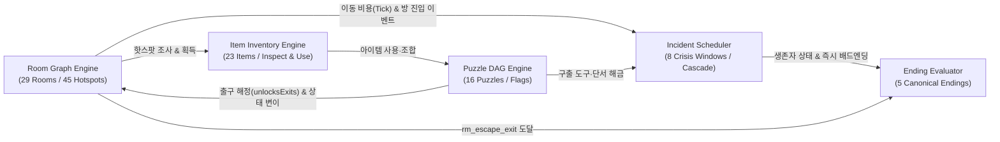
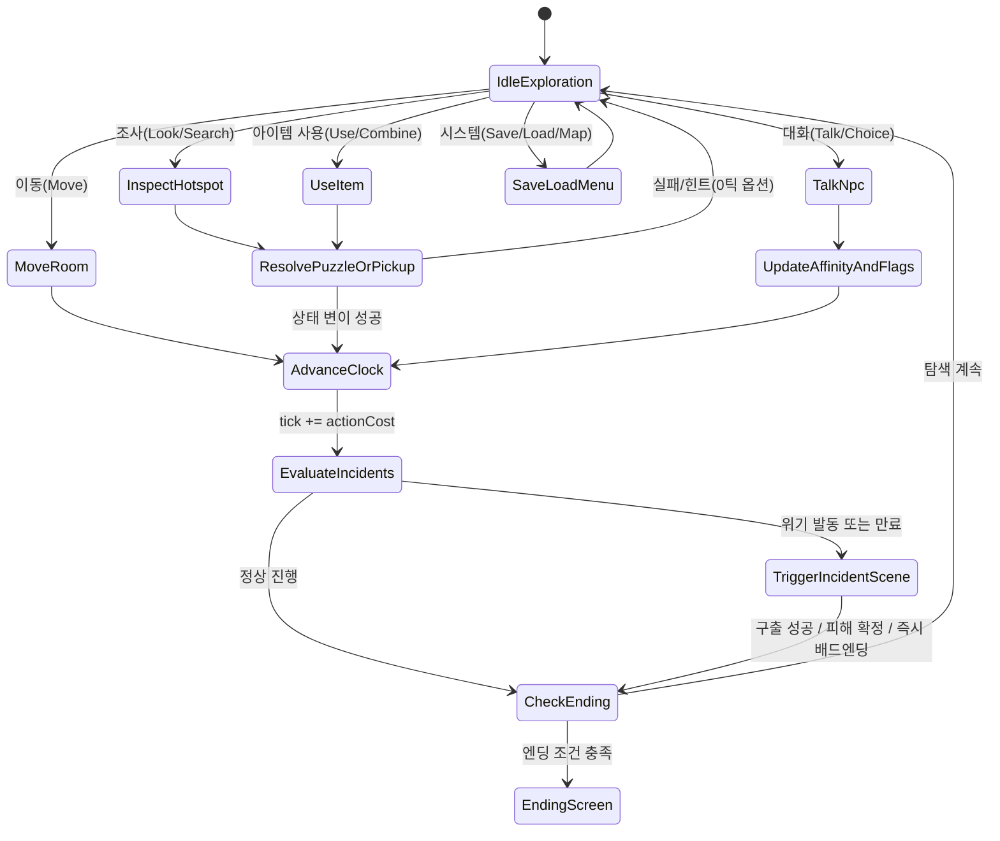

# 01. 핵심 게임 루프 및 상태 머신

## 1. 핵심 설계 철학: 4대 하위 엔진의 결합

*침묵의 세입자*의 긴장감은 **"퍼즐을 풀기 위해 방을 이동하는 행동 자체가 시간·사건 시계를 진전시켜 동료의 위기를 촉발한다"**는 구조적 결합에서 나온다. `[확인]` `[해석]`

## 2. 거시 루프 (Macro Loop: 5개 탐색 페이즈)

원작의 구교사 탈출은 위층(5F)에서 아래층(1F)으로 하향 개방되면서 동시에 상층 백트래킹과 종반 시계탑 역상승이 교차하는 **5단계 페이즈**로 전개된다. `[확인]`

1. **Phase 1 — 5F 감금 및 4F 개방**: 음악실에서 편지 대조 → 3-1(`기계유`), 과학실(`갈색 표지 책`, 메모), 남자 화장실 금고 `3878`(`녹슨 철제 열쇠`) → 쿠미 선생 화장실 위기 대응 → 5F→4F 계단 문 해정.
2. **Phase 2 — 4F 탐색 및 5F 백트래킹**: 4F 복도(`붉은 수성 도료`), 4F 소실(`드라이버` 및 쥐구멍 `작은 열쇠`), 리카 고립·아케미 수첩/배전반 위기 관리 → 5F 복귀해 금고 뒷면(`단1 건전지`)→여자 화장실 타임 레코더(`작은 망치`) → 4F 공작실 석고상 파괴(`구리 열쇠`) → 4F→3F 계단 문 해정.
3. **Phase 3 — 3F 방송·도서 구역 돌파**: 3F 방송실 창고 바 록 해제(`바 록` 회수) → 방송실 진입(`목제 사다리`, `라이터`, `난수표`, 소가 구출) → 도서실 서가 이동(`붉은 리본 방울` → 4F 시청각실 코토미 전달) → 막다른 복도 천장 손잡이(`사다리`+`드라이버` → `붉은 리본 열쇠`) → 3F→2F 계단 문 해정.
4. **Phase 4 — 2F 연소 퍼즐 및 1F 개방**: 2F 1-1 교실 일행 대화(미유키 동행) → 2F 남자 화장실(`알코올 병`) → 2F 급식실 난로(`갈색 표지 책`+`알코올 병`+`라이터` → `은색 열쇠`) → 2F→1F 계단 해정 및 시계탑 접근 개방.
5. **Phase 5 — 시계탑·방송실 클라이맥스 및 1F 보건실 탈출**: 1F 현관(봉쇄된 가짜 출구 확인) → 시계탑에서 미유키 확인 및 사다리에 `붉은 수성 도료` 사용 → 3F 방송실 창고에서 `바 록`으로 진파치 배신·대치 처리 → 1F 복도에서 유작 제압 결과물 `유작의 나이프` 입수 → 1F 보건실 침대 옆 판자 제거 → `rm_escape_exit` 진입 및 엔딩 판정.

## 3. 미시 루프 (Micro Loop: 단일 행동 턴 처리)

플레이어의 모든 의미 있는 액션은 결정론적 **Action Dispatch 파이프라인**을 통과한다. `[재구성안]`

### 행동별 시간 비용(Tick Cost) 정책 `[재구성안]`
원작은 탐색·이동 반복에 따라 내부 상황이 진행되어 구출 지연 시 동료가 실종되는 구조를 취한다. `[확인]` 현대 재구현 엔진에서는 불공정한 "조사 남발 패배"를 막기 위해 다음과 같이 비용을 차등한다.

| 액션 유형 | 기본 틱 비용 | 설명 |
|---|---:|---|
| 방 간 이동 (`MOVE_ROOM`) | `+1 tick` | 공간 이동이 시간 경과의 주된 축 |
| 층 간 계단 이동 (`MOVE_FLOOR`) | `+1 tick` | 동일 비용 유지(백트래킹 과벌점 방지) |
| 핫스팟 단순 조사/힌트 확인 (`INSPECT`) | `0 tick` | 퍼즐 추론을 위한 반복 관찰은 패널티 없음 |
| 퍼즐 해결 / 아이템 획득 (`SOLVE_PUZZLE`, `PICKUP`) | `+1 tick` | 물리적 작업 수행으로 시간 소모 |
| 위기 대응 대화/구출 (`RESOLVE_INCIDENT`) | `0 tick` | 위기 현장에 제시간에 도착했으면 즉시 처리 |
| 세이브 / 로드 / 지도 열람 (`SYSTEM`) | `0 tick` | 메타 액션은 시간 미진행 |

## 4. 전역 상태 머신(WorldState) 계층

단일 직렬화 가능 객체 `GameState`는 아래 5개 슬라이스로 구성된다.

1. **`spatial`**: `currentRoomId`, `visitedRooms[]`, `unlockedExits[]`, `roomHotspotStates{}`
2. **`inventory`**: `ownedItems[]`, `consumedItems[]`, `inspectedClues[]`
3. **`puzzles`**: `solvedPuzzles[]`, `flags{}`
4. **`narrative`**: `clockTicks`, `currentPhase`, `characterStates{}`, `characterLocations{}`, `affinities{ miyuki, kotomi }`, `activeIncidents[]`, `resolvedIncidents[]`
5. **`outcome`**: `endingId | null`, `compromisedCount`, `evidenceTapeSpawned`

이 5개 슬라이스 외에 숨은 전역 변수를 두지 않음으로써, **모든 시점의 완벽한 세이브/로드와 결정론적 테스트 리플레이**를 보장한다.
