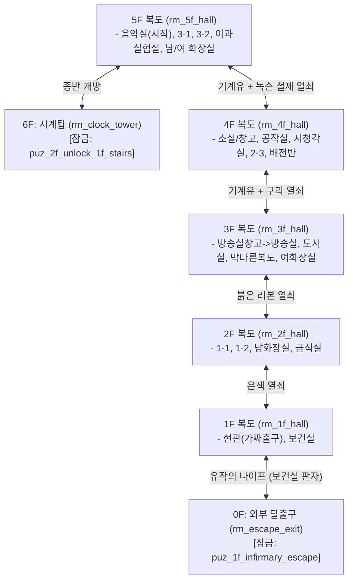

# 02. 방 그래프 및 공간 탐색 시스템

## 1. 구교사 수직 계층 구조

*침묵의 세입자*의 구교사는 **5층(시작) → 4층 → 3층 → 2층 → 1층(탈출)**의 하향 계단식 잠금 구조에, 종반 **시계탑(6층 상층부)**과 **1층 보건실 비밀 탈출구(0층 외부)**가 결합된 총 **7개 수직 레이어, 29개 방, 45개 핫스팟** 그래프로 복원되었다. `[확인]` `[해석]`

## 2. 층별 방 목록 및 핵심 기능 (`verified_data/rooms.json` 기준)

### 5층 (시작층 — 7개 방)
| Room ID | 방 이름 | 핵심 핫스팟 / 기능 | 확증 |
|---|---|---|---|
| `rm_5f_music` | 5F 음악실 | 게임 시작 지점. 호출 편지 대조 및 감금 확인, 판자 창문 조사 | `[확인]` |
| `rm_5f_hall` | 5F 복도 | 5층 허브. 4F 계단 문(`puz_5f_unlock_4f_stairs`), 종반 시계탑 연결구 | `[확인]` |
| `rm_5f_class_3_1` | 5F 3-1 교실 | `item_machine_oil`(기계유) 입수 | `[확인]` |
| `rm_5f_class_3_2` | 5F 3-2 교실 | `item_clue_memo_3_2`(단서 메모) 입수 | `[확인]` |
| `rm_5f_science` | 5F 이과 실험실 | 골격 표본 메모, 상자(`item_brown_book`), 후반 `item_akemi_notebook` | `[확인]` |
| `rm_5f_restroom_m` | 5F 남자 화장실 | 비밀번호 금고 `3878`(`item_rusted_key`), 백트래킹 금고 후면(`item_d_battery`) | `[확인]` |
| `rm_5f_restroom_f` | 5F 여자 화장실 | 바닥 타임 레코더(`item_small_hammer`), 쿠미 선생 호위 사건 지점 | `[확인]` |

### 4층 (중상층 — 6개 방)
| Room ID | 방 이름 | 핵심 핫스팟 / 기능 | 확증 |
|---|---|---|---|
| `rm_4f_hall` | 4F 복도 | `item_red_paint`(붉은 수성 도료), 3F 계단 잠금 문, 리카 고립 사건 | `[확인]` |
| `rm_4f_storage` | 4F 소실/창고 | 골판지 상자(`item_screwdriver`), 쥐구멍 벽면 파괴(`item_small_key`) | `[확인]` |
| `rm_4f_craft` | 4F 공작실 | '생각하는 사람' 석고상 파괴(`item_copper_key`) | `[확인]` |
| `rm_4f_av` | 4F 시청각실 | 코토미 이벤트(`item_red_ribbon_bell` 전달), 비디오 재생기(증거 테이프 확인) | `[확인]` |
| `rm_4f_class_2_3` | 4F 2-3 교실 | 일행 합류 및 아케미 수첩 반환 | `[확인]` |
| `rm_4f_electrical` | 4F 배전반 구역 | 아케미 패닉·인화 화재 배드엔딩 방지 위기 지점 | `[해석]` |

### 3층 (중층 — 6개 방)
| Room ID | 방 이름 | 핵심 핫스팟 / 기능 | 확증 |
|---|---|---|---|
| `rm_3f_hall` | 3F 복도 | 3층 허브. 2F 계단 잠금 문, 미오 분리 사건 지점 | `[확인]` |
| `rm_3f_broadcast_prep` | 3F 방송실 창고(준비실) | 바 록 해제(`item_bar_lock` 획득), 종반 배신자 격리 잠금 | `[확인]` |
| `rm_3f_broadcast` | 3F 방송실 | `item_wooden_ladder`, `item_lighter`, `item_cipher_table`, 소가 구출 | `[확인]` |
| `rm_3f_library` | 3F 도서실 | 서가 이동(`item_red_ribbon_bell`), 미유키·진파치 핵심 대화(호감도) | `[확인]` |
| `rm_3f_dead_end` | 3F 막다른 복도 | 고양이 소리 천장 손잡이(`목제 사다리`+`드라이버` → `item_red_ribbon_key`) | `[확인]` |
| `rm_3f_restroom_f` | 3F 여자 화장실 | 2번째 칸: 동료 구출 실패 시 `item_evidence_tape` 출현 지점 | `[확인]` |

### 2층 (하중층 — 5개 방)
| Room ID | 방 이름 | 핵심 핫스팟 / 기능 | 확증 |
|---|---|---|---|
| `rm_2f_hall` | 2F 복도 | 2층 허브. 1F 계단 잠금 문(`item_silver_key`) | `[확인]` |
| `rm_2f_class_1_1` | 2F 1-1 교실 | 일행 대화 후 퇴장 시 미유키 동행 개시 | `[확인]` |
| `rm_2f_class_1_2` | 2F 1-2 교실 | 일행 분산 확인 및 안전 점검 지점 | `[확인]` |
| `rm_2f_restroom_m` | 2F 남자 화장실 | 좌측 칸 `item_alcohol_bottle`(알코올 병) 입수 | `[확인]` |
| `rm_2f_kitchen` | 2F 급식실 | 장작 난로 연소 퍼즐(`갈색 표지 책`+`알코올 병`+`라이터` → `item_silver_key`) | `[확인]` |

### 1층 · 시계탑 · 탈출구 (5개 방)
| Room ID | 방 이름 | 핵심 핫스팟 / 기능 | 확증 |
|---|---|---|---|
| `rm_1f_hall` | 1F 복도 | 생존자 합류 지점, 종반 유작 제압 후 `item_isaku_knife` 입수 | `[확인]` |
| `rm_1f_entrance` | 1F 현관(가짜 출구) | 열쇠 자체가 존재하지 않는 봉쇄 함정 문(탐색 전환 유도) | `[확인]` |
| `rm_1f_infirmary` | 1F 보건실 | 침대 근처 봉쇄 판자에 `item_isaku_knife` 사용 → 비밀 탈출구 개방 | `[확인]` |
| `rm_clock_tower` | 시계탑 (6F) | 종반 미유키 상태 확인 및 사다리에 `item_red_paint` 도포 | `[확인]` |
| `rm_escape_exit` | 구교사 외부 탈출구 (0F) | 최종 도착 시 엔딩 판정기 호출 | `[확인]` |

## 3. 잠금 통로 및 동적 핫스팟 상태 전이 규칙

1. **양방향 그래프 무결성**: 모든 출구 `A -> B`는 반드시 대응하는 복귀 출구 `B -> A`를 가진다. 단, 층간 하행 문(`5F->4F`, `4F->3F`, `3F->2F`, `2F->1F`), 방송실 내문, 시계탑 진입로, 보건실 탈출구 등 **6개 단방향 잠금 간선**은 대응하는 `unlockPuzzleId`가 해결될 때 개방되며, 한 번 개방된 상행 계단은 영구 개방을 유지해 백트래킹을 보장한다. `[확인]` `[재구성안]`
2. **조건부 가시성(Dynamic Hotspot Visibility)**:
   - `hs_5f_restroom_m_safe_back`: `flg_5f_safe_opened`가 설정된 이후 상호작용 활성화.
   - `hs_5f_science_floor` (`item_akemi_notebook`): Phase 2 진입 이후 출현.
   - `hs_3f_stall_2` (`item_evidence_tape`): `flg_evidence_tape_spawned == true`일 때만 생성(전원 생존 진행 중에는 빈 칸으로 유지).
   - `hs_1f_hall_isaku_body` (`item_isaku_knife`): `flg_climax_isaku_down == true` 이후 상호작용 가능.
3. **가짜 출구(Red Herring) 설계**: `rm_1f_entrance`(1층 현관)는 플레이어에게 "1층까지 내려왔는데 정문 열쇠가 없다"는 심리적 반전을 주어 시계탑 최종 대치와 보건실 비밀 통로 탐색으로 시선을 전환시키는 서사적 장치다. `[확인]`
