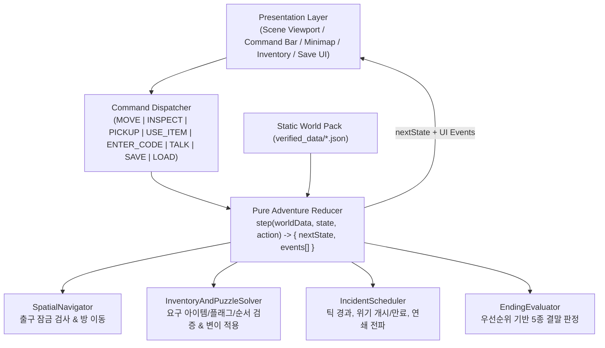

# 07. 데이터 스키마 및 탐색 어드벤처 엔진 아키텍처

> **핵심 목표**: *침묵의 세입자*의 원작 데이터를 그대로 구동하면서도, JSON 데이터팩 교체만으로 임의의 폐쇄 공간 탈출 어드벤처에 재사용할 수 있는 **Room + Item + Puzzle + Incident 결합 엔진**을 정의한다. `[재구성안]`

## 1. 핵심 TypeScript 데이터 스키마

```ts
export type Certainty = '확인' | '해석' | '재구성안' | '검증 필요';

export type CharacterStatus =
  | 'safe'
  | 'at_risk'
  | 'rescued'
  | 'compromised'
  | 'hostile'
  | 'incapacitated'
  | 'deceased_backstory';

export interface RoomExit {
  to: string;
  direction: string;
  locked: boolean;
  unlockPuzzleId: string | null;
}

export interface RoomDef {
  id: string;
  floor: number;
  nameKo: string;
  nameJa: string;
  nameEn: string;
  zoneType: string;
  initialLockState: string;
  exits: RoomExit[];
  hotspots: Array<{ id: string; labelKo: string; actionType: string }>;
  certainty: Certainty;
  sourceIds: string[];
}

export interface ItemDef {
  id: string;
  nameKo: string;
  nameJa: string;
  nameEn: string;
  category: 'clue' | 'tool' | 'key' | 'puzzle_material' | 'character_key_item' | 'incident_artifact';
  acquireMethod: 'starting_inventory' | 'room_pickup' | 'puzzle_reward' | 'event_pickup' | 'conditional_incident_drop';
  pickupRoomId: string;
  pickupPuzzleId: string | null;
  targetHotspotIds: string[];
  consumable: boolean;
  combineWith: string[];
  purposeKo: string;
  certainty: Certainty;
  sourceIds: string[];
}

export interface PuzzleDef {
  id: string;
  nameKo: string;
  roomId: string;
  hotspotId: string;
  puzzleType: string;
  codeSolution: string | null;
  requiresPuzzles: string[];
  requiresItems: string[];
  requiresFlags: string[];
  consumesItems: string[];
  grantsItems: string[];
  setsFlags: string[];
  unlocksExits: Array<{ from: string; to: string }>;
  failureRisk: string;
  softlockPrevention: string;
  certainty: Certainty;
  sourceIds: string[];
}

export interface IncidentDef {
  id: string;
  targetCharacterId: string;
  phase: string;
  triggerRoomId: string;
  triggerCondition: string;
  windowTicks: number;
  rescueAction: string;
  failureOutcome: {
    characterStatus: CharacterStatus;
    setsFlags: string[];
    immediateEndingId?: string;
    cascadeToIncidentIds: string[];
  };
  successOutcome: {
    characterStatus: CharacterStatus;
    setsFlags: string[];
  };
  certainty: Certainty;
  sourceIds: string[];
}

export interface EndingDef {
  id: string;
  nameKo: string;
  nameJa: string;
  tier: 'happy' | 'normal' | 'bad';
  priority: number;
  conditions: {
    reachedRoomId: string | null;
    requiredFlags?: string[];
    requiredAnyFlags?: string[];
    maxCompromisedCount?: number;
    minCompromisedCount?: number;
    minMiyukiAffinity?: number;
    maxMiyukiAffinity?: number;
  };
  summaryKo: string;
  certainty: Certainty;
  sourceIds: string[];
}
```

## 2. 엔진 모듈 아키텍처 (4-Engine + Pure Reducer)



### 순수 함수형 턴 리듀서 계약 (`step`)
```ts
export type EngineAction =
  | { type: 'MOVE_ROOM'; toRoomId: string }
  | { type: 'INSPECT_HOTSPOT'; hotspotId: string }
  | { type: 'PICKUP_ITEM'; itemId: string }
  | { type: 'USE_ITEM'; itemId: string; hotspotId: string }
  | { type: 'SUBMIT_CODE'; puzzleId: string; code: string }
  | { type: 'RESOLVE_INCIDENT'; incidentId: string; choiceId: string }
  | { type: 'UPDATE_AFFINITY'; characterId: 'char_miyuki' | 'char_kotomi'; delta: number };

export interface StepResult {
  nextState: GameState;
  emittedEvents: EngineEvent[]; // UI 알림, 효과음, 대사 큐, 자동 세이브 트리거
  blockedReason?: string;       // 잠긴 문, 윤활 필요, 재료 부족 등
}
```

## 3. 재사용성 설계 포인트

1. **데이터-로직 완전 분리**: *침묵의 세입자* 특유의 금고 번호(`3878`), 윤활 해정, 난로 연소, 시계탑 도료, 바 록 격리 규칙이 코드에 하드코딩되지 않고 모두 `puzzles.json`과 `incidents_and_endings.json`에 선언적으로 기술된다.
2. **정적 검증기 통합**: 새 시나리오를 작성할 때도 `validate_data.mjs`를 그대로 실행해 그래프 단절·참조 깨짐·퍼즐 순환·소프트락을 빌드 타임에 자동 차단할 수 있다.
3. **헤드리스 시뮬레이션 지원**: 렌더링 계층과 분리된 순수 리듀서이므로 Node.js CLI에서 수천 회 분기 퍼징(Fuzzing)과 전 엔딩 도달 자동 회귀 테스트를 1초 내에 수행할 수 있다.
