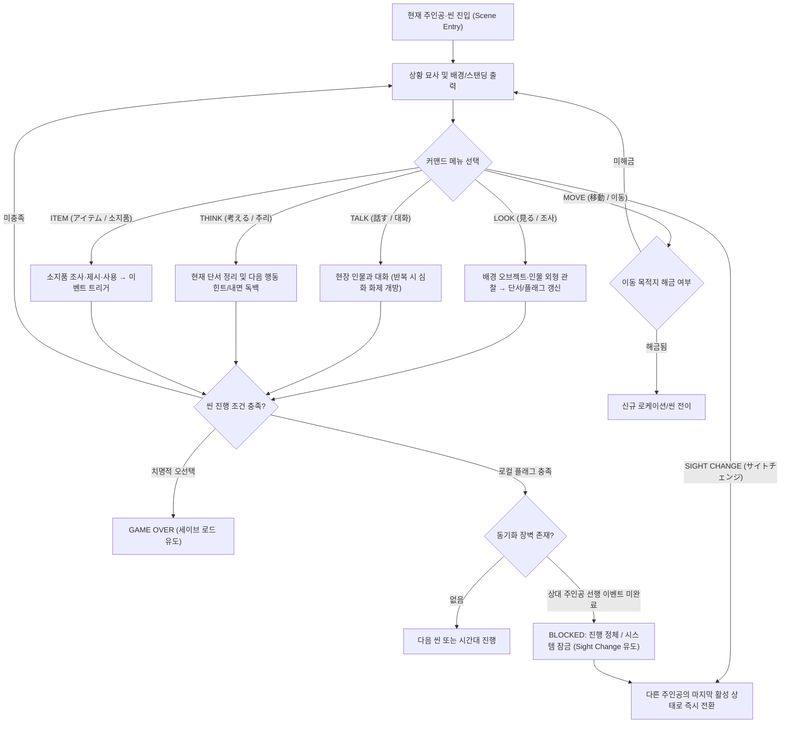
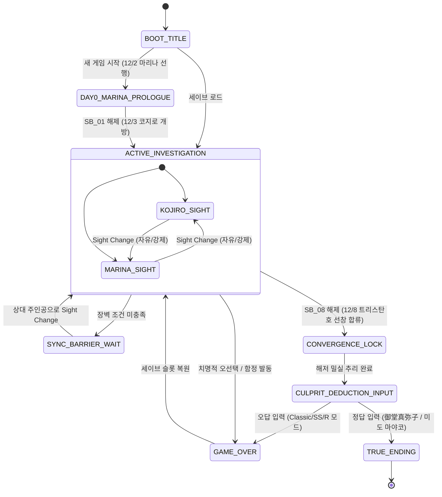

# 01. 코어 루프 및 전체 상태 머신

## 1. 게임 구조의 본질: 변칙적 외길(変則的な一本道) `[확인]` `[해석]`

《Twin Sight Paradox》는 선택지에 따라 여러 히로인 엔딩으로 분기하는 미연시/멀티 엔딩 비주얼 노벨이 아니다. 본작은 **단 하나의 진엔딩(True Ending)**을 향해 두 주인공의 독립된 커맨드 수사 루프가 퍼즐처럼 맞물리며 전진하는 **변칙적 외길 추리 어드벤처**다. `[확인]`

- **왜 '변칙적 외길'인가?** `[해석]`
  - 플레이어는 어느 시점까지 코지로를 먼저 진행할지, 마리나를 먼저 진행할지 **국소적 진행 순서(Local Ordering)**를 자유롭게 선택할 수 있다.
  - 그러나 거시적 인과(Global Causality)는 **동기화 장벽(Sync Barrier)**에 의해 제어되므로, 한쪽 주인공이 일정 임계점을 넘어 단독으로 폭주하는 것이 원천 차단된다.
  - 잘못된 대응이나 치명적 실수(적대자 대치 중 오선택, 필수 준비 미비 상태 진입 등)는 분기 루트가 아니라 **즉시 게임 오버(Bad End / Game Over)**로 귀결되어 세이브 복귀를 강제한다. `[확인]`

## 2. 커맨드 기반 ADV 코어 루프 `[확인]`

플레이어가 한 주인공의 씬(Scene) 안에서 수행하는 기본 상호작용 루프는 고전 일본식 커맨드 선택형 ADV의 6대 동사로 구성된다.

### 2.1 원작 커맨드 소진(Exhaustion) 특성 `[확인]` `[해석]`
- **반복 실행에 의한 점진적 정보 개방**: 《Twin Sight Paradox》는 `LOOK`이나 `TALK`를 **1회만 실행하고 끝나는 것이 아니라 2~3회 연속 선택**해야 숨겨진 화제나 조사 플래그가 열리는 구조가 빈번하다. `[확인]`
- **`THINK`의 내비게이션 역할**: 막혔을 때 `THINK`를 선택하면 주인공이 현재까지 수집한 단서를 정리하며 "지금 필요한 정보" 또는 "다른 방향으로 알아봐야 함"을 암시한다. `[확인]` `[해석]`
- **명령 고갈 = 시점 전환 신호**: 현재 주인공 측에서 모든 `LOOK`/`TALK`/`THINK`/`ITEM`과 가용 `MOVE`를 소진했음에도 시간대가 넘어가지 않거나(예: 12월 6일 마리나의 DBMS 레벨7 접근 거부), 특정 대사가 반복된다면 이는 **상대 주인공의 동기화 플래그 대기 상태**임을 뜻한다. `[확인]` `[해석]`

## 3. 글로벌 게임 상태 머신 (Global FSM) `[재구성안]`

PlayHub 런타임에서 원작의 흐름을 무결하게 재현하기 위한 최상위 상태 머신은 8개 상태로 정의한다.

### 3.1 상태별 전이 규칙 `[재구성안]`

| 상태 ID | 활성 주인공 | Sight Change 허용 | 진입 조건 | 탈출 조건 |
| --- | --- | --- | --- | --- |
| `BOOT_TITLE` | 없음 | 불가 | 앱 기동 | New Game 또는 Load Save |
| `DAY0_MARINA_PROLOGUE` | `marina` 단독 | **불가 (잠금)** | New Game | `M_D0_02` 완료(`evt_marina_day0_setup`) → `SB_01` 해제 |
| `ACTIVE_INVESTIGATION` | `kojiro` 또는 `marina` | **허용 (자유)** | `SB_01` 해제 이후~`SB_08` 이전 | 장벽 봉쇄, 게임오버, 또는 `SB_08` 합류 |
| `SYNC_BARRIER_WAIT` | 봉쇄된 주인공 | **권장/강제** | `required_world_flags` 미충족 상태에서 진행 시도 | 상대 주인공으로 전환하여 해제 이벤트 발생 |
| `CONVERGENCE_LOCK` | 통합(`both` / 합류 시점) | **비활성화(통합 완료)** | `K_D5_01` + `M_D5_01` 모두 완료(`SB_08`) | 해저 선창 단서 통합 완료 |
| `CULPRIT_DEDUCTION_INPUT` | 통합(`both`) | 불가 | 트리스탄호 해저 추리 정점 도달 | 정답 입력(`TRUE_ENDING`) / 오답(`GAME_OVER`) *(PLUS 모드에서는 자동 연출 옵션 지원)* |
| `GAME_OVER` | 사망/실패 주인공 | 불가 | 치명적 오선택 또는 범인 오답 | 직전/선택 슬롯 로드 또는 타이틀 복귀 |
| `TRUE_ENDING` | 통합(`both`) | 불가 | 진범 규명 및 구출 시퀀스 완료 | 에필로그·스태프롤 종료 |

## 4. 게임오버 및 소프트락(Softlock) 분리 원칙 `[확인]` `[재구성안]`

원작에서 플레이어가 느끼는 '막힘'은 사실 두 가지 전혀 다른 시스템 상태에서 비롯된다. PlayHub 재현 엔진은 이 둘을 엄격히 구분해야 한다.

1. **즉시 게임오버 (Immediate Game Over)** `[확인]`:
   - 암살자/적대자와의 대치, 폭발·총격 위기, 범인 이름 오입력 등에서 잘못된 커맨드를 선택하면 즉시 실패 엔딩이 출력된다.
   - 엔진은 즉사 분기 직전에 자동 체크포인트(Auto-Checkpoint)를 남겨 현대 유저의 불필요한 반복 노동을 방지하되, Classic 모드에서는 수동 세이브 로드 경험을 보존할 수 있도록 설정 가능하게 한다. `[재구성안]`
2. **정상적 동기화 정체 (Expected Sync Stall)** `[확인]` `[해석]`:
   - 플레이어가 잘못한 것이 아니라, 상대 주인공의 시간축을 따라잡아야 하는 정상적인 멀티 사이트 대기 상태다.
   - 원작에서는 이 상태가 불친절하게 느껴질 수 있었으나, 엔진 레벨에서 **`SYNC_BARRIER_WAIT`** 상태로 명시적으로 모델링함으로써 (a) 영구 소프트락을 수학적으로 원천 봉쇄하고, (b) UI에서 선택적으로 힌트(예: `R` 스타일 시점 전환 알림)를 제공할 수 있다. `[재구성안]`
