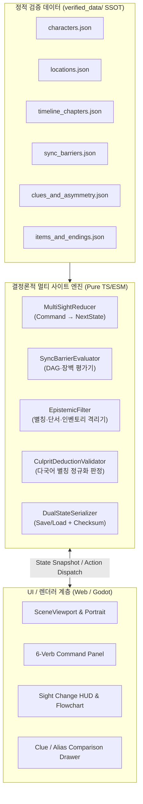

# 07. 데이터 스키마 및 PlayHub 결정론적 엔진 아키텍처

## 1. 아키텍처 개요: 데이터 주도 멀티 사이트 엔진 `[재구성안]`

PlayHub에서 《Twin Sight Paradox》를 구현할 때 시나리오 로직을 하드코딩된 `if/else` 스크립트로 흩뿌리면 동기화 장벽 교착이나 정보 비대칭 누수(예: 코지로가 마리나만 아는 정보를 말하는 버그)가 필연적으로 발생한다. 따라서 **순수 데이터 SSOT(`verified_data/*.json`) + 결정론적 순수 함수 리듀서(Deterministic State Reducer)** 구조를 채택한다.



## 2. 핵심 TypeScript 도메인 스키마 `[재구성안]`

아래 인터페이스는 `ReverseDesign/verified_data/*.json`의 실제 구조와 1:1로 대응한다.

```ts
export type ProtagonistId = 'kojiro' | 'marina';
export type TrackId = ProtagonistId | 'both';
export type VerificationTag = '확인' | '해석' | '재구성안' | '검증 필요';

export interface CharacterPerception {
  initial_alias: string;
  initial_role: string;
  trust_level: 'ally' | 'neutral' | 'suspect' | 'hostile' | 'unknown' | 'self';
  truth_revealed_at_scene: string | null;
}

export interface CharacterRecord {
  id: string;
  name_kr: string;
  name_jp: string;
  name_en: string;
  faction: string;
  true_identity: string;
  known_to_kojiro: CharacterPerception;
  known_to_marina: CharacterPerception;
  verification_status: VerificationTag;
}

export interface LocationRecord {
  id: string;
  name_kr: string;
  name_jp: string;
  name_en: string;
  district: string;
  accessible_by: TrackId;
  unlock_day: number;
  summary: string;
  verification_status: VerificationTag;
}

export interface TimelineScene {
  id: string;
  track: TrackId;
  day_index: number; // 0 (Dec 2) .. 6 (Dec 8)
  calendar_date: string; // '12-02' .. '12-08'
  title_kr: string;
  title_jp: string;
  location_ids: string[];
  character_ids: string[];
  prev_scene_ids: string[];
  emits_event_ids: string[];
  sight_change_allowed: boolean;
  summary: string;
  verification_status: VerificationTag;
}

export interface SyncBarrier {
  id: string;
  name_kr: string;
  barrier_type: 'temporal_pacing' | 'world_mutation' | 'concurrent_exploit' | 'final_convergence';
  blocked_protagonist: TrackId;
  blocked_scene: string;
  unlocking_protagonist: TrackId;
  unlocking_scene: string;
  unlocking_event_id: string;
  required_event_ids: string[];
  cross_causal_effect: string;
  player_hint_modern: string;
  verification_status: VerificationTag;
}

export interface AsymmetricClue {
  id: string;
  title_kr: string;
  category: 'identity' | 'artifact' | 'conspiracy' | 'murder' | 'system_hack';
  holder: ProtagonistId | 'shared_asymmetric';
  acquired_at_scene: string;
  related_character_ids: string[];
  related_location_ids: string[];
  perceived_meaning_kojiro: string;
  perceived_meaning_marina: string;
  true_meaning: string;
  shared_at_scene: string;
  dramatic_irony_type: 'alias_mismatch' | 'dual_target_mirror' | 'split_artifact' | 'impostor_trap' | 'concurrent_sync';
  verification_status: VerificationTag;
}
```

## 3. 엔진 액션 디스패치 계약 (Action Contract) `[재구성안]`

모든 사용자 입력은 결정론적 액션 객체로 리듀서에 전달되어 단위 테스트·리플레이·자동 QA가 100% 재현 가능하도록 한다.

```ts
export type GameAction =
  | { type: 'START_NEW_GAME'; mode: { sightHintMode: 'modern' | 'classic'; culpritInputMode: 'classic' | 'streamlined' } }
  | { type: 'EXEC_COMMAND'; verb: 'LOOK' | 'TALK' | 'THINK' | 'MOVE' | 'ITEM'; targetId: string }
  | { type: 'SIGHT_CHANGE'; to?: ProtagonistId }
  | { type: 'ATTEMPT_ADVANCE_SCENE'; nextSceneId: string }
  | { type: 'SUBMIT_CULPRIT_NAME'; rawInput: string }
  | { type: 'LOAD_SNAPSHOT'; snapshot: DualSaveSnapshot };
```

### 3.1 핵심 불변 규칙 (Engine Invariants) `[재구성안]`
1. **비대칭 격리 불변식**: `EXEC_COMMAND` 평가 시 `EpistemicFilter`는 반드시 `state.protagonists[state.activeProtagonist]`의 `inventoryItemIds`와 `knownClueIds`만 입력으로 받는다(합류 상태 `CONVERGENCE_LOCK` 제외).
2. **시점 전환 원자성**: `SIGHT_CHANGE`는 `globalPhase === 'ACTIVE_INVESTIGATION'`이고 현재 씬의 `sight_change_allowed === true`일 때만 허용된다.
3. **범인 입력 정규화**: `SUBMIT_CULPRIT_NAME`은 공백·중점(`=`, `・`)·대소문자를 제거한 뒤, `items_and_endings.json`의 `accepted_answers` 집합(`미도마야코`, `마야코`, `御堂真弥子`, `みどうまやこ`, `真弥子`, `mayakomido`, `mayako`)과 대조해 다국어 오인식을 방지한다.
4. **교차 이벤트 단조성**: `sharedWorld.triggeredEventIds`는 단조 증가(Monotonic Append-Only) 집합이므로, 한 번 해제된 동기화 장벽이 의도치 않게 다시 잠겨 플레이어를 가두는 회귀가 발생하지 않는다.

## 4. PlayHub 통합 확장성 `[재구성안]`

- **정적 웹 런타임 우선(Zero-Backend 가능)**: 엔진 코어(`Pure TS/ESM`)와 `verified_data/*.json`만으로 브라우저에서 완결 실행되며, 세이브 슬롯은 `localStorage` 또는 PlayHub 유저 스토리지 API에 동일 JSON 스키마로 저장한다.
- **리플레이 및 자동 QA 친화성**: 모든 상태 변화가 `GameAction[]` 로그로 직렬화되므로, "12월 2일 → 12월 8일 최단 진엔딩 골든 패스"를 헤드리스 Node 테스트에서 50ms 이내에 전수 시뮬레이션할 수 있다.
