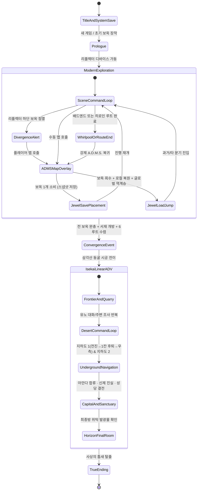

# 01. 코어 루프 및 2부제 상태 머신

## 1. 2부제(Two-Part) 게임 구조 개관 `[확인]`
『YU-NO』는 단일 게임 안에 **성격이 완전히 다른 2개의 플레이 루프**를 결합한 독창적 구조를 지닌다.

1. **제1부: 프롤로그 및 현세편 (사카이마치 / 境町)**
   - **핵심 루프**: 포인트 앤 클릭 탐색 → 리플렉터 점멸 감지 → 보옥 세이브 배치 → 분기 탐색 및 아이템/보옥 확보 → 관문 막힘(Lock Gate) 또는 소용돌이(Whirlpool) 도달 → A.D.M.S. 맵 개방 → 타 분기 보옥 로드(아이템·글로벌 플래그 역계승) → 재탐색. `[확인]`
   - **목표**: 6개 추가 보옥을 모두 회수(PC-98 기준 총 8개, SS/리메이크 총 10개)하고 주요 히로인 루트의 진상과 핵심 열쇠(`item_study_key`)를 확보해 1일차 서재 및 삼각산 수렴 관문을 돌파한다. `[확인]`

2. **제2부: 이세계편 / 에필로그 (데라 그란트 / デラ＝グラント)**
   - **핵심 루프**: A.D.M.S. 병렬세계 점프가 봉인된 **선형 모험·커맨드 총공격(コマンド総当たり)** 루프. 현재 장소에서 `대화하기 / 조사하기 / 주변 보기 / 이동하기 / 아이템 사용`을 반복 실행해 서사 플래그와 공간 퍼즐(지하도 1·2, 사막 횡단, 최종방 발광 위탁물 확인)을 돌파한다. `[확인]`
   - **목표**: 변경(보더) → 아이리아의 집(유노 탄생) → 성석 채굴장 → 사막·오아시스 → 지하도 → 제도(신제 아유미·아만다) → 성당 결전 → 사상의 틈새(트루 엔딩) 완주. `[확인]`

## 2. 최상위 게임 상태 머신 (Macro FSM) `[해석]` `[재구성안]`

## 3. 현세편 1턴 마이크로 루프 (Micro Gameplay Loop) `[확인]` `[해석]`
현세편에서 플레이어가 단일 장면(Scene) 내에서 반복하는 6단계 루프는 다음과 같다.

1. **공간 인지 & 핫스팟 탐색**: 현재 로케이션(예: `loc_arima_room`, `loc_ryuzoji_storehouse`)의 배경 화면 위 오브젝트·인물을 커서로 가리켜 `보기(見る) / 조사하기(調べる) / 대화하기(話す) / 사용하기(使う)` 커맨드 실행. `[확인]`
2. **장소 이동(移動)**: 현재 시간대에 개방된 사카이마치 맵 목록(집 내부, 학원 구역, 켄노미사키, 시가지 등)을 선택해 이동. 특정 이동 순서(예: 학원 정문 → 홀 → 학원 정문 재방문)가 숨겨진 만남(`item_kanna_student_id`)을 트리거한다. `[확인]`
3. **분기 임박 감지**: 리플렉터 디바이스 하단 보옥이 **점멸(Blinking)**하면 곧 병렬세계가 갈라지는 핵심 선택지 또는 이벤트가 도래함을 인지한다. `[확인]`
4. **보옥 배치 전략 결정**:
   - 가용 보옥이 ≥ 1개라면 점멸 직전 지점에 **보옥 세이브**를 심어 안전한 앵커를 확보한다. `[확인]`
   - 가용 보옥이 0개라면 기존에 심어 둔 덜 중요한 분기점에서 점프해 보옥을 회수하거나, 광점(Shining Point)을 찾아 새 보옥을 확보해야 한다. `[해석]`
5. **결과 관측 (획득 / 관문 차단 / 소용돌이)**:
   - 새 아이템(`item_blue_card`, `item_chounenseki`)이나 보옥 획득 → 글로벌 상태에 영구 반영.
   - 필요 아이템이 없어 관문(`lock_gate`)에서 막히거나 소용돌이(`whirlpool`)에 빠짐 → A.D.M.S. 맵으로 빠져나와 타 분기 탐색. `[확인]`
6. **역계승 점프(Jewel Load) 및 재고정**:
   - 목표 앵커 노드로 점프하면 해당 노드의 보옥이 리플렉터로 반환된다.
   - 그 앵커를 나중에 또 써야 한다면 **점프 직후 즉시 보옥 세이브를 다시 배치**하는 습관이 핵심 플레이 루프를 형성한다. `[확인]`

## 4. 이세계편 루프 전환의 의도적 설계 대비 `[해석]`
| 축 | 제1부: 현세편 (사카이마치) | 제2부: 이세계편 (데라 그란트) |
|---|---|---|
| **공간 구조** | 허브형 사카이마치 19개소 자유 이동 | 챕터 진행형 8개 구역 순차 돌파 |
| **시간축 구조** | 다분기 병렬 트리 (A.D.M.S. 자유 왕복) | 단일 비가역 시간축 (점프 봉인) |
| **핵심 퍼즐 동력** | 루트 간 아이템 역계승 + 보옥 자원 배분 | 커맨드 총공격 + 공간 방향 기억(지하도) + 위탁물 발광 확인 |
| **플레이어 심리** | "실패해도 보옥으로 돌아가 아이템을 들고 다시 푼다" (전능적 관찰자) | "되돌릴 수 없는 이세계에서 생존하고 인과를 완결한다" (당사자성 강조) `[해석]` |
