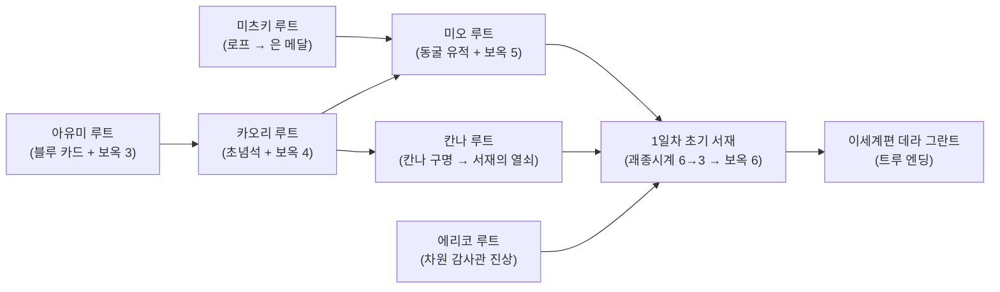

# 03. 플래그 추적 & 루트 간 정보·아이템 계승 아키텍처

## 1. 비대칭 상태 분할 (Global vs Local State Partition) `[확인]` `[해석]`
『YU-NO』가 수많은 분기형 어드벤처와 구별되는 결정적 설계는 **보옥 로드(Jewel Load) 시 상태가 절반만 되감긴다**는 점이다. 이 비대칭 분할이 곧 퍼즐이자 서사의 물리 법칙이 된다.

| 상태 계층 | 포함 데이터 | 보옥 로드 시 거동 | 설계 의도 `[해석]` |
|---|---|---|---|
| **Global State (리플렉터 계승 계층)** | ① 소지품 인벤토리의 **현재 상태** (보유·소비 모두 포함) ② 누적 획득 보옥 집합 (`collectedJewels`) ③ A.D.M.S. 탐색 완료 노드·엣지·소용돌이·광점 기록 ④ 글로벌 메타 플래그 11종 (루트 클리어, 서재 개방, 이세계 해금 등) | **과거로 점프해도 리셋되지 않고 현재 상태가 그대로 역계승됨** `[확인]` | 미래·타 평행세계에서 얻은 열쇠·정보를 과거와 타 분기로 반입하여 막힌 관문을 여는 핵심 퍼즐 메커니즘 |
| **Local State (시간축 스냅샷 계층)** | ① `currentNodeId`, `currentLocationId` ② 로컬 장면 플래그 12종 (선택지, 동행자, 조사 순서, 퍼즐 상태) ③ 현재 시간축 내 NPC 배치·생사 상태 ④ 세이브 시점에 **이미 취득 완료된 맵 오브젝트 목록** (`takenPickupsAtSnapshot`) | **보옥 세이브를 찍은 시점의 스냅샷으로 정확히 복원됨** `[확인]` | 인과를 되돌려 다른 선택지를 시도하되, 이미 획득한 아이템을 과거에서 무한 복제하지 못하도록 차단 |

## 2. 대표적인 원작 루트 간 교차 계승 매트릭스 `[확인]`
[flags_and_inheritance.json](verified_data/flags_and_inheritance.json)에 정식 등록된 5대 교차 루트 계승 경로는 다음과 같다.

| 계승 ID | 출발 루트 (획득처) | 도착 루트 (사용처) | 계승 아이템 | 목표 관문 노드 | 해결되는 문제 |
|---|---|---|---|---|---|
| `xfer_ayumi_to_kaori_blue_card` | `route_ayumi` | `route_kaori` | `item_blue_card` (블루 카드) | `node_kaori_gate_blue_card` | 카오리 루트 단독으로는 열 수 없는 지오테크닉스 사옥 보안문을 해제해 코다이 연구실 잠입 |
| `xfer_mitsuki_to_mio_silver_medal` | `route_mitsuki` | `route_mio` | `item_silver_medal` (은 메달) | `node_mio_cave_puzzle` | 류조지 저택 토장(로프)→우물에서 인양한 은 메달을 사당 지하 유적 퍼즐로 반입 |
| `xfer_kaori_to_mio_chounenseki` | `route_kaori` | `route_mio` | `item_chounenseki` (초념석) | `node_mio_cave_puzzle` | 코다이 연구실에서 확보한 초념석을 사당 동굴에 반입해 유적 공명 발동 |
| `xfer_kaori_to_kanna_chounenseki` | `route_kaori` | `route_kanna` | `item_chounenseki` (초념석) | `node_kanna_crisis_gate` | 칸나 루트 종반 붕괴 위기에서 초념석으로 칸나를 구명하고 소용돌이(배드엔드) 회피 |
| `xfer_kanna_to_convergence_study_key` | `route_kanna` | `route_convergence` | `item_study_key` (서재의 열쇠) | `node_study_unlock` | 칸나 루트 종반에서 얻은 열쇠를 **1일차 초기 시간대(짐 보존)**로 역계승해 서재 개방 및 보옥 6 확보 |

### 2.1 교차 계승 의존 사슬 (Dependency Chain)

## 3. 소비 역설, 아이템 비복구 규칙 및 순서 함정 분석 `[확인]` `[해석]`

### 3.1 "소비된 아이템은 과거로 로드해도 돌아오지 않는다" 규칙 `[확인]`
- 예컨대 플레이어가 `아이템 A`를 주운 **뒤** 보옥 세이브 `S1`을 만들고, 그 이후 전개에서 `아이템 A`를 소비해 인벤토리에서 사라졌다고 가정하자.
- 이때 `S1`으로 보옥 로드를 하더라도:
  1. **인벤토리에는 `아이템 A`가 복구되지 않는다** (글로벌 인벤토리 상태가 역계승되므로 "이미 소비한 상태" 유지). `[확인]`
  2. **맵 위에도 `아이템 A`가 다시 나타나지 않는다** (`S1` 스냅샷 시점에 이미 맵에서 획득 완료된 상태였기 때문). `[확인]`
- **해법**: 해당 아이템을 획득하기 **이전** 시점의 보옥 세이브나, 동일한 아이템이 존재하는 **다른 평행세계 분기**(예: `item_kanna_student_id`는 정문 외에 시가지 취객 충돌에서도 재입수 가능)로 이동해 다시 확보해야 한다. `[확인]`

### 3.2 대표적 로컬 순서 함정 (Order-Sensitive Traps) `[확인]`
| 함정 유형 | 발생 위치 | 원인 로컬 플래그 / 행동 | 결과 | 회피·복구 방법 |
|---|---|---|---|---|
| **토장 로프 소실** | `loc_ryuzoji_storehouse` | 로프 획득 전 벽을 먼저 조사 (`flag_local_storehouse_wall_first`) | 로프 영구 미획득 → 우물 은 메달 불가 → 미오 동굴 막힘 | 토장 진입 직전(`node_mitsuki_call`) 보옥 로드 후 좌측 로프 우선 회수 |
| **서랍 설명서 열람** | `loc_arima_room` | 서랍 설명서를 '읽는다' 선택 | 보옥 1(`jewel_found_1`) 분기 미발동 | 1일차 거점(`node_day1_hub`) 보옥 로드 후 '읽지 않는다' 선택 |
| **여경비원 자기카드 사용** | `loc_geo_technics` | 아유미 루트에서 여경비원에게 자기카드를 바로 사용 | 삼각산 보옥 3(`jewel_found_3`) 분기 미진입 | `node_ayumi_branch` 보옥 로드 후 자기카드 미사용으로 사당/삼각산 우회 |
| **동굴 파트너 미오 단독** | `loc_shrine` | 동굴 파트너로 유우키를 선택하지 않음 | 보옥 5(`jewel_found_5`) 웅덩이 미접근 | `node_mio_branch` 보옥 로드 후 유우키 동행 선택 |
| **1일차 서재 앵커 소실** | `node_day1_hub` | 1일차 거점 보옥을 회수한 뒤 재설치하지 않고 진행 `[해석]` | 후일 `item_study_key`를 얻고도 짐 보존 시간대 서재 복귀 곤란 | 시스템 세이브 백업 또는 PlayHub 엔진의 루트/1일차 영구 보호 규칙(`[재구성안]`) |

## 4. PlayHub 엔진용 패러독스·교착 방지 설계 (`[재구성안]`)
원작 PC-98의 하드코어한 자원 관리 긴장감은 보존하되, 현대 웹/PlayHub 플레이어가 치명적 소프트락(Softlock)에 빠지지 않도록 다음 3가지 안전장치를 설계한다.
1. **초기 거점 재고정 알림(Anchor Re-Pin Prompt)**: `node_day1_hub`처럼 교차 계승 수렴 대상이 되는 노드로 보옥 로드할 때, "보옥이 회수되었습니다. 이 지점을 유지하려면 즉시 보옥 세이브를 다시 배치하세요" 안내 표시. `[재구성안]`
2. **소모품 경고(Paradox Risk Inspector)**: 소비 시 타 분기 관문(`requires_items`)에 영향이 있는 아이템을 사용할 때 A.D.M.S. 메타 로그에 해당 아이템의 출처 분기를 기록. `[재구성안]`
3. **고정점 도달성 검증기 연동**: 콘텐츠 패치나 시나리오 수정 시 `validate_data.mjs`의 고정점 솔버를 돌려 어느 순서로 루트를 공략하더라도 6개 보옥과 트루 엔딩에 100% 도달 가능함을 CI에서 보장. `[재구성안]`
