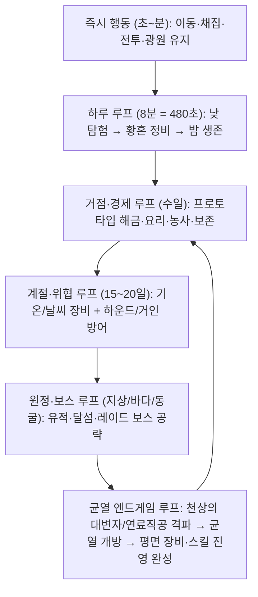
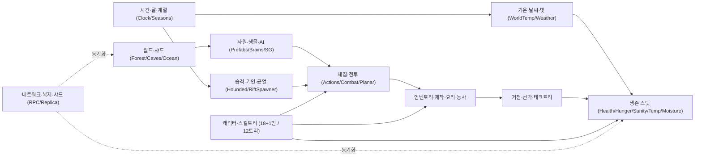

# 01. 게임 개요와 핵심 플레이 루프

> 상위 문서: [00. 목차](00_index.md) | 1차 출처: `scripts/tuning.lua`, `scripts/gamemodes.lua`, `scripts/constants.lua`, `scripts/actions.lua`

---

## 1. 제품 정의

**[데이터 확인]** Don't Starve Together (DST, Steam AppID `322330`, 설치본 v`763928`)는 Klei Entertainment가 개발한 2.5D 탑다운(사선 투영 + 빌보드 KAnim 스프라이트) 멀티플레이어 협동 생존 샌드박스 게임이다. 기본 최대 서버 인원은 `TUNING.MAX_SERVER_SIZE = 6` (`tuning.lua:56`)이며, 지상(`forest`)과 동굴(`cave`) 두 샤드(Shard)로 구성된 절차적 생성 세계에서 계절·어둠·기아·광기·거대 보스·차원의 균열(Rifts)에 맞서 생존하고 거점과 장비를 확장한다.

**[설계 해석] 핵심 판타지와 감정 곡선:**
- **초반(1~20일, 첫 가을)**: 무일푼 조난자에서 거점 구축자로의 긴장감. "밤이 오기 전에 빛과 식량을 확보해야 한다"는 분 단위 압박.
- **중반(21~70일, 첫 사계절 완주)**: 환경 적응과 생태계 활용의 성취감. 겨울 추위·디어클롭스, 봄 폭우·개구리비, 여름 과열·자연발화·개미사자를 거쳐 지속 가능한 거점 경제를 완성.
- **후반(유적·바다·레이드 보스)**: 고위험 원정과 파티 역할 분담(탱커/딜러/서포터/채집·농사·요리). 고대 연료직공과 천상의 대변자 격파.
- **엔드게임(균열 개방 이후)**: 달 균열(`LUNAR_RIFTS_ACTIVE`)과 그림자 균열(`SHADOW_RIFTS_ACTIVE`)이 세계를 변질시키며, 평면(Planar) 장비와 캐릭터 스킬트리 진영(`allegiance`)으로 극한 보스전과 자동화 거점을 완성.

---

## 2. DST 협동 생존의 5대 설계 기둥

| 기둥 | 코드·데이터 근거 | 기획적 작동 원리 (`[설계 해석]`) |
|---|---|---|
| **1. 다중 예산 교환** | 체력(`150`)·허기(`150`, 일 75 소비)·정신력(`200`)·체온(`-20~90°C`)·습기(`0~100`)·인벤토리(`15칸`+장비`4칸`)·시간(`480초/일`) | 어느 한 게이지도 독립적이지 않다. 식량을 구하면 시간·광원·내구도를 쓰고, 전투를 하면 체력·방어구·정신력을 소비한다. |
| **2. 비대칭 협동과 역할 분담** | 18인 플레이어블 캐릭터 + 12인 스킬트리(`skilltree_*.lua`), 보스 HP 2~10× 상향, 방어구 내구도 `0.7×` | 혼자서도 생존할 수 있지만, 전투(위그프리드/볼프강)·요리(왈리)·농사(웜우드)·건설/기계(위노나)·지원(워톡스/웬디)이 결합될 때 생산성과 레이드 효율이 기하급수적으로 상승한다. |
| **3. 사망의 공동체화** | `GAME_MODES.survival`: `ghost_enabled = true`, `ghost_sanity_drain = true`, `reset_time = {120, 180}`, 부활 페널티 `-25%` | 싱글플레이의 영구 삭제 대신 **유령화**로 세션을 유지하되, 살아있는 동료의 정신력을 지속적으로 깎고 전원 사망 시 120초 카운트다운 후 세계 초기화로 긴장감을 보존한다. |
| **4. 창발적 규칙 합성** | 835개 컴포넌트(`burnable`, `freezable`, `moisture`, `perishable`, `sanity`, `planarentity` 등)와 308개 `ACTIONS` | 개별 스크립트 예외보다 공통 컴포넌트 상호작용(예: 젖은 적에게 전기 피해 `1.5 + 1.0 × wetness` 증폭, 불이 나무→거점→보스로 번짐)이 예상치 못한 전술과 사고를 만든다. |
| **5. 이중 축(Shadow vs Lunar) 확장** | `SANITY_MODE_INSANITY(0)` / `SANITY_MODE_LUNACY(1)`, `riftspawner.lua`, `planardamage`/`planardefense` | 오래 살아남은 거점이 단순 안주에 빠지지 않도록, 기존 규칙을 뒤집는 공간(달섬의 계몽)과 물리 피해 감쇄 계층(평면 개체)을 단계적으로 투입한다. |

---

## 3. 시간 규모별 플레이 루프



| 시간 규모 | 길이(기본값) | 플레이어의 핵심 질문 | 주요 소모 자원 | 실패 시 결과 | 연결 문서 |
|---|---|---|---|---|---|
| **즉시(초)** | 0.4~30초 | "지금 한 대 더 때릴까 피할까?" | 체력, 방어구 내구도, 포지션 | 피격·경직·사망 | [08](08_combat_armor_planar.md) |
| **하루(분)** | 480초(16세그) | "밤이 오기 전에 빛과 식량이 충분한가?" | 허기(일 75), 연료, 정신력 | 어둠(찰리) 피격, 굶주림 | [02](02_time_seasons_environment.md), [03](03_survival_stats_death.md) |
| **주간(3~10일)** | 24~80분 | "하운드 습격과 부패 전에 어떤 설비를 올릴까?" | 금·목재·돌·식량 신선도 | 거점 파손, 식량 부패 | [06](06_resources_inventory_crafting.md), [07](07_food_cooking_farming_ranching.md) |
| **계절(15~20일)** | 2~2.6시간 | "다음 계절의 추위/폭우/폭염과 거인을 막을 수 있는가?" | 보온/냉각/방수 의복, 회복식 | 동사/열사/자연발화/거점 초토화 | [02](02_time_seasons_environment.md), [09](09_creatures_bosses_rifts.md) |
| **장기(70일+)** | 9시간+ | "동굴 유적·바다·달섬·균열을 어떤 순서로 공략할까?" | 마법·항해·평면 장비, 파티 시간 | 원정 전멸, 자원 고갈 | [05](05_worldgen_biomes_shards.md), [10](10_seafaring_caves_endgame.md) |

---

## 4. 공통 의사결정 비용 모델 (`[설계 해석]`)

DST에서 모든 행동(채집·전투·항해·농사·보스전)은 단일 재화가 아니라 **다차원 비용 벡터**의 교환이다.

```text
행동 순가치 = (생존 여유 획득 + 영구 인프라/프로토타입 + 맵/지식 정보 + 엔드게임 진행)
             - (소모 시간 × 초당 허기/부패/계절 압박)
             - (직접 소비 재료 + 무기/방어구/도구 내구도)
             - (기대 피해 × 회복 비용 + 유령화/최대체력 페널티 리스크)
```

예를 들어 `meatballs`(미트볼, 허기 `+62.5`)를 위해 몬스터 고기 1 + 얼음 3을 쓰는 선택은 단순 칼로리 효율뿐 아니라 **얼음의 여름 방재(눈투척기) 기회비용**과 **냄비 조리 시간(`0.75 × 20s = 15s`)**까지 함께 계산해야 한다.

---

## 5. 전체 시스템 의존성 맵



**[재구성 설계]** 이 의존성 방향에서 `Clock/Seasons → Env → Stats`와 `World → Eco → Gather → Inv → Base` 두 축은 순환 참조 없이 서버 권위(Master Sim) 단일 틱에서 결정론적으로 갱신할 수 있으며, `Net(Replica/RPC)` 계층은 이 상태를 클라이언트에 투영하고 입력만 역전파하는 구조로 분리해야 한다. 상세 아키텍처는 [11. 멀티플레이어·네트워크](11_multiplayer_network_architecture.md) 및 [13. Godot 재구축 계획](13_godot_rebuild_plan_qa.md)에서 다룬다.
