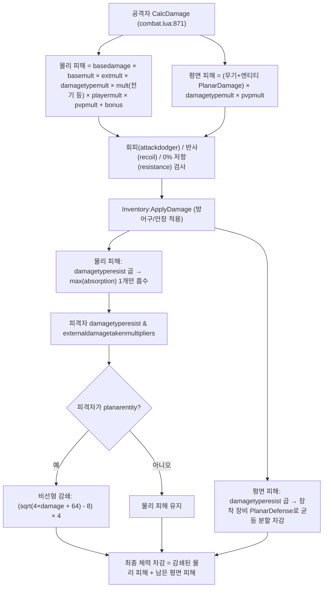

# 08. 전투, DST 방어구, 평면(Planar) 피해·방어와 진영 상성

> 상위 문서: [00. 목차](00_index.md) | 1차 출처: `scripts/components/combat.lua`, `scripts/components/inventory.lua`, `scripts/components/planarentity.lua`, `scripts/components/planardamage.lua`, `scripts/components/planardefense.lua`, `scripts/tuning.lua`

---

## 1. 전투 피해 계산 파이프라인 (`Combat:CalcDamage` & `GetAttacked_Internal`) (`[코드 확인]`)

DST의 전투는 **물리(일반) 피해(`damage`)**와 **특수(평면) 피해(`spdamage = { planar = ... }`)** 두 채널이 병렬로 계산되어 최종 합산된다.

### 1.1 전기 속성 증폭 공식 (`combat.lua:1200–1210`)
- 공격자 또는 무기에 `stimuli == "electric"`이 있고 피격자가 전기 면역이 아닐 때:
  $$\text{mult} = \text{electric\_damage\_mult} + \text{electric\_wet\_damage\_mult} \times \text{GetWetMultiplier()}$$
- 기본 `TUNING.ELECTRIC_DAMAGE_MULT = 1.5` (`tuning.lua:660`). 젖은 적에게는 최대 **2.5배** (`1.5 + 1.0`) 물리 피해가 들어간다! (예: 왈리의 볼트 염소 젤리 + 비/물풍선 조합)

### 1.2 공격 가능·경직·사거리 (`tuning.lua:108–113`, `combat.lua:780–843`)
- 기본 공격 주기: `WILSON_ATTACK_PERIOD = 0.4초`, 기본 공격력 `BASE_SURVIVOR_ATTACK = 34`, 기본 사거리 `DEFAULT_ATTACK_RANGE = 2`, 기본 경직 복구 `DEFAULT_HIT_RECOVERY = 0.75초`, 원거리 경직 복구 배율 `2×`.
- **보이드 공격 차단(`combat.lua:813–824`)**: 플레이어 근접 무기의 `attackrangesq > 4`일 때 중간 지점이 통행 불가(바다/심연)이면 공격 도달을 차단한다.

---

## 2. DST 방어구 규칙: 싱글플레이(DS)와의 결정적 차이 (`[코드 확인]`)

`scripts/components/inventory.lua` (L408–460) 및 `scripts/tuning.lua` (L33–34)에서 확인한 DST 전용 규칙:

1. **내구도 0.7배 하향**: `MULTIPLAYER_ARMOR_DURABILITY_MODIFIER = 0.7` (`tuning.lua:33`). 모든 일반 방어구 내구도는 싱글플레이의 70%다.
2. **다중 방어구 흡수율 비중첩 (`inventory.lua:415–453`)**:
   - 머리(투구)와 몸통(갑옷)을 동시에 착용해도 흡수율이 곱연산으로 중첩되지 않고, **가장 높은 흡수율 1개만 적용**된다:
     $$\text{absorbed\_percent} = \max_{i}(\text{amt}_i), \qquad \text{leftover\_damage} = \text{damage} \times (1 - \text{absorbed\_percent})$$
   - 대신 흡수된 피해의 내구도 소모는 각 방어구의 흡수율 비율로 분산된다:
     $$\text{armor\_damage}_i = \text{absorbed\_damage} \times \frac{\text{amt}_i}{\sum_j \text{amt}_j} + \text{bonus\_damage}_i$$
   - **[설계 해석]** 투구(80%) + 갑옷(80%)을 같이 입어도 체력 피해는 20% 그대로 들어오지만, **각 방어구의 내구도 수명이 2배로 늘어나고** 전투 중 한쪽이 깨져도 즉시 무방비가 되지 않는다. 또한 `damagetyperesist`(그림자/달 진영 저항)와 `PlanarDefense`는 두 부위가 **합산/곱연산**되므로 후반에는 세트 착용 이점이 극대화된다.

---

## 3. 평면(Planar) 피해·방어와 비선형 감쇄 (`[코드 확인]`)

엔드게임 균열(Rifts) 이후 콘텐츠의 핵심 전투 축이다 (`planarentity.lua`, `planardamage.lua`, `planardefense.lua`).

### 3.1 평면 개체의 일반 물리 피해 감쇄 공식 (`planarentity.lua:901–907`)
`planarentity` 컴포넌트를 가진 적(균열 변이 보스, 그림자 하수인, 천상의 후예, 워봇 등)은 일반 물리 피해를 다음 비선형 공식으로 대폭 깎아낸다:
$$d_{\text{eff}} = \left(\sqrt{4 \cdot d + 64} - 8\right) \times 4$$

| 원래 물리 피해 $d$ | 평면 개체 적용 피해 $d_{\text{eff}}$ | 실효 보존율 |
|---:|---:|---:|
| 34 (창) | 24.49 | 72.0% |
| 68 (다크 소드) | 41.32 | 60.8% |
| 100 | 54.16 | 54.2% |
| 200 | 85.46 | 42.7% |
| 500 (폭발/극딜) | 149.68 | 29.9% |

- 반면 **평면 피해(`spdamage.planar`)**는 이 감쇄를 **완전히 무시**하고 100% 직격한다.
- 역으로 플레이어가 평면 공격을 받을 때, 일반 방어구 흡수율(`80~95%`)은 **평면 피해를 전혀 막지 못한다!** 오직 장비의 **`PlanarDefense` 수치만큼 고정 감산**(`inventory.lua:438–460`)과 진영 저항(`damagetyperesist`)만 평면 피해를 줄일 수 있다.

### 3.2 진영 상성 (`damagetypebonus` / `damagetyperesist`) (`[데이터 확인]`)
- **달 진영 장비 (`ARMOR_LUNARPLANT*`)**: 각 부위 평면 방어 `10` + 달 저항 `0.9×` (2부위 세트 시 `0.75×`, `tuning.lua:1898`), 피격 시 평면 반사 피해 `10` (그림자 대상 `20`). 브라이트셰이드 검(`SWORD_LUNARPLANT`)은 물리 `38` + 평면 `30` (`+5` 세트 보너스).
- **그림자 진영 장비 (`ARMOR_VOIDCLOTH*`)**: 각 부위 평면 방어 `10` + 그림자 저항 `0.9×` (2부위 세트 시 `0.75×`), 공허의 낫(`VOIDCLOTH_SCYTHE`)은 물리 `38` + 평면 `18`, 연속 타격 시 세트 평면 피해 최대 `+24` (`6타` 누적, `3초` 감쇠).

---

## 4. 대표 무기·방어구 정밀 수치표 (`tuning.lua`) (`[데이터 확인]`)

### 4.1 주요 무기 (`wilson_attack = 34` 기준)
| 무기 ID | 물리 피해 | 평면 피해 | 내구도(회) | 특수 효과 |
|---|---:|---:|---:|---|
| `spear` (창) | 34 | 0 | 150 | 기본 무기 |
| `spear_wathgrithr` (전투 창) | 42.5 | 0 | 200 | 위그프리드 전용 |
| `spear_wathgrithr_lightning_charged` | 59.5 | **20** | 200 | 전기+돌진(`68`) |
| `hambat` (햄 배트) | 59.5 → 29.75 | 0 | 신선도 10일 | 내구도 무제한, 신선도 비례 최소 `0.5×` |
| `ruins_bat` (툴레사이트 몽둥이) | 59.5 | 0 | 200 | 이속 `+10%`, 그림자 촉수 소환, `SHADOW_LEVEL=2` |
| `nightsword` (어둠의 검) | 68 | 0 | 100 | 장착 중 정신력 감소, `SHADOW_LEVEL=2` |
| `pocketwatch_weapon` (알람 시계) | **81.6** *(노년)* | 0 | 연료식 | 완다 전용, 악몽 연료 충전 |
| `sword_lunarplant` (브라이트셰이드 검) | 38 | **30** | 200 | 세트 시 평면 `+5`, 대 그림자 특효 |
| `voidcloth_scythe` (그림자 사신) | 38 | **18** | 200 | 광역 베기, 대 달 특효, 세트 스택 최대 `+24` |
| `staff_lunarplant` (브라이트셰이드 지팡이) | 0 | **10** | 50 | 연쇄 튕김 `5회`(세트 `7회`), 대 그림자 `2×` |

### 4.2 주요 방어구 (`wilson_health=150`, `durability_mod=0.7` 환산)
| 방어구 ID | 슬롯 | 내구도 | 물리 흡수 | 평면 방어 | 특수 효과 |
|---|---|---:|---:|---:|---|
| `armorgrass` (풀 갑옷) | Body | 157.5 | 60% | 0 | 초반 임시용 |
| `armorwood` (나무 갑옷) | Body | 315 | 80% | 0 | 표준 초반 갑옷 |
| `footballhat` (풋볼 헬멧) | Head | 315 | 80% | 0 | 표준 전투 투구 (가방 병용) |
| `wathgrithrhat` / `improved` | Head | 525 / 682.5 | 80% | 0 | 위그프리드 전용 |
| `armormarble` (대리석 갑옷) | Body | 735 | **95%** | 0 | 이속 `0.7×` |
| `armor_sanity` (밤의 갑옷) | Body | 525 | **95%** | 0 | 피해의 `10%`를 정신력으로 전환 |
| `ruinshat` / `armorruins` | Head / Body | 840 / 1,260 | **90%** | 0 | 왕관 `33%` 확률 `4초` 무적 보호막(쿨 `5s`) |
| `dreadstonehat` / `armordreadstone` | Head / Body | 840 / 840 | **90%** | **5** | 정신력 소모 자동 수리, 그림자 저항 `0.9×` |
| `wagpunkhat` / `armorwagpunk` | Head / Body | 730 / 730 | 85% | **5** | 연속 타격 시 이속 `1.10~1.30×` 가속 |
| `lunarplanthat` / `armor_lunarplant` | Head / Body | 830 / 830 | 80% | **10** | 달 저항 `0.9×`(세트 `0.75×`), 평면 반사 `10`(그림자 `20`) |
| `voidclothhat` / `armor_voidcloth` | Head / Body | 830 / 830 | 80% | **10** | 그림자 저항 `0.9×`(세트 `0.75×`), 그림자 면역 |
