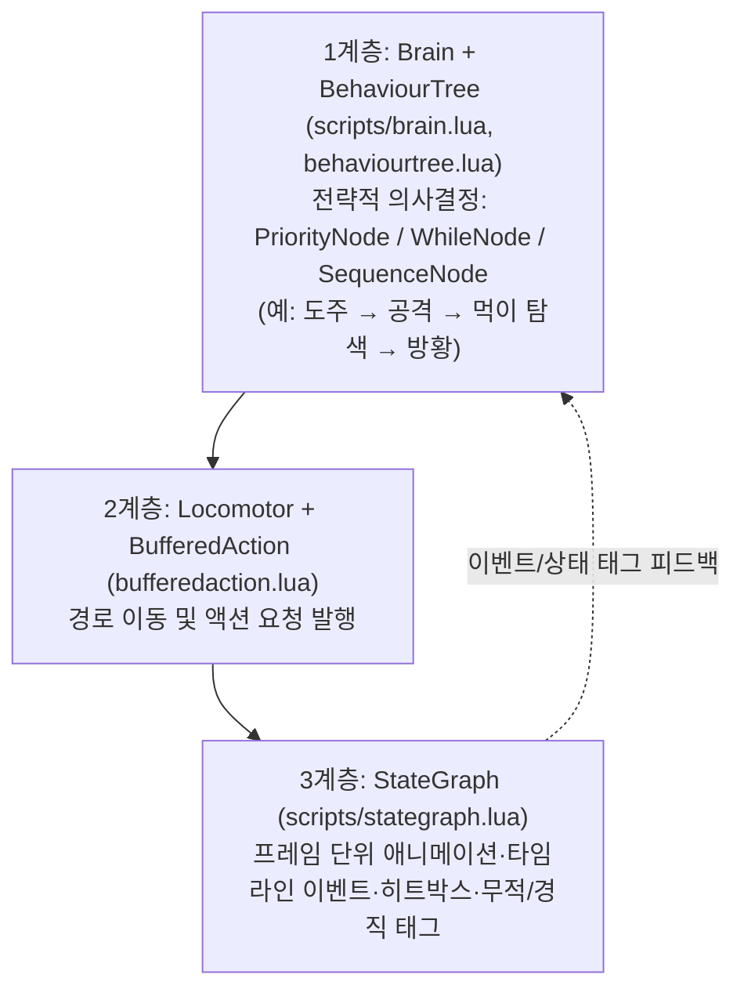

# 09. 생물 AI, 습격, 거인·레이드 보스와 균열(Rifts)

> 상위 문서: [00. 목차](00_index.md) | 1차 출처: `scripts/brain.lua`, `scripts/behaviourtree.lua`, `scripts/stategraph.lua`, `scripts/components/hounded.lua`, `scripts/components/riftspawner.lua`, `scripts/tuning.lua`

---

## 1. 3계층 생물 AI 아키텍처 (`[코드 확인]`)

DST의 199개 `brains`, 29개 `behaviours`, 264개 `stategraphs`는 엄격한 **3계층 책임 분리**를 따른다.

- **StateGraph(SG)**가 실제 공격 판정 프레임(`TimeEvent(x*FRAMES, ...)`), 피격 경직(`hit`), 슈퍼아머(`nointerrupt`), 쿨다운을 제어하므로, 플레이어의 **카이팅(공격 유도 → 회피 → 반격)** 타이밍은 전적으로 보스 SG의 타임라인과 `ATTACK_PERIOD`에서 비롯된다.
- **충돌 마스크 계층 (`constants.lua:54–68`)**: `SMALLOBSTACLES(8192)`는 일반 캐릭터와 충돌하지만 `GIANTS(16384)`(거인)와는 충돌하지 않아 거인이 작은 장애물·나무를 짓밟고 통과할 수 있다.

---

## 2. 주기적 습격: 하운드 & 동굴 웜 (`hounded.lua`, `tuning.lua`) (`[데이터 확인]`)

- **경고 단계 (`constants.lua:149–161`)**: `LVL1~LVL4` (지상 하운드), `LVL1_WORM~LVL4_WORM` (동굴 심연 벌레), `WORM_BOSS` (그레이트 데프스 웜, 25일 주기 `WORM_BOSS_DAYS = 25`).
- **하운드 기본 스탯**: 일반 하운드 HP `150`, 피해 `20`, 공격주기 `2초`, 이속 `10`(수영 `3.5`). 변이 하운드 HP `100`, 피해 `25`. 계절에 따라 불 하운드(여름/가을)·얼음 하운드(겨울/봄) 혼합.
- **웨스 특이점**: `WES_HOUND_TARGET_MULT = 2.0` (`tuning.lua:2721`) — 멀티플레이 파티 내 하운드 표적 우선순위 2배.

---

## 3. DST 거인·레이드·엔드게임 보스 전수 스탯표 (`tuning.lua`) (`[데이터 확인]`)

> DST는 멀티플레이 협동을 전제로 싱글플레이 거인의 체력을 **2배**로 늘리고, 전용 레이드/엔드게임 보스는 **10,000 ~ 99,999 HP** 및 **평면 피해/방어**로 설계했다. `vs플레이어 배율`이 `0.5`인 보스는 플레이어에게 기본 공격력의 절반만 들어간다.

| 분류 | 보스명 (ID) | 체력 (HP) | 기본 피해 (vs플레이어) | 평면 피해 | 공격주기 | 핵심 기믹 / 출현 조건 |
|---|---|---:|---:|---:|---:|---|
| **계절 거인** | 외눈사슴 (`deerclops`) | **4,000** | 150 (`×0.5=75`) | 0 | 4초 | 겨울 중반, 광역 빙결·강력한 광기 오라 |
| **계절 거인** | 무스/구스 (`moose`) | **6,000** | 150 | 0 | 3초 | 봄 둥지 9곳 중 스폰, 무장해제 포효, 모슬링 부화 |
| **계절 거인** | 개미사자 (`antlion`) | **6,000** | 모래성/가시 | 0 | 4→2초 | 여름 오아시스 사막, 조공 미납 시 거점 싱크홀 생성 |
| **계절 거인** | 곰소리 (`bearger`) | **6,000** | 175 | 0 | 3초 | 가을, 식량 약탈·강력한 지면 강타·하품(수면) |
| **레이드(지상)** | 용파리 (`dragonfly`) | **27,500** | 150 / 분노 **300** | 0 | 4 / 3초 | 용암 사막 상주, 용암충 소환·분노 시 3연 강타 |
| **레이드(지상)** | 여왕벌 (`beequeen`) | **22,500** | 120 | 0 | 2초 | 거대 벌집, 그럼블 비 소환·꿀길 감속(`0.4×`)·비명 |
| **레이드(지상)** | 클라우스 (`klaus`) | **10,000** *(2페이즈 +5,000)* | 75 *(격노 증폭)* | 0 | 3초 | 겨울 전리품 주머니, 불/얼음 사슴 동반, 비전투 `25 HP/s` 재생 |
| **레이드(지상)** | 공포의 눈 / 쌍둥이 (`eyeofterror` / `twinofterror`) | **5,000** / **각 10,000** | 125(`×0.5`) / **250** | 0 | 3초 | 밤 한정(테라리움 활성화), 65% 변신·돌진(`speed=15`) |
| **레이드(해상)** | 말바트로스 (`malbatross`) | **5,000** | 150 (`×0.5=75`) | 0 | 4초 | 어군(Shoal) 출현, 깃털 투척·파도 유발 |
| **레이드(해상)** | 게왕 (`crabking`) | **12,000+** *(보석 가산)* | 150 (`×0.5`) + 40집게 | 0 | 4초 | 9보석 소켓 커스터마이징, 집게·간헐천·빙결·자가 회복 |
| **레이드(해상)** | 상어보이 (`sharkboi`) | **8,000** | 75 | 0 | 3초 | 겨울 빙산 아레나, 빙판 축소·돌진 어뢰 |
| **레이드(동굴)** | 고대 수호자 (`minotaur`) | **10,000** | 100 | 0 | 2초 | 유적 미궁, 고속 돌진(`speed=17`)·기둥 충돌 스턴·촉수 |
| **레이드(동굴)** | 토드스툴 / 미저러블 (`toadstool` / `_dark`) | **52,500** / **99,999** | 단계별 상승 | 0 | 단계별 | 독버섯 나무 방어력 증폭·포자 구름(`20` 도트)·폭탄 |
| **레이드(동굴)** | 악몽 늑대돼지 (`daywalker`) | **10,000** | 75 / X할퀴기 `150` / 강타 `225` | 0 | 4~6초 | 동굴 기둥 3개 해방, 피로도 루프·비전투 `25 HP/s` 재생 |
| **엔드게임(그림자)** | 고대 연료직공 (`stalker_atrium`) | **16,000** *(2페이즈 10,000)* | 200 | 0 | 3초 | 유적 아트리움, 뼈 감옥·우븐 섀도우 회복·정신제어·무적 방패 → **처치 시 유적 리셋 & 그림자 균열 해금 조건** |
| **엔드게임(달)** | 천상의 대변자 (`alterguardian_phase1~3`) | **10,000 + 20,000 + 22,500** *(시작 13k/14k)* | 166.7 / 133.3 / 150 (`×0.75`) | 0 | 7.5/6/5초 | 달섬 3제단 결합 소환, 3연속 페이즈·레이저(`120`)·수면 함정 → **처치 시 달 폭풍/달 균열 해금** |
| **균열(달 변이)** | 결정화 외눈사슴 / 갑주 곰소리 / 빙의 바그 (`mutated_*`) | **6,000 / 8,000 / 3,000** | 150 / 175 / 20(화염) | **30** | 3초 | 달 균열 활성 후 처치 시체 빙의 변이, `planarentity` 적용 |
| **균열(달 최종)** | 워봇 (`wagboss_robot`) | **22,500** | 200 (`×0.75`) | **30** *(빔 50)* | 3.5→2초 | 와그스태프 아레나, 미사일·드론 해킹·궤도 폭격 |
| **균열(달 최종)** | 천상의 후예 (`alterguardian_phase4_lunarrift`) | **16,000** | 225 (`×0.75`) | **35** *(초신성 50)* | 3→2.75초 | 달 균열 최종 보스, 초신성(`40s` 쿨) |
| **균열(그림자)** | 그림자 하수인 4종 (`shadowthrall_*`) | **800~1,200** | 20~35 | **20~30** | 4초 | 손/뿔/날개/입 협동 패턴, 그림자 균열 출현 |
| **균열(그림자)** | 그림자 대심연 벌레 (`worm_boss_shadow`) | **6,000** | 20 (`×0.5`) | **10** | 가변 | 50% 이하 격노, 삼킴 시 폭발 피해 `1.5×` |
| **균열(그림자)** | 찰리 보스 / 슈라우든 (`charlie_boss` / `shrouden`) | 코드 연동 | — | **30 / 35~40** | — | 최신 `rifts` 아레나(`charliearenawatcher`, 가시 폭발 평면 `40`) |

---

## 4. 균열(Rifts) 엔드게임 스포너 루프 (`riftspawner.lua`, `tuning.lua`) (`[코드 확인]`)

`scripts/components/riftspawner.lua` (L183–250)와 `tuning.lua` (L7625–7786):
- **달 균열 (지상)**: 천상의 대변자 격파(또는 월드 설정 `"always"`) 후 `LUNAR_RIFTS_ACTIVE` 태그 활성화 → `wagpunk_manager`도 동시 활성화.
  - 균열은 3단계(`RIFT_LUNAR1_MAXSTAGE = 3`)로 성장(단계당 `4~5일`), `0.75~1.25일`마다 순수한 광채 결정(`lunarrift_crystals`, 채광 `20회`) 생성.
  - 치명적 브라이트셰이드 식물·달 우박·균열 변이 보스 출현.
- **그림자 균열 (동굴)**: 고대 연료직공 격파 후 동굴 샤드에 `SHADOW_RIFTS_ACTIVE` 활성화.
  - 3단계 성장(`4~5일`/단계), `15일` 후 자동 폐쇄 후 재스폰(`RIFT_SHADOW1_CLOSE_TIME = 15일`).
  - 동굴 산성비 유발, 지진 방해(`0.1` 확률), 그림자 기생충(`shadowthrall_parasite`) 및 그림자 하수인 스폰 → 공포석(Dreadstone)·공허의 천(Voidcloth) 파밍 루프 완성.
