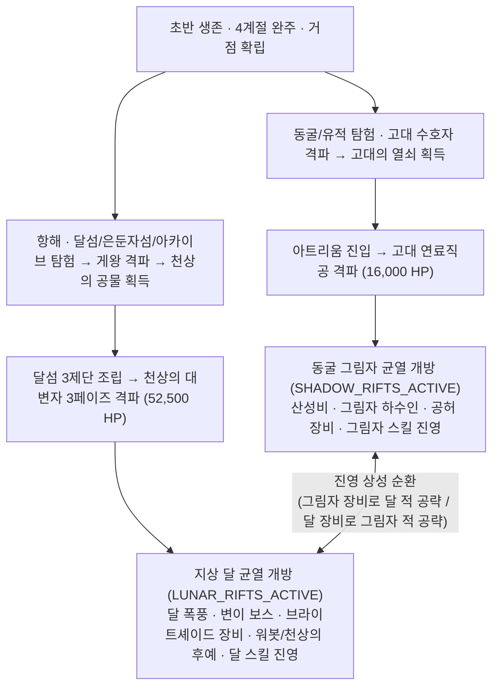

# 10. 해상 항해, 동굴·유적·아카이브·볼트와 2축 엔드게임

> 상위 문서: [00. 목차](00_index.md) | 1차 출처: `scripts/components/boatphysics.lua`, `scripts/components/walkableplatform.lua`, `scripts/components/nightmareclock.lua`, `scripts/components/archivemanager.lua`, `scripts/tuning.lua`

---

## 1. 해상 항해와 보트 물리 시뮬레이션 (`[코드 확인]`)

DST의 바다(Turn of Tides 이후)는 1인 카누가 아니라 **여러 플레이어가 위에 서서 걸어 다니며 시설(화덕·상자·돛·키·닻·대포·자석)을 짓는 이동식 플랫폼(`walkableplatform`)**이다.

### 1.1 보트 기본 물리 상수 (`tuning.lua` `BOAT` 테이블)
| 항목 | 상수 | 값 |
|---|---|---:|
| 기본 목재 보트 체력 / 반경 / 질량 | `BOAT.HEALTH` / `RADIUS` / `MASS` | **200 HP** / **반경 4** / **질량 500** |
| 용선(Dragon Boat) 체력 / 반경 | `DRAGON_BOAT_HEALTH` / `RADIUS` | **200 HP** / **반경 3.0** |
| 단일 충돌 최대 선체 피해 | `BOAT.MAX_HULL_HEALTH_DAMAGE` | **70** |
| 최대 허용 속도 / 힘 속도 상한 | `MAX_ALLOWED_VELOCITY` / `MAX_FORCE_VELOCITY` | **10** / **3.5** |
| 기본/최대 항력(Drag) | `BASE_DRAG` / `MAX_DRAG` | **0.2** / **1.5** |
| 키(Rudder) 선회 속도 | `RUDDER_TURN_SPEED` | **0.6 rad/s** |
| 누수 임시 막기 유지 시간 | `BOAT_LEAK_PLUGGED_TIME` | **20 ± 5초** |
| 해초 패치 수명 (소/중 누수) | `BOAT_REPAIR_KELP_REPAIR_TIME_*` | **0.75일** / **0.50일** |

### 1.2 다중 돛(Mast) 및 자석(Magnet) 속도 체감 공식 (`boatphysics.lua:344–384`)
보트에 돛을 여러 개 달아도 속도가 선형으로 무한 증가하지 않고 **오름차순 정렬 후 `0.7^k` 기하급수 체감**이 적용된다:
$$v_{\max} = \min\!\left(\left(\sum_{k=0}^{n-1} v_{\text{mast}, k} \cdot 0.7^k + \sum_{j=0}^{m-1} v_{\text{magnet}, j} \cdot 0.7^j\right) \cdot \text{max\_velocity} \cdot \prod \text{drag\_mod},\; 10\right)$$

### 1.3 주요 해상 콘텐츠
- **달섬(Moon Island)**: 본토와 바다로 분리된 5개 태스크 대륙. 진입 시 정신력이 달 계몽(`SANITY_MODE_LUNACY`)으로 전환. 3개 달 제단 조각을 조합해 천상의 대변자 루트로 진입.
- **은둔자 섬(`hermitcrab_01`)**: 진주 할머니(Pearl) 호감도 퀘스트 및 상점(`HERMITCRABSHOP`, 차 상점 `hermitcrab_teashop`), 호감도 달성 시 **진주의 진주(Pearl's Pearl)** 획득(게왕 전투에 필수).
- **원숭이 섬(`monkeyisland_01`)**: 화약 원숭이 해적 습격(`pirateraids`), 선박 대포(`BOAT_CANNON_*`), 저주받은 장신구(`wonkey` 변신), 원숭이 여왕 거래(바나나·항구 부두 키트).
- **수몰림(`OCEAN_WATERLOG`)**: 거대 바위나무(Knobbly Tree) 아래 그늘(여름 과열 방지 + 강우 차단), 무화과 수확.

---

## 2. 동굴(Caves), 고대 유적(Ruins), 아카이브와 볼트 (`[코드 확인]`)

### 2.1 동굴 환경 특성
- **기온 완충**: 여름 폭염과 겨울 한파가 지상보다 크게 완화되므로, 동굴은 여름 피서 거점으로 활용된다.
- **지진(Quaker)**: 주기적으로 천장에서 광물·부싯돌·보석·토끼가 낙하(그림자 균열 활성 시 `0.1` 확률로 그림자 방해).
- **동굴 시야 카메라**: `FollowCamera` 최대 줌이 지상 `50`에서 동굴 **`35`**로, 피치가 `30~60°`에서 **`25~40°`**로 좁혀져 폐쇄감을 연출한다 (`followcamera.lua:87–93`).

### 2.2 고대 유적과 악몽 주기 (`nightmareclock.lua`, `tuning.lua:2772`)
유적(`Nightmare` 태그 구역)은 지상 시계와 독립된 **4단계 악몽 주기**로 순환한다 (`NIGHTMARE_SEGS`, 변동폭 `±3` 세그먼트):

| 단계 | 기본 세그먼트 (`×30s`) | 환경·생태 변화 (`[코드 확인]`) |
|---|---:|---|
| `calm` (평온) | **12세그 (6분)** | 붉은 조명 소멸, 악몽 균열 폐쇄, 그림자 스폰 없음 |
| `warn` (경고) | **3세그 (1.5분)** | 경고 사운드(`nightmare_warning`), 붉은 맥동 시작 |
| `wild` (광란) | **5세그 (2.5분)** | 악몽 균열 완전 개방, 그림자 괴물 대량 출현, 동굴 원숭이 그림자화 |
| `dawn` (여명) | **2세그 (1분)** | `nightmare_end` 사운드, 광란 잔존 괴물 소멸 시작 |

### 2.3 고대 아카이브(`ArchiveMaze`)와 고대 금고(`Vault`)
- **고대 아카이브 (`archivemanager.lua`, `archive_worldgen.lua`)**: 달 버섯 숲 너머의 고대 지식 저장소. 오케스트리나 퍼즐·공명기·아스트랄 감지기를 통해 **천상의 지식(달 제단·천상의 대변자)** 단서와 고대 청사진(`turfcraftingstation`, 툴레사이트 파편 정제 등)을 해금.
- **고대 금고 (`vault_lobby`, `vault_vault`, `VAULT_REFINE`)**: 설치본 최신 콘텐츠로 `vault_refiner_pedestal`, `vaultorbteleporter`, `vault_pillar_guardbrain`, `play_the_vault.lua` 등 전용 퍼즐·텔레포트·정제 스테이션 구조를 포함한다.

---

## 3. DST 2축 엔드게임 진행 로드맵 (`[설계 해석]`)

DST의 장기 진행은 일직선 퀘스트가 아니라 **그림자(동굴/유적) 축**과 **달(바다/달섬/폭풍) 축**이 맞물리는 이중 나선 구조다.

**[설계 해석]** 두 축은 서로의 카운터 장비를 공급한다. 브라이트셰이드(달) 장비는 그림자 진영 적에게 추가 피해/반사를 주고, 공허(그림자) 장비는 달 진영 적에게 강하다. 이 교차 상성이 단일 최종 장비 고착화를 방지하고 두 샤드(지상+동굴)를 끝까지 오가게 만든다.
