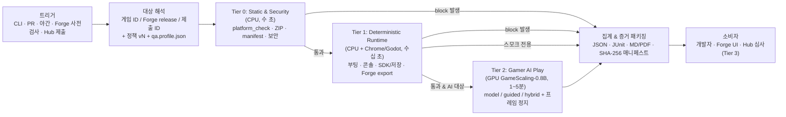
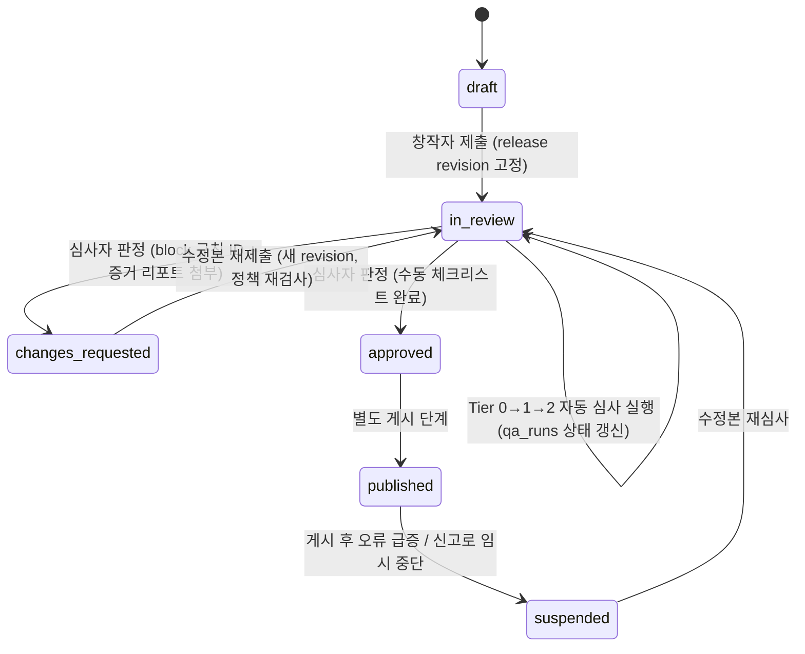
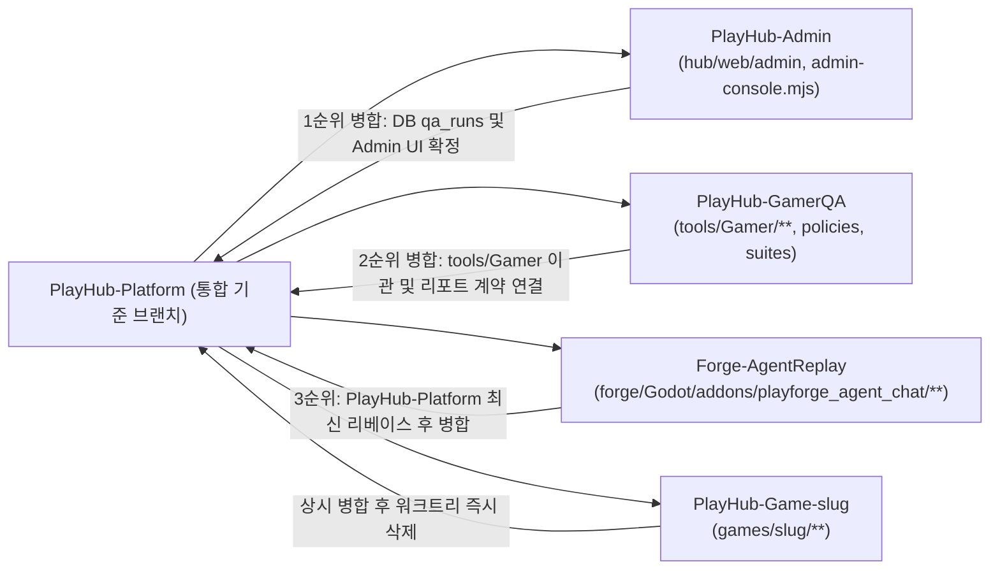

# GamerQA 설계·운영 계획 (v0.2, 2026-11-19)

GamerQA는 기존 `tools/Gamer/`의 **GameScaling-0.8B-S3 기반 AI 모델 플레이 QA 프로토타입**과 PlayHub의 기존 정적·브라우저·Forge 테스트를 하나의 파이프라인으로 통합하는 품질 검사·심사 시스템입니다.

1. **Hub · Forge 게임 자동화 테스트**: 정적/보안 검사, 결정론적 스모크, AI 모델 플레이(`model`/`guided`/`hybrid`) 회귀
2. **Hub 제출 게임 자동/수동 심사 및 검수**: 창작자 제출물의 계층형 자동 사전 심사, 증거 리포트(MD/PDF/해시), 심사자 수동 검수 연동
3. **운영 계획**: GPU 추론 서버·격리 실행 환경, 정책 버전 관리, SLA, 증거 보존, 게시 후 모니터링

> 작업 브랜치: `PlayHub-GamerQA` (`PlayHub-Platform` `22fcf1b`에서 분기).
> `PlayHub-Platform/tools/Gamer/`의 미커밋 프로토타입 자산을 정리·편입한 뒤 `PlayHub-Platform`으로 병합합니다.

---

## 1. 기존 자산 현황 (실측 기준)

### 1.1 `PlayHub-Platform/tools/Gamer/` (미커밋 프로토타입)

| 구성요소 | 현재 파일/폴더 | 크기/상태 | GamerQA 편입 방향 |
|---|---|---|---|
| 추론 서버 | `inference_server.py`, `download_model.py`, `Setup/Run/Smoke-Inference.ps1`, `test_inference_server.py` | 코드 + 단위 테스트 10개 통과 | `tools/Gamer/inference/` 공용 서비스로 승격 |
| 모델 플레이 하네스 | `playhub_model_qa.mjs`, `Run-ModelQA.ps1`, `Run-PlayHubBrowser.mjs`, `playhub_model_qa.test.mjs` | Chrome 실제 입력 + 프레임 정지 + 3모드(`model`/`guided`/`hybrid`) | `tools/Gamer/GamerQA/suites/ai-play/`로 일반화 |
| 게임별 플래너 | `fortress_planner.mjs`, `besiege_planner.mjs` (+ `.test.mjs`) | 물리/전투 제어기, 테스트 통과 | `GamerQA/planners/` 또는 `games/<id>/qa/`로 플러그인화 |
| 리포트 생성기 | `write_qa_report.py`, `write_improved_qa_report.py`, `export_qa_pdf.py`, `Reports/2026-11-18-*` | MD + `evidence-manifest.json` + PDF | `GamerQA/reporters/`로 통합 |
| 기존 검증 래퍼 | `Verify-Client.ps1`, `Verify-PlayHub.ps1` | 오프라인 파서 + PlayHub 핵심/브라우저 스모크 | `GamerQA` CLI 하위 명령으로 흡수 |
| 외부 코드 (`gamescaling`) | `gamescaling/` (`THUSI-Lab/GameScaling`, Apache-2.0, `843a320`) | 0.9 MB, nested `.git` | `git subtree --squash`로 `vendor/gamescaling` 편입 (§4) |
| 외부 코드 (`upstream`) | `upstream/` (`RainBowLuoCS/Gamer`, Apache-2.0, `69a4f98`) | 0.1 MB, nested `.git` (`readme.md` 프롬프트만 참조 중, Streaming-vLLM 미공개) | 프롬프트 고정 추출 + `vendor/gamer-upstream` subtree, Streaming-vLLM 공개 시 fork 검토 (§4) |
| 대용량 로컬 런타임/가중치 | `.venv-inference/` (4.58 GB), `models/GameScaling-0.8B-S3/` (2.13 GB), `runtime/node-*` (138 MB), `.venv/` (30 MB), `TestResults/` (69 MB), `output/`, `tmp/` | 총 ~6.95 GB, **Git 제외 필수** | `.gitignore` 보강 + `GAMER_CACHE_ROOT`로 워크트리 간 공유 |

### 1.2 PlayHub 기존 테스트·심사 자산 (소유권 유지, 래핑 재사용)

| 자산 | 위치 | GamerQA 역할 |
|---|---|---|
| 정적 카탈로그·ZIP 검사 (Python) | `hub/automation/platform_check` | Tier 0 `suites/static` 호출 (업로드 ZIP 정책 단일 관리) |
| 브라우저 통합 검사 (Playwright) | `hub/qa/webgames-browser.mjs`, `community-browser.mjs` | Tier 1 `suites/runtime-web` 기반 |
| 로컬 게임 호스트·SDK | `tools/local-games` (`sdk-host`, `catalog-smoke`) | 격리 실행 호스트 |
| 게임별 통합 테스트 | `games/<id>/tests` (`hades`, `kingdom-rush` 등) | 게임 소유 유지, 자동 탐색 실행 |
| Forge 테스트·빌드·검증 | `forge/Tests/*.test.cjs`, `forge/Tools/{run-tests,regression-loop,test-godot-web,export-godot-project,deployment-zip-validator}.cjs` | Tier 1 `suites/forge`, `adapters/forge` |
| Hub 제출 상태 머신 | `hub/server/creator-review.mjs` (`draft → in_review → changes_requested / approved`) | Tier 3 심사 연동 지점 (승인 ≠ 게시) |
| 범용 멀티엔진 러너 | 형제 워크트리 `game-test-framework` (Python) | 선택 어댑터 (Godot/Web Visible RHI 수동 확인) |

### 1.3 이관 시 즉시 수정이 필요한 현재 프로토타입 제약

1. `playhub-target.json`의 `projectRoot`가 `D:\Github\GoDotProjects-worktrees\PlayHub-Platform`으로 하드코딩됨 → 워크트리 상대경로 자동 해석 + `--project-root` / 환경변수 override로 변경.
2. `playhub_model_qa.mjs`에 `fortress-blue`, `besiege` 시나리오와 텔레메트리 훅이 하드코딩됨 → `games/<id>/qa.profile.json` + **제로-설정 fallback**(`game.manifest.json`의 `title`/`instructions`/`rules`/`controls` 자동 주입)으로 분리.
3. `playhub_model_qa.mjs:79`가 `upstream/readme.md`에서 정규식으로 시스템 프롬프트를 추출 → 버전 고정 프롬프트 파일(`policies/prompts/gamer-system.v1.txt`)로 분리해 업스트림 README 변경에 의한 파손 차단.
4. `tools/Gamer/.gitignore`에 `output/`, `tmp/` 누락 및 nested `.git` 정리 필요.

---

## 2. 폴더 구조

**원칙**: 대용량 모델·추론 서버·외부 벤더는 `tools/Gamer/` 공용 계층에 두고, 테스트·심사·운영 로직은 `tools/Gamer/GamerQA/`에 모아 추후 `GamerBot` 등 다른 에이전트 도구와 추론 인프라를 공유할 수 있게 합니다.

```text
tools/Gamer/
├─ README.md                      # Gamer 도구군 개요 및 빠른 시작
├─ .gitignore                     # .venv*, models/, runtime/, TestResults/, output/, tmp/, __pycache__/
├─ vendor/                        # 외부 오픈소스 (nested .git 제거, git subtree로 관리)
│  ├─ gamescaling/                #   THUSI-Lab/GameScaling (Apache-2.0, subtree --squash)
│  └─ gamer-upstream/             #   RainBowLuoCS/Gamer (Apache-2.0, 문서·스펙 참조용)
├─ inference/                     # 공용 로컬 모델 추론 서비스 (기존 루트에서 이동)
│  ├─ inference_server.py         #   HTTP 127.0.0.1:8765 (/health, /act)
│  ├─ download_model.py           #   HF 리비전 고정 + SHA-256 검증
│  ├─ requirements-client.lock.txt
│  ├─ requirements-inference.lock.txt
│  ├─ Setup-Inference.ps1
│  ├─ Run-Inference.ps1
│  ├─ Smoke-Inference.ps1
│  └─ tests/test_inference_server.py
└─ GamerQA/                       # Hub·Forge 자동화 테스트 + 제출 심사 + 운영 본체
   ├─ README.md
   ├─ PLAN.md                     # 이 문서
   ├─ Run_GamerQA.bat             # tools/Run_*.bat 규칙 준수 (--check 지원)
   ├─ package.json                # Node 24+, playwright 버전 hub/qa와 통일
   ├─ bin/gamerqa.mjs             # CLI: run | review | report | verify | policy | triage
   ├─ core/                       # 오케스트레이터, Tier 스케줄러, 작업 큐, 격리 실행기, 결과 집계
   ├─ schemas/                    # qa-profile / qa-run / review-report / evidence-manifest JSON Schema
   ├─ policies/                   # 버전 불변 심사 정책 (변경 시 vN+1 신설 + fixtures 회귀)
   │  ├─ review-policy.v1.json    #   규칙 ID, 심각도(block/major/minor/info), Tier 매핑
   │  ├─ prompts/gamer-system.v1.txt
   │  └─ checklists/manual-review.v1.md
   ├─ suites/
   │  ├─ static/                  # Tier 0: platform_check, manifest, ZIP, 용량·라이선스·externalNetwork
   │  ├─ security/                # Tier 0~1: CSP, 허용 목록 밖 요청 차단, eval/금지 API, 저장소 한도
   │  ├─ runtime-web/             # Tier 1: hub/qa, tools/local-games, 부팅·콘솔·첫프레임·저장·리사이즈
   │  ├─ runtime-godot/           # Tier 1: godot --headless --script, Web export 로딩
   │  ├─ forge/                   # Tier 1: Forge 템플릿→프로젝트→export→ZIP 검증→실행 스모크
   │  └─ ai-play/                 # Tier 2: 기존 playhub_model_qa.mjs 일반화 (model/guided/hybrid)
   ├─ planners/                   # 선택형 게임별 제어기 (fortress_planner.mjs, besiege_planner.mjs 등)
   ├─ reporters/                  # JSON, JUnit XML, HTML, Markdown, PDF(export_qa_pdf.py), SHA-256 매니페스트
   ├─ adapters/
   │  ├─ hub/                     # PlayHub-Admin의 qa_runs 계약 준수, 보고서·증거 연결
   │  ├─ forge/                   # release/export 해석, 제출 전 사전 검사 API
   │  └─ game-test-framework/     # (선택) ProjectTests.json 생성·Visible RHI 수동 검증 호출
   ├─ ops/
   │  ├─ RUNBOOK.md               # 장애·GPU 큐 적체·롤백·게시 중단 절차
   │  ├─ schedules.json           # PR/야간/주간 스케줄 정의
   │  └─ quarantine.json          # 불안정(flaky) 검사 격리 목록 (만료일 필수)
   ├─ fixtures/                   # 정상·위반 샘플 게임 패키지 (정책 회귀용)
   └─ tests/                      # GamerQA 단위 테스트 (기존 *.test.mjs 포함)
```

### 게임·산출물·캐시 배치 규칙

- **게임별 QA 프로필 (게임 폴더 소유)**: `games/<id>/qa.profile.json`
  - 시나리오 목표, 허용 controller 모드(`model`/`guided`/`hybrid`), 텔레메트리 훅(선택), 타임아웃, 예외 규칙(사유·만료일 필수).
  - 프로필이 없는 게임(신규 제출 게임 포함)은 `game.manifest.json`만으로 Tier 0 + Tier 1 + Tier 2(`model` 제로-설정 탐색) 실행.
- **실행 산출물 (Git 제외)**: `artifacts/gamerqa/<run-id>/` (`report.json`, `junit.xml`, `report.html`, `REPORT.md`, `REPORT.pdf`, `evidence-manifest.json`, `steps.jsonl`, 스크린샷).
- **대용량 로컬 캐시 (워크트리 외부 공유 권장)**: 환경변수 `GAMER_CACHE_ROOT` (예: `D:\Github\.cache\Gamer`)에 `models/`(2.13 GB), `.venv-inference/`(4.58 GB), `runtime/`을 두고, 미설정 시 `tools/Gamer/` 내부 경로를 fallback으로 사용. 워크트리를 여러 개 만들어도 6.7 GB를 중복 다운로드하지 않음.

---

## 3. 동작 흐름

### 3.1 계층형 실행 파이프라인 (Tier 0 → Tier 3)

GPU 추론 비용과 실행 시간을 아끼기 위해 **빠르고 저렴한 검사에서 차단(Fail-fast)**하고, 통과한 대상만 AI 플레이(GPU)와 사람 심사로 넘깁니다.



- 모든 실행 결과에 `policyVersion`, `targetHash`(파일 트리/release 해시), `modelRevision`(`e4115961...`), `runner`(OS, Chrome, Godot, CUDA 버전)를 기록해 재현성을 보장합니다.
- 상태 값은 `pass | warn | fail | error | skip`이며, **`skip`과 `error`는 절대 통과로 판정하지 않습니다.**

### 3.2 Hub 카탈로그 & Forge 자동화 테스트 흐름

| 대상 | 트리거 | 실행 범위 | AI 컨트롤러 모드 | 산출물 활용 |
|---|---|---|---|---|
| **Hub 변경 게임** | 커밋 전 / PR (`gamerqa run --changed`) | Tier 0 + Tier 1 | 생략 (옵션 `--with-ai`) | 개발자 즉시 피드백 |
| **Hub 카탈로그 전체** | 야간 배치 | 전 게임 Tier 0 + Tier 1, 핵심 게임 Tier 2 | `guided` / `hybrid` (회귀용) | `games/PLAYABLE_STATUS.md` 갱신 후보 생성 (자동 커밋 금지) |
| **Forge 템플릿 4종** | 템플릿/엔진 변경 시 | `export-godot-project` → `deployment-zip-validator` → `test-godot-web` / `runtime-godot` | 핵심 템플릿 `guided` 스모크 | 템플릿 품질 게이트 |
| **Forge 창작자 사전 검사** | Forge UI "제출 전 검사" 버튼 | Hub 심사와 **동일한 `review-policy.vN`**의 Tier 0 + Tier 1 (+ 선택 Tier 2 `model`) | `model` (제로-설정) | 제출 전 반려 사유 사전 해소 |

### 3.3 Hub 제출 게임 자동/수동 심사 흐름



- **기존 DB 및 `PlayHub-Admin` 완벽 호환**:
  - `hub/server/creator-review.mjs`의 `creator_submissions.status` CHECK 제약(`draft`, `in_review`, `changes_requested`, `approved`)은 변경하지 않습니다.
  - 수동 심사 UI와 `qa_runs` / `submission_checklists` 테이블 DDL은 **`PlayHub-Admin` 브랜치(`hub/server/admin-console.mjs`, `hub/web/admin/*`)가 소유**합니다. `PlayHub-GamerQA`는 `hub/web/admin/*`을 직접 수정하지 않고 아래 **무충돌 파일·DB 계약**만 생산합니다:
    - **DB `qa_runs` 컬럼 계약**: `(id, submission_id, target_type['catalog'|'game'|'submission'|'forge_template'|'forge_release'|'portable'], target_id, release_revision, policy_version, qa_status['pending'|'running'|'passed'|'warned'|'failed'|'error'], score, report_path, summary_json, started_at, finished_at)`
    - **리포트 파일 계약**: `artifacts/gamerqa/<runId>/report.json` (`target`/`gameId`, `policyVersion`, `status`, `summary`, `generatedAt`/`finishedAt`)
    - **AI QA 상태 계약**: `tools/Gamer/TestResults/inference-health.json`, `inference-smoke.json`, `<runId>/summary.json` (또는 `artifacts/gamerqa/`에서 미러링)
    - **정책·운영 파일 계약**: `tools/Gamer/GamerQA/policies/*.json` (`version`, `rules[]`, `updatedAt`), `ops/quarantine.json` (`items[]`), `ops/schedules.json` (`schedules[]`)
- **제출 게임에서의 AI 플레이(Tier 2) 동작 방식**:
  - 외부 창작자 제출 게임에는 `fortress_planner` 같은 전용 플래너가 없으므로 **`model` 모드(제로-설정)**로 실행합니다.
  - `game.manifest.json`의 `title`, `instructions`, `rules`, `controls`를 프롬프트에 자동 주입해 15~30스텝 동안 조작합니다.
  - 평가 지표(객관적·비주관적 기준): **부팅 성공, 입력 후 화면 변화(프레임 diff, 먹통/프리징 감지), 치명적 JS/WebGL/WASM 예외 0건, 허용 외 네트워크 요청 0건, 메모리/CPU 폭주 없음**.
  - 모델의 플레이 실력 부족(목표 미달성)은 **block이 아닌 `info`/`warn`**으로만 기록해 오탐 반려를 막고, 심사자가 스크린샷/영상으로 확인하게 합니다.
- **자동 권고 등급 & 수동 심사(Tier 3)**:
  - **Hard Fail (변경 요청 권고)**: Tier 0/1 `block` 규칙 위반(manifest 손상, ZIP 정책 위반, 부팅 실패, 콘솔 치명 오류, 허용 목록 밖 네트워크, 금지 API 등). P2에서는 심사자가 근거를 확인하고 원클릭 확정.
  - **Needs Manual (표준 수동 검수)**: `block` 없음. 심사자는 자동 리포트(MD/PDF + AI 플레이 스냅샷)를 보며 수동 체크리스트(저작권/표지, 연령 등급, 유해 콘텐츠, 설명-플레이 일치, 조작감)만 확인 후 `approved` 또는 `changes_requested` 판정.
  - **Fast-track 후보 (P4 검토)**: 기존 승인 게임의 패치 중 `capabilities`·`externalNetwork` 변경 없음 + Tier 0~2 전체 `pass`인 경우 수동 체크리스트 축소.
- **신뢰할 수 없는 제출 코드 격리(보안 필수)**:
  - 일회용 브라우저 프로필 + 임시 디렉터리 + CPU/메모리/시간 제한.
  - 네트워크 기본 차단, `manifest.capabilities.externalNetwork` 허용 목록과 추론 서버(`127.0.0.1:8765`, 호스트 하네스에서만 호출)만 허용.
  - 제출 게임 실행 프로세스와 운영자 OAuth 토큰·Drive 자격증명·Hub DB 쓰기 권한을 완전히 분리.

---

## 4. 저장소 전략 검토: In-tree / Subtree / Submodule / Fork

실제 `tools/Gamer/` 내부의 외부 저장소 2개(`gamescaling`, `upstream`)와 주변 저장소를 기준으로 판단합니다.

| 대상 | 현재 상태 | 권장 방식 | 판단 근거 |
|---|---|---|---|
| **GamerQA 본체** (`tools/Gamer/GamerQA`, `tools/Gamer/inference`) | `PlayHub-Platform/tools/Gamer/`에 미커밋 | **In-tree** (`PlayHub-GamerQA` 브랜치 → `PlayHub-Platform` 병합) | Hub `creator-review` API, `game.manifest.json`, Forge 테스트와 강하게 결합되어 원자적 커밋이 필요함. 현재 소비자는 PlayHub 단일 플랫폼. |
| **`gamescaling`** (`THUSI-Lab/GameScaling`, Apache-2.0) | `tools/Gamer/gamescaling/`에 nested `.git` (0.9 MB) | **`git subtree add --squash`** (`tools/Gamer/vendor/gamescaling`), **당장 fork 불필요** | ① 0.9 MB로 매우 작음. ② `inference_server.py`가 직접 import하므로 워크트리/CI에서 추가 `submodule update` 없이 즉시 동작해야 함. ③ 현재 코드 수정 없이 그대로 사용 중이므로 fork 유지 비용이 불필요. 향후 `KEY_VOCAB`·액션 포맷을 자체 확장할 때만 `alex-kang-ovdr/GameScaling`으로 fork 전환. |
| **`upstream`** (`RainBowLuoCS/Gamer`, Apache-2.0) | `tools/Gamer/upstream/`에 nested `.git` (0.1 MB, Streaming-vLLM 미공개) | **1단계(현재): `git subtree --squash`** (`vendor/gamer-upstream`) + 프롬프트 파일 추출.<br>**2단계(Streaming-vLLM 공개 시): `alex-kang-ovdr/Gamer`로 fork** | ① 현재는 `readme.md` 프롬프트 텍스트만 참조하므로 0.1 MB subtree로 충분. ② 향후 Streaming-vLLM(CUDA/vLLM 기반 대규모 서빙 엔진)이 공개되면 Windows 포팅·PlayHub 커스터마이징이 필요해지고 용량도 커지므로, 모노레포에 넣지 말고 **fork 후 별도 추론 서비스 저장소**로 분리하는 것이 적합. |
| **모델 가중치·가상환경·노드** (`models/`, `.venv-inference/`, `runtime/`) | 총 ~6.95 GB (로컬 존재) | **Git 제외 (`.gitignore`) + `GAMER_CACHE_ROOT` + SHA-256 다운로드 스크립트** | Git 히스토리 오염 방지. `download_model.py`의 HF 리비전 고정과 SHA-256 검증으로 재현성 확보. |
| **`godot-engine`** (`alex-kang-ovdr/godot-engine`) | 기존 submodule 유지 | **기존 유지** (추가 submodule 지양) | GamerQA는 엔진 소스를 수정하지 않고 빌드된 `GODOT_BIN`만 사용. 새 워크트리마다 submodule을 초기화해야 하는 부담을 늘리지 않음. |
| **`game-test-framework`** | 형제 디렉터리 (로컬 `.git` 링크 깨짐) | **당장 외부 경로 참조** (`GAME_TEST_FRAMEWORK_ROOT`) → 포터블/CI 필요 시 `git subtree --squash` | 원래 외부 경로 참조 전제. 먼저 깨진 git 링크/원격 저장소를 복구한 뒤 필요 시 subtree로 편입. |

### 요약 결론
- **Subtree 사용 필요 여부**: **예 — `gamescaling` (0.9 MB)에 가장 적합합니다.** 지금처럼 nested `.git`으로 두면 `git add` 시 깨진 gitlink가 되며, submodule로 바꾸면 워크트리마다 초기화 부담이 생깁니다. `git subtree add --prefix tools/Gamer/vendor/gamescaling ... --squash`로 넣으면 단일 체크아웃으로 바로 동작하고 업스트림 갱신도 `subtree pull`로 추적할 수 있습니다.
- **Fork 필요 여부**: **현재는 불필요, Streaming-vLLM 공개 시점에 필요.** 지금 쓰는 `gamescaling`과 `upstream`은 수정 없이 사용 중이므로 fork 관리 비용만 늘어납니다. 다만 향후 `RainBowLuoCS/Gamer`의 **Streaming-vLLM**이 공개되어 Windows/PlayHub용 패치가 필요해지거나, `GameScaling` 액션 스펙을 자체 수정해야 할 때 `alex-kang-ovdr` 계정으로 fork합니다.
- **향후 분리 경로**: ColonyDefense·captain-forever 등 다른 프로젝트도 GamerQA를 쓰게 되면 `git subtree split --prefix tools/Gamer/GamerQA`로 히스토리를 유지한 채 독립 저장소로 분리할 수 있습니다.

---

## 5. 운영 계획

| 영역 | 운영 기준 (초안) |
|---|---|
| **역할 분담** | 창작자(Forge 사전 검사·재제출), 심사자(Tier 3 수동 검수·판정), 운영자(정책 승인·GPU 큐·게시 중단), QA 유지보수자(스위트·플래너·격리 목록) |
| **실행 토폴로지** | Tier 0~1은 일반 CPU 워커/개발 PC에서 상시 실행. Tier 2(AI 플레이)는 CUDA GPU가 있는 전용 QA 호스트에서 `inference_server.py`를 상주 서비스로 운영하고 큐에서 순차 처리(동시성 제어, OOM 방지). |
| **SLA** | Tier 0~1 결과: 제출 후 3분 이내. Tier 2(AI 플레이) 포함 자동 심사 완료: 15분 이내(GPU 대기열 포함). 수동 심사 1차 응답: 영업일 2일 이내. |
| **정책 변경 관리** | `policies/review-policy.vN.json`과 `prompts/*.vN.txt`는 불변(수정 대신 새 버전 추가). `fixtures/` 회귀 통과 필수. 심사 중인 제출물은 제출 시점의 정책 버전을 유지. |
| **이의 제기 & 오탐** | 창작자가 규칙 ID를 지정해 이의 제기 → 다른 심사자가 재검토. 오탐 확인 시 정책 패치 또는 `qa.profile.json` 예외(사유·만료일 필수). |
| **불안정(Flaky) 관리** | Tier 1/2 실패 시 2회 재시도. 3회 연속 불안정 시 `ops/quarantine.json` 등록(만료일 필수, 격리 중에는 `block` 강등). AI 플레이(`model` 모드)의 비결정성으로 인한 목표 미달은 기본적으로 `warn/info` 처리. |
| **증거 보존** | 심사 보고서·판정·`evidence-manifest.json`(해시)은 영구 보관(감사). AI 플레이 스크린샷/`steps.jsonl`/PDF는 90일, 야간 회귀 산출물은 30일 보관(`forge/Tools/drive-retention-policy.cjs` 정책과 정합). |
| **게시 후 모니터링** | `hub/server/metrics.mjs`의 클라이언트 오류율·신고 건수가 임계치 초과 시 운영자 알림 → 필요 시 게시 중단(`suspended`) 및 재심사 회부. |
| **운영 지표(KPI)** | 자동 권고-심사자 일치율(번복률), 오탐률, 제출→1차 응답 리드타임, GPU 큐 대기시간, 야간 카탈로그 통과율, 격리 검사 수. |

---

## 6. 단계별 로드맵

| 단계 | 핵심 작업 | 완료 기준 |
|---|---|---|
| **P0 이관 및 골격** | ① `PlayHub-Platform/tools/Gamer/` 코드를 `PlayHub-GamerQA`의 새 구조(`inference/`, `GamerQA/`)로 이관<br>② `gamescaling`·`gamer-upstream` nested `.git` 제거 및 `git subtree --squash` 편입<br>③ `playhub-target.json` 하드코딩 제거, `GAMER_CACHE_ROOT` 지원, 프롬프트 파일 추출<br>④ `bin/gamerqa.mjs`, `Run_GamerQA.bat --check`, 기존 단위 테스트(10+11개) 통과 | `PlayHub-GamerQA` 워크트리에서 기존 `Verify-Client`, `Verify-PlayHub`, 추론/플래너 테스트 21개 + `gamerqa run --game fortress-blue`가 JSON/MD/PDF 리포트 생성 |
| **P1 카탈로그 회귀** | Tier 0(`platform_check`·보안) + Tier 1(`hub/qa`·`local-games`) 통합, `games/<id>/qa.profile.json` 스키마 도입, 야간 전체 스모크 스케줄 | 카탈로그 전 게임 야간 리포트 + `PLAYABLE_STATUS.md` 갱신 후보 자동 생성 |
| **P2 Hub 제출 심사** | `qa_runs` 테이블, `adapters/hub`, 격리 실행기(일회용 프로필·네트워크 차단), 제로-설정 AI 플레이(Tier 2 `model` 모드), 수동 심사 UI(체크리스트 + 증거/PDF 뷰어) | 제출→자동 심사(Tier 0~2)→심사자 판정→감사 로그 연결 E2E 동작 |
| **P3 Forge 연동** | `suites/forge`(템플릿 4종 export→ZIP→Web/Godot 실행 스모크), `runtime-godot`, Forge UI "제출 전 사전 검사" 버튼 | 템플릿 4종 회귀 통과, 창작자가 제출 전 동일 정책으로 사전 검사 가능 |
| **P4 고도화** | Streaming-vLLM 공개 시 `alex-kang-ovdr/Gamer` fork·연동, `Forge-AgentReplay` 리플레이 회귀, Fast-track 정책, 게시 후 자동 알림 | 심사 번복률 기준 충족 시 패치 Fast-track 시범 운영 |

---

## 7. 에이전트·담당자별 무충돌 워크트리·브랜치·폴더 분배 전략

현재 병렬 가동 중인 워크트리(`PlayHub-Platform`, `PlayHub-Admin`, `PlayHub-GamerQA`, `Forge-AgentReplay`)와 게임별 작업의 충돌을 원천 차단하기 위한 운영 규칙입니다.

### 7.1 워크트리 & 브랜치 토폴로지 (1 에이전트 = 1 전용 워크트리 = 1 소유 디렉터리)

| 워크트리 (`D:\Github\GoDotProjects-worktrees\`) | 브랜치 | 담당 에이전트 / 역할 | **단독 쓰기 소유 폴더 (Write-Owner)** | **수정 금지 (Read-Only 경계)** |
|---|---|---|---|---|
| `PlayHub-Platform` | `PlayHub-Platform` | **통합 코디네이터 (Trunk)** | `README.md`, `Run_PlayHub_Portable.cmd`, `tools/launch.cjs`, `tools/start-platform.ps1`, `docs/architecture/`, `games/catalog.json` 등 루트 집계 파일 | 개별 피처 직접 개발 지양 (피처 브랜치 병합 및 통합 스모크 전용) |
| `PlayHub-Admin` | `PlayHub-Admin` | **Admin / 운영 콘솔 에이전트** | `hub/web/admin/**`, `hub/server/admin-console.mjs`, `hub/tests/admin-console*.mjs`, `docs/ADMIN_PAGE_PLAN.md` | `tools/Gamer/**`, `forge/**`, `games/**` |
| `PlayHub-GamerQA` | `PlayHub-GamerQA` | **QA / AI 플레이 검수 에이전트** | `tools/Gamer/**` (`inference/`, `vendor/`, `GamerQA/`), `games/<id>/qa.profile.json`, `artifacts/gamerqa/**` | `hub/web/admin/**`, `hub/server/app.mjs`, `forge/OfficialGodot/**` |
| `Forge-AgentReplay` | `Forge-AgentReplay` | **Forge AI 에디터 / 리플레이 에이전트** | `forge/Godot/addons/playforge_agent_chat/**`, `forge/Godot/addons/playforge_showcase/**`, `forge/Templates/**`, `forge/Tests/**`, `forge/Tools/{agent-chat-*,template-catalog.cjs,prepare-template-showcase.cjs}`, `forge/OfficialGodot/agent*`, `Run_AgentReplay.cmd` (정식 목록: `tools/worktree-ownership/owners.json`) | `hub/**`, `tools/Gamer/**`, `games/**` |
| `PlayHub-Game-<slug>` *(필요 시 단기 생성)* | `feat/game-<slug>` | **개별 게임 이관·개선 에이전트** | `games/<slug>/**` (`Web/`, `game.manifest.json`, `qa.profile.json`, `tests/`) | 다른 게임 폴더, `games/catalog.json`·`PLAYABLE_STATUS.md` 등 공용 목록 파일 |

### 7.2 5대 충돌 핫스팟(Hotspot) 해체 규칙

1. **`hub/server/app.mjs` (라우터 집중 충돌)**
   - 각 도메인은 자체 모듈 파일(`hub/server/admin-console.mjs`, `hub/server/creator-review.mjs` 등)만 수정하고, `app.mjs`에는 **1줄짜리 위임 훅(`if (await adminConsole.handle(req, res, url)) return;`)** 만 둡니다.
   - `PlayHub-GamerQA`는 `hub/server/`를 직접 수정하지 않고 CLI·산출물 JSON·SQLite `qa_runs` 레코드로만 `PlayHub-Admin`과 통신합니다.
2. **`games/catalog.json`, `games/manifest.json`, `games/PLAYABLE_STATUS.md` (게임 목록 충돌)**
   - 개별 게임 에이전트는 **`games/<slug>/game.manifest.json`만 수정**합니다.
   - 루트의 `catalog.json`, `CATALOG.md`, `PLAYABLE_STATUS.md`는 피처 브랜치에서 수동 편집하지 않고, `PlayHub-Platform` 통합 시점에 생성/검증 스크립트로 일괄 갱신합니다.
3. **`tools/launch.cjs`, `forge/server.cjs`, 루트 `README.md` (런처·문서 충돌)**
   - `Forge-AgentReplay`와 `PlayHub-Platform`이 동시에 건드려 충돌이 났던 파일들입니다.
   - 공용 런처(`tools/launch.cjs`)는 환경변수/설정 파일(`artifacts/local-runtime/` 또는 CLI 플래그) 기반 플러그인 방식으로 고정하고, 도구별 전용 진입점(`tools/Gamer/GamerQA/Run_GamerQA.bat`, `Run_AgentReplay.cmd`)을 분리합니다.
   - 문서도 루트 `README.md` 대신 각 도메인 문서(`docs/ADMIN_PAGE_PLAN.md`, `tools/Gamer/GamerQA/PLAN.md`, `forge/Docs/*`)에 작성하고 통합 시 링크만 추가합니다.
4. **동시 실행 포트·DB·브라우저 프로필 충돌 (런타임 격리)**
   - 여러 워크트리의 에이전트가 동시에 서버/브라우저 테스트를 띄워도 충돌하지 않도록 워크트리별 포트 오프셋과 임시 디렉터리를 분리합니다:
     - `PlayHub-Platform` (기준 실행): Hub `8080/8081/8090/8091`, Forge `4177`
     - `PlayHub-Admin` (테스트): `os.tmpdir()` 격리 SQLite + 동적 포트(`0` 또는 `18080+`)
     - `PlayHub-GamerQA` (테스트): 격리 임시 호스트(`19080+`) + 일회용 Chrome 프로필(`artifacts/gamerqa/tmp-profile-<runId>`)
     - **GPU 추론 서버(`127.0.0.1:8765`)**: VRAM(2.13 GB 모델) 중복 점유를 막기 위해 **머신당 단일 상주 프로세스**로 띄우고 모든 워크트리가 공유 호출합니다.
5. **대용량 자산(6.95 GB) 및 `godot-engine` 서브모듈 중복 방지**
   - `GAMER_CACHE_ROOT` (예: `D:\Github\.cache\Gamer` 또는 `PlayHub-Platform\tools\Gamer` 참조)로 `models/`(2.13 GB), `.venv-inference/`(4.58 GB), `runtime/`(138 MB)을 단일 경로에서 공유합니다.
   - 새 워크트리에서는 `godot-engine` 서브모듈을 `submodule update` 하지 않고(빈 폴더 유지), 엔진 실행이 필요할 때만 `GODOT_BIN` 환경변수로 빌드된 바이너리를 지정합니다.

### 7.3 브랜치 수명주기 및 병합 순서



1. **1순위 (`PlayHub-Admin` → `PlayHub-Platform`)**: `qa_runs` / `submission_checklists` 테이블과 4대 탭 Admin UI를 먼저 통합 브랜치에 안착시킵니다.
2. **2순위 (`PlayHub-GamerQA` → `PlayHub-Platform`)**: `tools/Gamer/**` 구조 정리와 `gamescaling` subtree 편입을 마친 뒤 `PlayHub-Platform`에 병합합니다 (`hub/` 파일 수정이 0개이므로 `PlayHub-Admin`과 **파일 충돌 0건**).
3. **3순위 (`Forge-AgentReplay` 리베이스 → `PlayHub-Platform`)**: `Forge-AgentReplay`는 분기 시점(`3e8bb1a`)이 이전이므로, 병합 전 `PlayHub-Platform` 최신 커밋(`hub-forge-integration`) 위로 리베이스하며 `forge/server.cjs`·`tools/launch.cjs` 겹침만 해소합니다.
4. **단기 게임 워크트리 (`PlayHub-Game-<slug>`)**: 작업·검증(`gamerqa run --game <slug>`) 완료 즉시 병합하고 `git worktree remove`로 정리해 방치 워크트리(`*-orphaned`, `*-wip-backup`) 증가를 막습니다.

---

### 7.4 리뷰 반영 (2026-11-19, 실제 저장소 대조)

| # | 발견 | 조치 |
|---|---|---|
| 1 | 병합 순서 1(Admin)은 이미 `PlayHub-Platform`에 병합됨(`0719108`). `PlayHub-Admin`은 자체 커밋 0개 | 순서 1 완료로 간주. `PlayHub-Admin`은 Platform 최신으로 갱신하거나 정리 |
| 2 | `tools/Gamer` 프로토타입 소스가 트렁크에 미커밋으로만 존재 (규칙 위반) | **완료**: GamerQA로 복사·커밋(`fd24e9d`), 트렁크의 소스 제거(대용량 폴더는 `info/exclude`로 가림). 디렉터리 재구조화(`inference/`, `GamerQA/`)와 subtree 편입은 P0에서 계속 |
| 3 | Forge 소유 경계가 실제 변경(Templates·Tests·Godot·Tools·OfficialGodot)보다 좁음. Forge·Platform 양쪽 변경 파일 35개 | §7.1 Forge 행 확장. 양쪽이 만지는 파일은 `owners.json`의 `shared`로 분리(`forge/server.cjs`, `forge/package.json`, `tools/launch.cjs`, `tools/preflight.cjs`, `tools/Run_*.bat`, `README.md` 등) |
| 4 | 핫스팟의 플러그인화 리팩터가 로드맵에 없음 | **P0 선행 과제 추가**: `tools/launch.cjs`·`forge/server.cjs`를 확장 지점 방식으로 바꾼 뒤 Forge 병합. 그 전에는 `shared` 파일을 한쪽 브랜치에서만 수정하고 다른 쪽이 먼저 리베이스 |
| 5 | 소유권 강제 장치 없음 | **완료**: `tools/worktree-ownership/{owners.json,check-ownership.mjs}` (Platform `7d8f82a`). 커밋 전 `node tools/worktree-ownership/check-ownership.mjs` 실행, 타 브랜치 소유 경로 수정 시 종료 코드 1 |
| 6 | Forge-AgentReplay에 미커밋 변경 62개 | 리베이스·병합 전에 커밋 필수 |

---

## 8. 착수 전 확정할 결정 사항 (업데이트)

> [!NOTE]
> 기존 질문 중 **수동 심사 UI 위치**와 **`qa_runs` 스키마**는 `PlayHub-Admin` 브랜치(`hub/server/admin-console.mjs`, `hub/web/admin/*`)에 이미 구현·확정되어 있어 `PlayHub-GamerQA`에서의 중복 개발을 제외했습니다.

1. **기존 `PlayHub-Platform/tools/Gamer/` 이관 방식**: `PlayHub-GamerQA` 워크트리로 코드를 복사·재구조화(`inference/`, `vendor/`, `GamerQA/`)해서 커밋하고, 대용량 캐시(`models/`, `.venv-inference/`, `runtime/` ~6.95 GB)는 공용 경로(`GAMER_CACHE_ROOT`)로 공유하는 방식으로 진행할까요?
2. **제출 게임 격리 수준**: 1차는 로컬 Windows 일회용 브라우저 프로필 + 네트워크 차단 + 시간/메모리 제한으로 시작할지, 별도 로컬 계정/VM을 전제로 할지 확인해 주세요.

