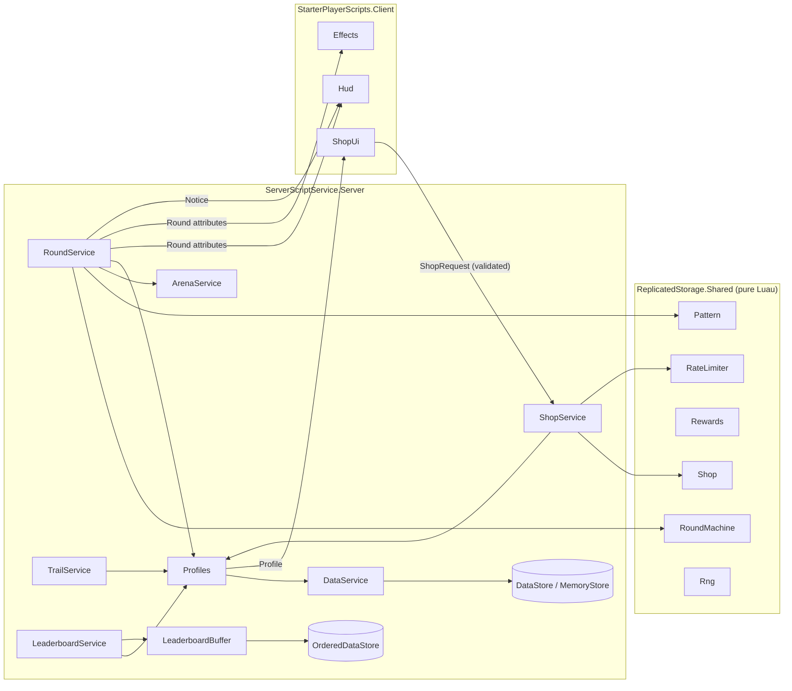

# Lantai Runtuh

A round-based Roblox party game written in strict Luau. *Lantai runtuh* is Indonesian for "collapsing floor".

Everyone starts on a 12×12 grid of colored tiles. Each wave the server names one color. When the countdown ends, every other tile drops away. Fall below the arena and you're out. The last player standing wins. Each wave gives you less time to react, adds more colors, and breaks the floor into smaller patches. Coins earned in a round buy cosmetic trails.

The whole place is generated from code: the lobby, the arena, the leaderboard and the UI. There are no meshes, images or sounds to upload; the two sound effects are files that ship with every Roblox client.


*How the floor gets harder over one round: waves 1 to 16 as the game's own `Pattern` and `RoundMachine` modules generate them for seed 2026, rendered top-down outside Roblox. This is not a capture of the game running in Studio.*

## Play it

Two ways to open it in Roblox Studio:

**Open the built place.** Run the build and open `build/LantaiRuntuh.rbxlx` in Studio, then press Play:

```bash
rojo build default.project.json -o build/LantaiRuntuh.rbxlx
```

**Live sync while editing.** Run the command below, then click Connect in the Rojo Studio plugin:

```bash
rojo serve
```

Solo play works because `MinPlayers` is 1 in [`Config.luau`](src/shared/Config.luau). Raise it before publishing a multiplayer server. To keep progress between sessions, publish the place and enable *Game Settings → Security → Enable Studio Access to API Services*. Without that, the game falls back to in-memory storage and prints a warning.

### Rules

| | |
|---|---|
| Waves | Warning time drops from 4 s to 1.25 s. Colors grow from 3 to 6. Patches shrink from 3×3 to single tiles. |
| Winning | Last player standing. If the final players fall in the same drop, they share the win. Solo players win by clearing all 30 waves. |
| Coins | 5 for playing, 2 per wave survived, 50 for a win. |
| Shop | Six trails from 50 to 1000 coins, bought and equipped from the Shop button. |
| Feedback | A tick for each of the last 3 seconds of a warning, a collapse sound on every drop, and a short camera shake for players on the arena. |
| Leaderboard | A board in the lobby lists the 10 players with the most wins across all servers. |
| Accessibility | Every tile shows its color's letter (R, B, Y, G, P, W), so you don't need to tell the colors apart. The camera shake is skipped when the player has Reduced Motion turned on. |

## Architecture



- **[`RoundMachine`](src/shared/RoundMachine.luau)** holds every game rule as a pure state machine: `Waiting → Intermission → Warning ⇄ Dropped → RoundOver`. It never touches Roblox. The server feeds it elapsed time and eliminations, and acts on the effects it returns (`StartRound`, `NewWave`, `Drop`, `Eliminated`, `EndRound`).
- **[`RoundService`](src/server/Services/RoundService.luau)** is the thin adapter between that machine and the world. It ticks every 100 ms, checks who fell below the kill height, and turns effects into tile changes, teleports, payouts and replicated round state.
- **[`DataService`](src/server/Data/DataService.luau)** stores player data with session locking. The store, clock and wait function are injected, so the same code runs against a real DataStore in game and an in-memory store in tests.
- **[`LeaderboardService`](src/server/Services/LeaderboardService.luau)** builds the lobby board and keeps it fed from an OrderedDataStore through [`LeaderboardBuffer`](src/server/Data/LeaderboardBuffer.luau).
- **The client only displays state.** It renders what the server replicates, plays [`Effects`](src/client/Effects.luau), and asks the server to buy or equip trails. Prices, coins and round results never come from the client.

```
src/
  shared/    Config, RoundMachine, Pattern, Rewards, Shop, RateLimiter, Rng
  server/    init.server.luau,
             Data/ (DataService, PlayerData, MemoryStore, LeaderboardBuffer, MemoryOrderedStore, RobloxStore),
             Services/ (RoundService, ArenaService, Profiles, ShopService, TrailService, LeaderboardService)
  client/    init.client.luau, Hud, Effects, ShopUi, Ui
tests/       run.luau, TestKit.luau, specs/, place.luau
```

## Engineering challenges & trade-offs

### Rules as a pure state machine

Round logic in Roblox games usually lives in one long `while true do task.wait()` loop mixed with Instance code. That's hard to reason about and impossible to test outside Studio. Here every rule sits in `RoundMachine`, which takes `tick(dt, readyPlayers)` and `eliminate(userId, fell)` and returns a list of effects.

This made the edge cases testable:
- Two finalists falling in the same drop.
- A player leaving mid-warning.
- A solo round that should only count a full clear as a win.

A fuzz test plays 2,000 random rounds with random falls and leaves. It checks that every round ends, that places are unique, and that winners were participants. The cost is one more layer: the service has to translate effects instead of doing the work inline.

### Fair simultaneous eliminations

Eliminations are checked on a 100 ms tick, so two players falling in the same drop are reported one after the other. If the round ended as soon as one player remained, the winner would depend on iteration order. During a drop, `RoundMachine` records who fell and judges the wave only when the drop ends. If everyone falls together, the players from that drop share the win. Players who left the game are never counted as winners.

### Session locking against item duplication

The classic Roblox data bug goes like this: a player joins server B while server A is still saving, A's late save lands on top of B's progress, and items get duplicated or lost. `DataService` stores `{ data, lock = { jobId, at } }` and uses only `UpdateAsync`:

- **Load:** only succeeds if the lock is free, already this server's, or older than `LockTimeoutSeconds`. The last case covers a server that crashed. Otherwise it waits and retries, then kicks with a clear message.
- **Save:** only writes while this server still holds the lock. A server that lost its lock marks the profile `lost` and never writes again, so newer progress can't be overwritten.
- **Autosave:** refreshes the lock timestamp, so a live server's lock never looks stale.
- **Leaving and shutdown:** both release the player. A `releasing` flag lets only the first call do it, so you don't get a false "session lost".

I didn't use ProfileService or ProfileStore on purpose. The point of the project is to show the mechanism, and the module is around 250 lines with a test for each case. In production I'd weigh that against a battle-tested library and add MessagingService-based force release.

### Retries and the Studio fallback

DataStore calls fail transiently, so each call retries with exponential backoff (1, 2, 4, 8 s). An unpublished Studio place fails every call, which would make every playtest wait out those retries. `RobloxStore` probes once in Studio and switches to `MemoryStore`, which has the same `UpdateAsync` contract.

### Server-authoritative shop

`ShopRequest` treats every argument as hostile:
- It checks argument types and string length.
- It rate-limits each player with a token bucket (2/s, burst 4).
- It takes prices from the server's catalog.
- It checks ownership before equipping.

The client's shop is a view of the last profile the server pushed.

### Round state as attributes, not remotes

The first version fired a `RoundState` remote to every player on each phase change. That was one message per player per change, and a player joining mid-phase saw nothing until the next one. Round state now lives as attributes on `ReplicatedStorage.Round`, with a per-player `InRound` attribute:

- The engine replicates each change once to everyone, and setting an attribute to its current value sends nothing.
- A player who joins mid-round receives the current values on join, with no special-case code.
- The alive count now updates on every elimination, not only on phase changes.

Several attributes change together, so the client marks itself dirty on any change and re-renders once per frame. It never shows a state where `Phase` is new but `Target` is still old.

The trade-off: attributes only hold simple values. Anything structured, such as the shop profile, still goes through a remote.

### A global leaderboard on a request budget

OrderedDataStore writes have a per-minute budget. Writing on every win would spend it on whoever wins several rounds in a row. [`LeaderboardBuffer`](src/server/Data/LeaderboardBuffer.luau) keeps only each player's latest win count and flushes once a minute together with the top-10 read:

- A flush costs at most one write per player whose wins actually changed. Coin updates and rejoins cost nothing, because the buffer remembers what is already stored.
- A failed write stays queued.
- A newer count recorded while a write was in flight is never overwritten by the retry.
- The server flushes once more on shutdown.

The board can therefore lag up to a minute behind, which is fine for an all-time list. In unpublished Studio it falls back to an in-memory ordered store and refreshes every 10 s.

### Sound without uploads

Uploaded audio would mean asset ids this repository can't verify or ship. I checked the Roblox client's current content manifest, and the two sounds used are among the files every client already has: `rbxasset://sounds/volume_slider.ogg` and `impact_explosion_03.mp3`. Both ids live in `Config.Effects`, so a published version can swap in uploaded sounds without code changes.

### Layout generation

Random 3×3 patches sometimes leave almost no safe ground, or almost none to avoid. `Pattern.generate` clamps the safe share to 12–50% by recoloring random tiles. A test checks that band over 3,000 seeds. The generator takes a plain `randInt` function, and the seeded `Rng` makes layouts reproducible from a seed in tests.

### What's left

- Run a multiplayer test session on the published experience to tune timings with real latency. Today the warning floor is 1.25 s. Publishing is automated (see [Publishing](#publishing)); the play session itself needs real players.

## Development

The toolchain is pinned in [`rokit.toml`](rokit.toml): Rojo, Selene, StyLua, Lune and luau-lsp. Install it, then run every check with:

```bash
rokit install
```

```bash
./scripts/check.sh
```

[CI](.github/workflows/ci.yml) runs the same script on every push, after [`scripts/install-tools.sh`](scripts/install-tools.sh) installs the versions pinned in `rokit.toml`.

`check.sh` runs these steps:

1. `stylua --check`: formatting.
2. `selene`: lint with the Roblox standard library.
3. `luau-lsp analyze`: strict type checking of every script against the Roblox API definitions, using a Rojo sourcemap.
4. `lune run tests/run.luau`: 64 tests covering RNG, layout generation, the round state machine (including the fuzz test), rewards, the shop, the rate limiter, player data repair, session locking, and leaderboard batching.
5. `tests/publish/run.sh`: runs `scripts/publish.sh` against a mock Open Cloud server. It checks the request it sends, the operation polling, a rejected key that must not appear in the output, and a failed operation.
6. `rojo build`, then `lune run tests/place.luau`: opens the built place file and checks that all 25 scripts, the remotes, the `Round` state object and the folder layout are in place, and that every script is `--!strict`.

The GIF at the top is generated from the same modules the game runs, so it can't drift from the real layouts:

```bash
lune run scripts/export-layouts.luau 2026 | python3 scripts/render-layouts.py docs/media/layouts.gif
```

To check that the tests catch real bugs, I broke the elimination order and the session-lock ownership check one at a time. The suite failed both times.

The tests cover the pure modules. Code that drives Instances (arena building, teleports, UI, effects, the leaderboard board) is type-checked but has to be playtested in Studio.

## Publishing

Publishing doesn't need Studio. [`scripts/publish.sh`](scripts/publish.sh) builds the place with Rojo and uploads it through the Roblox Open Cloud Assets API (`PATCH /assets/v1/assets/{placeId}`), then polls the returned operation until Roblox reports the new revision.

[`.github/workflows/publish.yml`](.github/workflows/publish.yml) runs it after every push to `main` that changes the game, once all checks pass. It can also be started by hand from the Actions tab. Until it is configured it skips with a notice instead of failing.

One-time setup, all on your own Roblox and GitHub accounts:

1. **Create the experience.** On [create.roblox.com](https://create.roblox.com/dashboard/creations), create an experience. Its start place's id is the number in the place URL.
2. **Create an API key.** Under *Open Cloud → API Keys*, create a key with **Assets: Read and Write** for that experience. Restrict it to GitHub's IP ranges or leave it open, and set an expiry.
3. **Store them in GitHub.** Under *Settings → Environments*, create an environment named `roblox`. Add the key as the secret `ROBLOX_API_KEY` and the place id as the variable `ROBLOX_PLACE_ID`. Adding a required reviewer to that environment turns every publish into a one-click approval.
4. **Finish the experience settings.** In the Creator Hub, fill in the experience questionnaire and set the visibility to public when you're ready.

To publish from your own machine instead:

```bash
ROBLOX_API_KEY=... ROBLOX_PLACE_ID=... ./scripts/publish.sh
```

The key is sent through a header file descriptor, so it never appears in the process list or in the script's output. `ROBLOX_PUBLISH=false` saves a new version without publishing it.

## License

[MIT](LICENSE)
